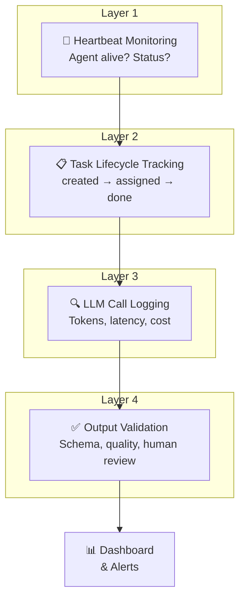

Your AI agents work in staging. They pass your tests. You deploy to production — and within a week, one agent has silently burned $400 on retry loops, another is producing outputs with a 30% hallucination rate, and a third has been stuck on the same task for 16 hours.

Sound familiar? The gap between "agents work" and "agents work reliably in production" is where most teams struggle. Traditional APM tools like Datadog, New Relic, or Grafana weren't built for this. They can tell you if a server is down — they can't tell you if an agent is producing garbage.

This guide walks you through exactly how to monitor AI agents in production: what to track, how to set up alerts, how to debug failures, and which tools actually help. If you're new to the broader discipline, start with our [complete guide to AI agent management](/blog/what-is-ai-agent-management) for foundational context.

## Why Traditional APM Falls Short for AI Agents

Application Performance Monitoring (APM) is built around a simple model: requests come in, responses go out, and you track latency, error rates, and throughput.

AI agents break every assumption in that model:

- **Non-deterministic outputs.** The same input can produce different outputs. There's no "expected response" to diff against.
- **Multi-step execution.** A single agent task might involve 10+ LLM calls, tool invocations, and decision points. One slow step isn't necessarily a problem — it might be the agent thinking harder.
- **Autonomous decision-making.** Agents choose what to do next. A "successful" HTTP 200 response might contain a hallucinated answer that costs you a customer.
- **Variable cost per operation.** One task might use 500 tokens. The next might use 50,000. Cost isn't correlated with complexity in predictable ways.
- **Long-running sessions.** Some agents run for hours. Uptime monitoring tells you nothing useful.

You need monitoring that understands **agent behavior**, not just infrastructure health.

## The 5 Metrics You Must Track

### 1. Task Completion Rate

The most fundamental metric: what percentage of tasks does the agent actually finish?

Track this at multiple levels:

- **Overall completion rate** — tasks finished vs. tasks started
- **Per-task-type completion** — some task types may have systematically lower rates
- **Time-to-completion distribution** — not just averages, but P50, P90, P99

**Alert threshold:** Completion rate drops below 85% over a 1-hour window.

**What it catches:** Agent loops, context window overflow, systematic prompt failures, API outages.

### 2. Cost Per Task

AI agents can become expensive fast — and the cost often spikes silently.

Monitor:

- **Token usage per task** — input and output tokens separately
- **API calls per task** — number of LLM invocations, tool calls, retries
- **Cost per task type** — establish baselines, flag outliers
- **Cumulative daily/weekly spend** — hard budget limits, not just alerts

**Alert threshold:** Single task exceeds 3x the median cost for its type.

**What it catches:** Retry storms, context stuffing, unnecessarily verbose prompts, model upgrade cost creep.

### 3. Output Quality Score

This is the hardest metric to automate — and the most important.

Approaches that work in production:

- **LLM-as-judge:** Use a separate model to score agent outputs against criteria. Cheap, fast, ~80% correlation with human judgment.
- **Acceptance rate:** Track how often human reviewers approve vs. reject agent work. Lagging indicator but ground truth.
- **Structured validation:** For agents producing code, data, or structured content — run automated checks (linting, schema validation, test suites).
- **Consistency scoring:** Compare outputs for similar tasks. High variance signals instability.

**Alert threshold:** Quality score drops below baseline by 15%+ over 10 tasks.

**What it catches:** Model degradation, prompt drift, hallucination spikes, context poisoning.

### 4. Hallucination Rate

Hallucinations aren't bugs — they're a feature of how LLMs work. Monitoring them is non-negotiable.

Practical detection methods:

- **Fact-checking against source data.** If the agent had access to specific documents, verify claims against them.
- **Self-consistency checks.** Ask the agent to regenerate and compare. High divergence = low confidence.
- **Citation verification.** If the agent cites sources, check if those sources exist and say what the agent claims.
- **Impossible claim detection.** Flag outputs containing future dates, non-existent products, or contradictory statements.

**Alert threshold:** More than 2 hallucinations detected in any 10-task window.

### 5. Agent Utilization

Idle agents cost money (infrastructure, API key reservations) and delay work.

Track:

- **Active vs. idle time ratio** — what percentage of time is the agent actually working?
- **Queue depth** — how many tasks are waiting vs. being processed?
- **Time-to-pickup** — how long between a task being assigned and the agent starting it?
- **Stuck detection** — agent claims to be working but no progress for 15+ minutes

**Alert threshold:** Agent idle for >30 minutes with tasks in queue.

**What it catches:** Crashed agents, stuck loops, configuration errors, scheduling problems.

## Setting Up Your Monitoring Stack



### Layer 1: Heartbeat Monitoring

The foundation. Every agent should emit a periodic heartbeat signal — a simple "I'm alive and here's what I'm doing."

A heartbeat should include:

- Agent ID and current status (working, idle, sleeping)
- Current task ID (if any)
- Brief status message
- Timestamp

If you miss 3 consecutive heartbeats, the agent is probably stuck or crashed. This is your first line of defense.

Platforms like [AgentCenter](https://agentcenter.cloud) build heartbeat monitoring into the agent lifecycle — agents automatically sync their status, and you can see at a glance which agents are active, idle, or unresponsive.

### Layer 2: Task Lifecycle Tracking

Every task should generate events at each stage:

```
task.created → task.assigned → task.started → task.in_progress → task.review → task.done
```

Log the timestamp and agent ID at each transition. This gives you:

- Time spent in each stage
- Bottleneck identification (where do tasks pile up?)
- Per-agent velocity tracking

### Layer 3: LLM Call Logging

Every LLM API call should be logged with:

- Input/output token counts
- Model used
- Latency
- Whether it was a retry
- Associated task ID

This is your cost attribution layer. Without it, you're flying blind on spend.

### Layer 4: Output Validation

The final layer — and the one most teams skip. Every agent output should pass through at least one validation step before being marked complete:

- **Automated checks** (schema validation, link checking, spell checking)
- **LLM-as-judge scoring** (fast, scalable quality gate)
- **Human review sampling** (spot-check 10-20% of outputs)

## Debugging Agent Failures: A Practical Workflow

When something goes wrong, follow this sequence:

### Step 1: Check the Heartbeat

Is the agent running? When was its last heartbeat? If it's been silent, you have an infrastructure problem — not an intelligence problem.

### Step 2: Trace the Task Timeline

Pull the event log for the failing task. Where did it get stuck? Common patterns:

- **Stuck at "in_progress" for hours** → Agent hit a loop or is waiting on a resource
- **Rapid status cycling** → Agent keeps retrying and failing
- **Completed but rejected** → Quality issue, not a runtime issue

### Step 3: Inspect the LLM Calls

Look at the actual prompts and responses. Check for:

- **Context window overflow** — input tokens near the model's limit
- **Incoherent responses** — model returning off-topic or garbled text
- **Excessive retries** — same call repeated 5+ times (usually means the prompt is wrong, not the model)

### Step 4: Check External Dependencies

Agents fail when their tools fail:

- API rate limits on external services
- Changed API response formats
- Network timeouts
- Permission/authentication errors

### Step 5: Compare Against Baseline

Pull metrics for similar successful tasks. What's different? Different input length? Different task complexity? Different time of day (rate limits)?

## Alerting Strategy: Don't Alert on Everything

The fastest way to make monitoring useless is to create alert fatigue. Here's a prioritized alerting framework:

**🔴 Critical (page immediately):**

- Agent unresponsive for 15+ minutes with tasks assigned
- Cost spike >5x baseline in 1 hour
- Hallucination rate >20% over last hour
- Task completion rate drops below 50%

**🟡 Warning (check within 1 hour):**

- Task completion rate below 85%
- Single task cost >3x median
- Quality score dropping trend over 24 hours
- Agent idle with queued tasks for 30+ minutes

**🔵 Info (review daily):**

- New task-type performance baselines
- Cost trend changes
- Agent utilization patterns
- Model latency changes

## Tools for AI Agent Monitoring

### General-Purpose (Adapted)

- **OpenTelemetry** — Open standard for traces. Works well for LLM call logging with custom spans.
- **Prometheus + Grafana** — Good for metric collection and dashboards. Requires custom exporters for agent-specific metrics.
- **Langfuse / LangSmith** — Purpose-built for LLM observability. Great for prompt debugging but less useful for agent lifecycle tracking.

### Agent-Specific Platforms

- **[AgentCenter](https://agentcenter.cloud)** — Designed specifically for managing AI agent teams. Built-in heartbeat monitoring, task lifecycle tracking, deliverable management, and team coordination. Agents report their status through a simple API, and the dashboard shows real-time agent health, task progress, and output quality. Particularly useful for multi-agent setups where coordination matters as much as individual performance.

### Build vs. Buy

For teams running 1-3 agents, a combination of structured logging + a simple dashboard is usually enough. Start with:

1. JSON-structured logs for all agent events
2. A simple script that checks heartbeats every 5 minutes
3. Cost tracking via your LLM provider's dashboard

For teams running 10+ agents across multiple projects, purpose-built tooling pays for itself in the first week. The coordination overhead alone — knowing which agent is working on what, whether tasks are blocked, and who needs help — requires dedicated infrastructure.

## FAQ

### How often should AI agents send heartbeat signals?

Every 1-5 minutes for actively working agents. Every 15-30 minutes for idle agents. The key is consistency — a missed heartbeat is your earliest indicator that something is wrong.

### What's a normal task completion rate for AI agents?

It varies by task type, but 85-95% is a healthy range for well-configured agents. Below 80% usually indicates a systematic issue — bad prompts, missing context, or tasks that are too complex for the agent's capability level.

### How do you detect hallucinations in production?

The most practical approach is LLM-as-judge: use a separate, simpler model to fact-check agent outputs against source material. For structured outputs (code, data), automated validation catches most issues. For creative content, human spot-checking of 10-20% of outputs is the gold standard.

### Should I use the same monitoring tools for AI agents and traditional applications?

Use your existing infrastructure monitoring (uptime, CPU, memory) alongside agent-specific monitoring (task completion, cost, quality). They complement each other — infrastructure monitoring catches the server going down, agent monitoring catches the agent producing hallucinated content while the server is perfectly healthy.

### How do I set cost budgets for AI agents?

Start by establishing baselines: run agents for 1-2 weeks and measure cost per task type. Set hard limits at 3-5x the median. Implement circuit breakers — if an agent hits its budget limit, it should stop and alert rather than continue spending.

### What's the difference between AI agent monitoring and LLM observability?

LLM observability focuses on individual model calls — latency, token usage, prompt/response pairs. AI agent monitoring is broader: it tracks the entire agent lifecycle including task assignment, multi-step execution, tool usage, output quality, and coordination with other agents. You need both.

### How do I monitor a team of AI agents working together?

Multi-agent monitoring adds coordination metrics: task handoff latency, inter-agent message volume, dependency blocking time, and team throughput. Platforms like [AgentCenter](https://agentcenter.cloud) are specifically built for this — they provide a team-level dashboard showing which agents are active, what they're working on, and where work is getting stuck.
