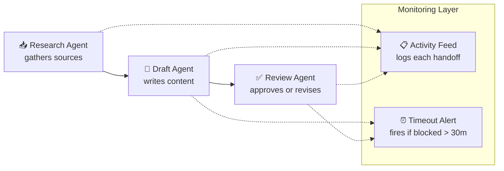

When your pipeline has three agents and something goes wrong, the symptom shows up at the end. The final output is missing or wrong. By the time you notice, you have no idea whether the failure happened in step one, step two, or somewhere in the handoff between them.

That's the core problem with multi-agent pipelines. They fail silently in the middle.

## What End-to-End Pipeline Monitoring Actually Means

Watching individual agents is not the same as watching your pipeline.

An agent can report "completed" while the overall pipeline is still broken because the output never reached the next step. The agent did its job. The handoff didn't. Without visibility across the chain, you'll spend an hour looking at the wrong thing.

End-to-end monitoring means you can see every task in the pipeline, what state it's in, and what happened at each handoff. Not just "three agents are online."

## How to Set It Up in AgentCenter

Here's the approach that works.

### 1. Model each pipeline step as a separate task

Don't create one task called "run the content pipeline." Create one task per step: research, draft, review. Each one goes to a specific agent.

This gives you per-step status. When something breaks, you know exactly where the pipeline stopped because each step has its own task card in [AgentCenter's Kanban board](/features/task-orchestration). The pipeline state becomes visible as a row of task cards, not a single blob.

### 2. Set task dependencies between steps

AgentCenter lets you mark a task as blocked until another task completes. Use this for every handoff.

If "draft" is blocked by "research," AgentCenter won't let your writing agent start until the research task finishes. This prevents one of the most common pipeline bugs: a downstream agent starting before the upstream agent is actually done.

Set the dependency when you create the tasks, not after the first failure.

### 3. Use a consistent naming prefix for each pipeline run

When you run the same pipeline multiple times in a day, you need a way to tell run #1 from run #2.

Use a prefix like `[pipeline-name]/[run-id]/step`. For example: `content-gen/run-003/research`, `content-gen/run-003/draft`, `content-gen/run-003/review`.

This makes it easy to filter the Kanban board and see the full state of one run without scrolling through unrelated tasks. Skip the naming convention and you'll end up staring at 30 tasks with no idea which belong together.

### 4. Set a timeout alert for blocked tasks

In [AgentCenter's monitoring settings](/features/agent-monitoring), you can set alerts that fire when a task stays in "blocked" status longer than expected.

If your typical pipeline takes 20 minutes, set a 30-minute alert. When you get it, you know a handoff failed or an agent stalled mid-work. You catch the problem before it cascades further downstream.

### 5. Use the activity feed to trace failures

When something breaks, the activity feed is where you start. Every task state change is logged: when a task was created, picked up, completed, blocked, or failed.

Find the task that stopped moving. The activity feed shows the last thing that happened on it. That narrows the failure to one step and one transition instead of one of three agents.

## A Real Example

We ran a 3-agent content pipeline: research, draft, review. It worked fine in staging. In production, the review step kept failing, but the draft agent was showing "completed."

The activity feed showed the draft task completed at 14:03. The review task was created at 14:03 but never picked up. The review agent was online and idle.

The issue: the review agent was scoped to a different project than the pipeline tasks. It could see the task in the queue but couldn't claim it. Five-minute fix. Three hours of confusion before we looked in the right place.

Task-level visibility got us there. Agent-level monitoring alone would have shown everything green.

## Common Mistakes

**Looking only at the final output.** By the time the pipeline produces nothing, you've lost context on where it stopped. Check step status while the pipeline is running, not just at the end.

**No dependencies between tasks.** Without dependencies, a downstream agent can start on incomplete input. The task "succeeds" with bad data. You won't catch this until the output looks wrong and you can't figure out why.

**No naming convention for runs.** If all pipeline tasks look the same, you can't filter to one pipeline run when something fails. Name your tasks to make run grouping obvious from the start.

**Treating handoff failures as agent failures.** The agent completed its task. The problem was the transition to the next step. These have different root causes. Look at the task transition, not just the agent status.

**Checking agent dashboards instead of task state.** An agent being "online" or "idle" tells you nothing about whether the pipeline progressed. Task state is what matters.

## Bottom Line

You don't need more dashboards. You need each pipeline step to be a distinct, named task with explicit dependencies and alerts on blocked states. When something breaks, the task timeline tells you exactly where. You're debugging a specific handoff instead of staring at three agents that all show green.

---

*The best time to set this up is before your agents start failing. [Try AgentCenter free for 7 days](/pricing) — cancel anytime.*
