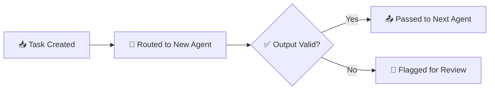

The first agent is easy. You build it, you ship it, it runs. You watch it closely because there's nothing else running.

Then you add a second one. Or a third. Or you inherit a workflow that already has 8 agents, and you need to drop a new one in without breaking anything.

That's where onboarding matters. A new agent doesn't just need to be built — it needs to be introduced to the system it's joining.

## What "Onboarding" Means for an AI Agent

Onboarding a new agent is the process of integrating it into a running workflow so it can do real work without causing unexpected failures.

That means:
- The agent has clear task scope (what it owns, what it doesn't)
- The team knows it exists and what it's doing
- There's a way to watch it during its first runs
- It connects cleanly to any agents that hand off work to it or receive work from it

None of this is complicated. Most teams skip it because they're moving fast. Then one of the 8 agents fails silently, and nobody knows which one.

## Step 1: Define the Agent's Scope Before It Runs Anything

Before you add a new agent to your project in AgentCenter, write down what it owns.

Specifically:
- What type of tasks it handles
- What its output format looks like
- Which agent (or human) hands work to it
- Where its output goes next

One paragraph is enough. You're not writing a spec — you're creating the baseline you'll use to judge whether the agent is working correctly.

If you can't describe what the agent owns in a few sentences, it's not ready to join a live workflow.

## Step 2: Add It to the Right Project with Limited Task Access

In AgentCenter, agents live inside projects. When you add a new agent, put it in the project it belongs to — not a test project, the real one.

But start with a limited task scope. Assign it one task type to begin with. You're not testing whether the agent can handle everything; you're confirming it behaves in your environment.

Routing one task type first means failures are contained. You're not touching the rest of the workflow until the new agent proves itself.

## Step 3: Set Up Monitoring Before the First Live Run

This is the step most teams skip. Don't skip it.

Before you let the new agent run on real tasks, open [agent monitoring](/features/agent-monitoring) in AgentCenter and verify you can see:

- Status updates (online, working, idle)
- Output from at least one test task
- Any errors from the test run

If you can't see it in the dashboard, you're flying blind. Add it before going live.

While you're there, note the cost on the first few test runs. Every agent has a per-task spend. Record what the first runs cost so you have a reference point. If the number doubles next week, you'll know immediately.

## Step 4: Run Dry Tasks Before Assigning Real Work

A dry run means assigning a real task from your queue to the new agent and reviewing the output manually before it goes anywhere downstream.

Do this 3 to 5 times.

You're checking:
- Is the output format correct?
- Are there edge cases the agent handles poorly?
- Does it complete tasks in a reasonable time?
- What happens when input is malformed or missing?

In AgentCenter, open the [task board](/features/task-orchestration) and assign the new agent directly. Review each output in the deliverable view before marking the task complete. Don't automate this step yet.

## Step 5: Introduce the Agent to the Team

If you're on a team, the people who review and act on agent output need to know the new agent exists.

In AgentCenter, use @mentions in the task thread to flag the first few completed tasks for a reviewer. A message like "@teamlead — new research agent completed its first 3 tasks, outputs look clean" takes 10 seconds and prevents the confusion that comes from output appearing without context.

This matters especially when multiple agents produce similar output. Reviewers need to know which agent created which task so they can give useful feedback.

## Step 6: Expand Scope After the First Stable Week

Once the agent has run 20 to 30 tasks without issues, it's earned more responsibility.

Expand its task scope to cover the full range of work it's designed for. At this point you should have:
- A baseline cost per task
- A sense of its typical completion time
- At least one edge case documented
- Reviewer feedback on output quality

If you don't have those things after a week, go back to Step 3. The agent might be working, but you don't have enough signal to trust it with a wider scope.

## Common Mistakes

**Skipping the dry run phase.** Teams add an agent, assign a task type, and trust it immediately. The first failure then hits downstream agents or customers. Three to five dry tasks is a small cost.

**Not setting a cost baseline.** Without a baseline, cost spikes are invisible. You find out weeks later that one agent ran 40x the expected token count on some task type. Set the baseline on day one.

**Adding the agent to the wrong project.** This sounds obvious but it happens. A research agent ends up in a project with 11 other agents doing something different. Task routing breaks. Put the agent in the right project from the start.

**Expanding scope too fast.** One task type first. Full scope after it's stable. The urge to get value immediately is real, but a week of limited scope saves hours of debugging later.

## Bottom Line

Onboarding a new agent isn't complicated. It's: define scope, add to the right project, monitor from day one, run dry tasks, tell your team, then expand. Each step takes minutes. The failure modes you avoid take hours to diagnose.

---

*The best time to set this up is before your agents start failing. [Try AgentCenter free for 7 days](/pricing) — cancel anytime.*
