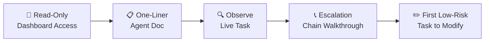

Onboarding a new engineer to your AI agent workflows is harder than it looks. They arrive, get repo access, and spend the first week asking questions that no one has written down: Which agent handles what? Why does this one retry three times? Who owns the invoice parser?

This isn't a people problem. It's a documentation problem — and a workflow access problem. Here's how to fix it before the next person joins.

## Why Agent Workflows Are Hard to Inherit

A codebase has structure. Files have names. Functions have signatures. A new engineer can navigate it on their own in a few days.

Agent workflows don't have that structure by default. They're distributed across prompts, model configs, task queues, and runtime behavior that varies with input. You can read the entire agent codebase and still not understand what it does in production until you've watched it handle 50 real tasks.

That's the gap. And it's the reason engineer onboarding for agent workflows takes longer, costs more senior engineer time, and fails more often than it should.

## What "Onboarded" Actually Means

A new engineer who's been onboarded well should be able to do three things within their first week:

1. Name every agent running in production and describe what it does in one sentence
2. Open the [agent dashboard](/features/agent-dashboard) and interpret what they're looking at
3. Know exactly who to ask — or where to look — when something goes wrong

That's the bar. Not "can deploy a new agent." Just: can they understand the system well enough to contribute safely?

## Step 1: Write One Sentence Per Agent

Before you can onboard anyone, you need this documentation yourself. For each agent in production, write one sentence: what it does, and what breaks if it fails.

Examples:
- **Invoice parser**: Extracts vendor, amount, and due date from incoming PDFs. If it fails, invoices queue in backlog — no payment impact for 24 hours.
- **Support triage agent**: Categorizes inbound tickets and assigns priority. If it fails, tickets land in the unassigned queue and get picked up manually.
- **Weekly summary agent**: Pulls task activity and produces a team digest every Friday morning. Non-critical — late is fine.

This takes 30 minutes if you have 8 agents. It takes 2 hours if you have 30. Either way, it's the most useful thing you can do before anyone new starts.

Keep this list where your agents live — not in a separate wiki that no one updates.

## Step 2: Give Dashboard Access Before Code Access

Most teams do this backwards. New engineers get repo access, deploy keys, and a staging environment — then try to understand production from there.

Flip the order. First week: read-only access to the [agent monitoring dashboard](/features/agent-monitoring). No code. No prompts. Just watch.

Let them see which agents are running, which are idle, which are stuck. Let them click into a completed task and read the output. Let them look at the activity feed and understand what "14 tasks completed, 2 failed, 1 stuck in working state" means in practice.

This builds a mental model faster than code review. The code tells you how agents work. The dashboard tells you what they're actually doing.

## Step 3: Walk Through One Task End-to-End

Pick a real task that recently completed — not a toy example. Walk the new engineer through it: what triggered it, which agent handled it, what the input looked like, what the output was, and how you'd know if something went wrong.

This end-to-end walkthrough takes 20 minutes. It's worth more than any written doc because it shows the full lifecycle in context, with real data.

Focus on:
- What triggered the task
- Which agent picked it up and why
- Where to see the input and output in AgentCenter
- What a failure looks like vs. a successful completion

## Step 4: Write Down the Escalation Chain

Every agent in production should have a clear owner and a clear escalation path. Write it in the same one-liner doc from Step 1:

- **Owner**: the person who understands the prompt and knows the deployment history
- **On-call contact**: who to reach if the agent is stuck at 2am
- **Definition of stuck**: task in "working" state for more than X minutes, or error count above Y

New engineers shouldn't have to figure out who to wake up during an incident. If that information isn't written down, it will cost you at the worst possible moment.

## Step 5: Let Them Observe Before They Touch Anything

Have the new engineer spend a full day watching the [task board](/features/task-orchestration) without making any changes. Let them read outputs. Let them check error logs. Let them notice patterns and ask questions.

Then give them one low-risk task to modify. Not a critical agent. Something with clear expected output, easy to verify, and no downstream dependencies.

Speed here is not the goal. Confidence is. An engineer who understands what they're changing is less likely to break something than one who's rushing to prove they can contribute.

## Common Mistakes

**Skipping the one-liner doc.** Without it, new engineers build their own mental model from whatever they happen to look at first. That model will be incomplete — and sometimes wrong in ways that cause real incidents.

**Only showing the happy path.** Walk through a failure too. Show them what an error looks like in the dashboard, how to read the logs, and how to decide whether it's urgent. The first time they see a failing agent shouldn't be during a real incident.

**Treating all agents as equally critical.** Some agents are experimental and low-stakes. Some handle customer-facing tasks that break if they go down. New engineers need to know which is which before they start making changes.

**Waiting for the new engineer to ask.** Onboarding materials shouldn't require a request. Have them ready before the person's first day.

## Bottom Line

Most engineer onboarding failures in agent workflows are documentation failures. Not "write a 30-page wiki" documentation — a single list with agent names, one-sentence descriptions, owners, and escalation paths.

New engineers who can read the [agent dashboard](/features/agent-monitoring), understand what each agent does, and know who to call when something breaks are faster to useful and less likely to cause incidents. That's worth a few hours of setup upfront.

---

*The best time to set this up is before your agents start failing. [Try AgentCenter free for 7 days](/pricing) — cancel anytime.*
