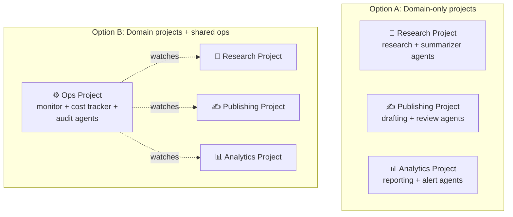

You had two projects. Four agents. Everything made sense. You knew which agent did what, who owned it, and where to find its tasks.

Then you added a third project. A fourth. Organizing AI agents across multiple projects stops being obvious the moment you cross three projects and eight agents. Suddenly you have a dozen agents spread across different workflows, and the clean mental model you had at the start is gone. An agent touches data from Project A but reports results in Project B. A monitoring agent runs across everything but lives in a single arbitrary project. Someone asks "which agent owns this task?" and nobody answers quickly.

This is not a scale problem. It is a structure problem. And it is worth fixing before you add another agent.

## What multi-project agent organization actually means

AgentCenter organizes work at three levels: projects, tasks, and agents. Projects are the top layer. Each project has its own Kanban board, its own agent assignments, and its own activity feed.

The problem is that agents do not always map cleanly to projects. Some agents are specialists: one per project, narrow scope, no confusion. Others are shared infrastructure, running the same type of work across every project you have.

Getting this right matters for two reasons. First, visibility. If your billing automation agent lives in the wrong project, the finance team will not see its tasks on their board. Second, debugging speed. When something breaks, you need to find the relevant tasks fast. An agent buried in the wrong project costs you time you do not have.

## Two models that work for most teams

**Model 1: One project per domain, no sharing.** Each business domain gets its own project. Research agents live in Research. Publishing agents live in Publishing. No agent spans projects. Cross-project dependencies get handled through task handoffs, not by moving agents around.

This works when your projects are genuinely independent. You get clear ownership, focused boards, and easy filtering. The downside: if you have shared infrastructure agents like cost tracking or monitoring, you end up either duplicating them across every project or making awkward placement decisions.

**Model 2: Domain projects plus a shared ops project.** Domain projects hold the agents doing the actual work. A separate Ops or Infrastructure project holds everything that cuts across domains: monitors, cost trackers, audit agents, alerting agents.

This fits better for most teams past 10 agents. Domain teams keep their own boards and stay focused on their work. Your ops team has one place to manage cross-cutting agents. Nothing gets duplicated.

Pick one model and apply it consistently. Mixed structures are worse than either option.

## Setting it up in AgentCenter

**Step 1: Audit what you have.** Open the [agent dashboard](/features/agent-dashboard) and list every agent, its function, and the project it currently lives in. Be honest about which agents are domain-specific and which are shared infrastructure.

**Step 2: Define your project structure.** Create one project per business domain. If you do not have one already, create a shared Ops project for cross-cutting agents. In AgentCenter, you set this up under Projects in the sidebar.

**Step 3: Move agents to the right project.** Reassign each agent to its correct home. Check that each agent's tasks are visible on the right Kanban board after the move.

**Step 4: Enforce naming conventions.** Prefix agent names with their domain so they are easy to identify in cross-project views. For example: `[RESEARCH] Summarizer`, `[OPS] Cost Tracker`, `[PUBLISHING] Draft Writer`. This looks pedantic until you are looking at a list of 30 agents and need to find the right one in 10 seconds.

**Step 5: Document cross-project dependencies.** When an agent in one project produces output consumed by an agent in another, write that down. Use the [task orchestration features](/features/task-orchestration) to set up explicit handoff tasks between projects. Do not rely on anyone remembering the dependency.

**Step 6: Assign clear ownership.** Every agent needs a named owner. If an agent moves to a new project, confirm the right team member still owns it. Wire the [agent monitoring dashboard](/features/agent-monitoring) so that owner gets alerts for that agent, not someone else.

## Common mistakes

**Putting everything in one project.** It feels simpler at first. One board, one place. Then you have 20 agents on a single Kanban and it is impossible to see what matters in any given context.

**Splitting shared agents by project.** Running a cost-tracking agent in every domain project means duplication. You will have four agents doing the same job with no central view of results. One shared agent in Ops is always better.

**Naming agents like they are temporary.** If your agents are named "Agent 1", "New Agent", or "Test v3 Final", you will regret it the first time you debug an incident across three projects at once. Rename them before you forget what they do.

**Never revisiting structure.** A two-project setup that made sense at 6 agents probably does not fit at 25. Plan a quarterly pass over your project structure. It takes 30 minutes and saves hours when something breaks.

## Bottom line

The right structure depends on your team. But the wrong structure is whatever makes you hunt for an agent at the worst possible moment. Two models cover most cases: one project per domain, or domain projects with a shared Ops project. Pick one, apply it consistently, and enforce naming conventions from day one.

Get the structure right before you need it. [Try AgentCenter free for 7 days](/pricing) — no lock-in.
