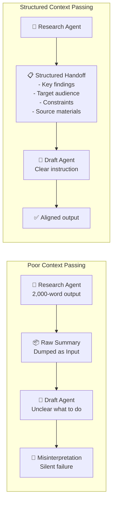

The failure mode I see most often in multi-agent pipelines isn't individual agents breaking. It's handoffs going wrong. Agent A finishes, passes something to Agent B, and Agent B interprets it differently than Agent A intended. Both agents run correctly. The pipeline output is still wrong.

Context passing between agents is one of the less-discussed parts of multi-agent design, and it's where most pipelines develop subtle failures.

## Why Handoffs Are Hard

Two agents don't share memory. Each agent starts fresh with whatever it was given. If what it was given is incomplete, ambiguous, or formatted in a way it doesn't expect, it fills in the gaps on its own — usually in ways the original task didn't intend.

Consider: Agent A researches a topic and produces a 2,000-word summary. Agent B is supposed to draft an article based on that summary. But Agent B's prompt says "draft a 500-word article." Agent B doesn't know whether to summarize the summary (losing information) or to assume the 500-word limit overrides the research depth. It makes a choice. Maybe the wrong one.

This isn't an Agent B failure. It's a context design failure.

## Step 1: Design a Structured Handoff Format

Raw agent output is almost never the right input for the next agent. Design a handoff structure that captures what the next agent needs to know, not just what the previous agent produced.

For each handoff in your pipeline, define:

- **Key outputs:** What are the 3-5 most important findings from the previous agent?
- **Constraints carried forward:** What requirements from the original task still apply?
- **Decisions made:** What did the previous agent decide, and why?
- **Open questions:** What does the previous agent explicitly not know that the next one should address?

This structure forces explicit communication of what matters, rather than assuming the next agent will extract it from raw output.

## Step 2: Include the Original Task Context

Every agent in a pipeline should receive the original task brief, not just the previous agent's output. This prevents context drift: where each successive agent interprets the task slightly differently from the original intent.

Pass two things to each agent:

1. The original task: what the user or system requested
2. The structured handoff: what the previous agent produced in structured form

The original task anchors each agent to the same goal. The handoff gives them the work done so far.

## Step 3: Validate the Handoff at Each Stage

Before passing an agent's output to the next agent, run a simple validation. Does the output include everything the next agent needs? Is it in the expected format?

This can be as simple as a schema check: does the output JSON contain the required fields? Or it can be a lightweight agent step that validates the handoff before passing it along.

In AgentCenter, the [deliverable review workflow](/features/multi-agent-workflows) can serve as this validation gate. Before the output goes to the next agent, a reviewer or an automated check verifies it's complete and correctly formatted.

## Step 4: Make Handoffs Explicit in Your Agent Prompts

Each agent's prompt should explicitly describe what it's receiving from the previous agent and what it should do with it.

Don't write: "Based on the research provided, draft an article."

Write: "You are receiving a structured research summary from a Research Agent. The summary includes: key findings, cited sources, and identified knowledge gaps. Your task is to draft a 600-word article that presents the key findings in accessible language for a technical audience. Do not introduce new claims not in the research summary."

The second version tells the agent what it's receiving, what it contains, and what to do with it. The first leaves too much to interpretation.

## Step 5: Handle Schema Drift

Over time, Agent A's output format may drift. Maybe someone updates A's prompt and the output structure changes slightly. Agent B, expecting the old format, silently starts misinterpreting inputs.

Two defenses:

**Explicit output schemas:** Require Agent A to produce output matching a defined JSON schema. Validate the schema before passing to Agent B. If the schema breaks, you catch it immediately rather than discovering it from bad downstream outputs.

**Version the handoff format:** Treat handoff schemas like API contracts. When they change, version them, update consuming agents, and test the updated pipeline before deploying.

## Common Mistakes

**Passing the entire conversation history.** Giving Agent B Agent A's full conversation history is noisy and expensive. Extract the relevant information. Be selective.

**No context about why decisions were made.** If Agent A decided to focus on three topics out of a possible ten, Agent B needs to know that decision was made and why — not just see the three topics.

**Assuming the next agent knows the system context.** Each agent is stateless. The system context — what product this is for, who the audience is, what constraints apply — needs to be restated at each handoff, not assumed to carry over.

## Bottom Line

Handoff design is pipeline design. The time you spend defining structured handoff formats before building saves debugging time after. Most multi-agent pipeline failures are handoff failures in disguise.

_The best time to set this up is before your agents start failing. [Try AgentCenter free for 7 days](/pricing) — cancel anytime._
