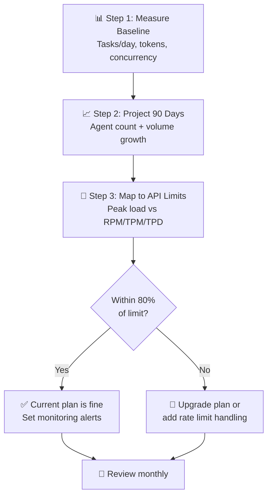

Most teams find out they need more capacity the wrong way. An agent throws rate limit errors at 2pm on a Tuesday. Or the billing statement shows token spend tripled last month with no obvious reason. Or three new agents get added to an existing workflow and suddenly everything slows down.

Capacity planning for AI agents is not complicated, but almost nobody does it proactively. Here's how to get ahead of it before you scale.

## What Capacity Planning Means for AI Agents

With traditional servers, capacity planning means CPU, RAM, and disk. With AI agents, the four numbers that matter are different:

- **Concurrency**: how many agents run tasks at the same time
- **Token volume**: how many tokens each task burns on average
- **API rate limits**: how many requests per minute your LLM provider allows
- **Cost per task**: what each completed task actually costs

These four numbers determine whether your agent setup works at 5 agents or falls over at 15.

## Step 1: Measure Your Current Baseline

Before you plan, know where you are now.

If you're on AgentCenter, pull a week of data from the [agent monitoring dashboard](/features/agent-monitoring). You want:

- Tasks completed per day, both average and peak day
- Average time per task
- How many tasks ran concurrently during your peak hours
- Token usage per task (if your LLM provider reports this)

If you don't have 7 days of data yet, even 48 hours gives you something useful. The goal is to stop guessing and start with real numbers.

## Step 2: Estimate Where You're Headed

You're not planning for today. You're planning for 60 to 90 days from now.

Ask these questions:

- How many new agents are you adding in the next two months?
- Will task volume grow because of new features, new use cases, or more users?
- Do any agents spike at predictable times? End-of-month reporting agents hit hard on the 30th. Content agents spike when campaigns go live.

Keep this rough: if you have 5 agents running 200 tasks per day today, and you plan to add 3 agents with usage doubling, your target is about 480 tasks per day at higher concurrency.

Round your projection up 30%. The goal is to avoid surprises, not model the future precisely.

## Step 3: Map Your Numbers to API Limits

Every LLM provider has rate limits, usually expressed as:

- Requests per minute (RPM)
- Tokens per minute (TPM)
- Tokens per day (TPD)

If your agent runs 10 tasks per hour and each task burns 4,000 tokens, that's 40,000 tokens per hour, about 667 tokens per minute on average. But peak load in a 10-minute window could be 3x that.

Most developers only plan for the average. Rate limit errors hit during peaks.

Check three things:

1. Find the rate limits for the specific model you're running. Limits vary by model tier, not just provider.
2. Multiply your peak task rate by average tokens per task.
3. Add a 2x buffer for prompt retries and multi-step agent chains.

If your peak load is at 80% or more of your provider's TPM limit, you're already close to the edge.

## Step 4: Pick the Right Plan

Once you know your projected agent count, pick the plan that fits your 90-day target, not today's count.

| Plan | Price | Max Agents |
|------|-------|------------|
| Starter | $14/mo | 5 |
| Pro | $29/mo | 15 |
| Scale | $79/mo | 50 |

Upgrading mid-project when you're already at the agent limit wastes time and causes disruption. If you're at 4 agents now and expect to run 10 within two months, start on Pro. The $15/month difference is less painful than an emergency plan change during a busy sprint.

Full plan details are on the [pricing page](/pricing).

## Step 5: Set Alerts Before You Need Them

Capacity planning is not a one-time exercise. The numbers change as you add agents and usage grows.

In AgentCenter, watch for:

- **Error rate spikes**: an early signal that you're hitting rate limits
- **Task queue depth**: tasks piling up means concurrency is saturated
- **Agent idle vs active time**: if agents sit idle most of the time, you're over-provisioned

Set a monthly calendar reminder to review your load numbers. It takes 10 minutes and saves you from scrambling when you're already under pressure.

## Common Mistakes

**Planning for average load instead of peak.** Your typical Tuesday afternoon is not your busiest Friday. Look at your worst hour, not the weekly mean.

**Ignoring chain effects.** A single user-facing request can trigger 3 to 5 internal agent tasks. Token usage compounds fast when you have multi-step workflows.

**Forgetting retries.** If you have retry logic, your actual token volume in failure scenarios can be 2 to 3x the happy-path estimate. Factor this into your numbers.

**Waiting until something breaks.** Rate limit errors and growing task queues show up in your monitoring data before they become outages. Checking the dashboard weekly costs 5 minutes.

## Bottom Line

Capacity planning for AI agents comes down to four numbers: tasks per day, peak concurrency, tokens per task, and your provider's rate limits. Get those numbers, project 90 days out, and you'll know exactly what plan you need before it becomes urgent.

---

*The best time to set this up is before your agents start failing. [Try AgentCenter free for 7 days](/pricing) — cancel anytime.*
