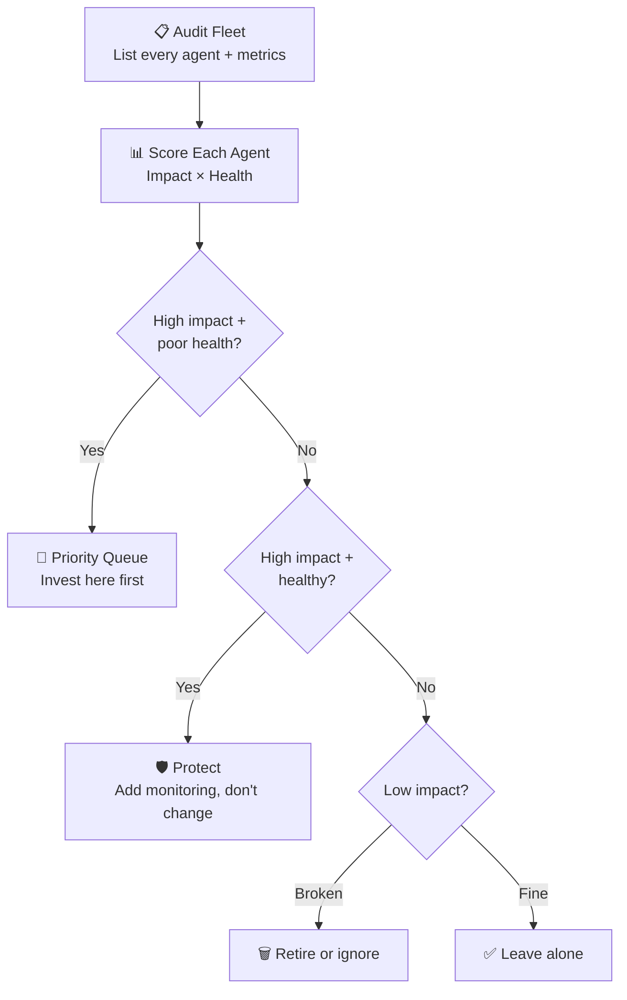

You have 14 agents running. Three are critical to revenue. Two are experiments nobody touches. The rest are somewhere in between. Your team has capacity for maybe two improvement projects this quarter.

Knowing how to prioritize AI agents — which ones to improve, which ones to protect, and which ones to leave alone — is one of the practical skills that separates teams that scale well from teams that spend all their time firefighting.

This is the agent investment problem. It's not about which idea sounds most exciting. It's about where your time and budget will have the most impact.

## What Agent Investment Prioritization Actually Means

Agent investment prioritization is the practice of evaluating your current agent fleet and deciding where to focus improvement effort. That means: prompt work, better monitoring, new tooling, tighter testing, or full rewrites. You're not deciding which agents to run. You're deciding which ones to actively improve.

Most teams skip this step. They either chase new agents (because new things are more interesting) or fix whatever broke last (because that's what's loudest). Neither approach works well at scale.

## How to Prioritize AI Agents: A Step-by-Step Process

### 1. Audit what you're running

Before you can prioritize, you need an accurate picture. List every agent: what it does, how often it runs, what it costs per month, and when it last failed.

If you're using AgentCenter, the [agent monitoring dashboard](/features/agent-monitoring) gives you this breakdown in one view — task volume, cost per task, error rate, and last failure timestamp. Without it, you're doing this from memory, which almost never produces accurate numbers.

Your audit output should look something like this:

| Agent | Monthly tasks | Cost/month | Error rate | Last failure |
|-------|---------------|-----------|------------|-------------|
| Content summarizer | 180 | $28 | 11% | 3 days ago |
| CMS publisher | 60 | $12 | 4% | Yesterday |
| Keyword extractor | 40 | $6 | 0.5% | 2 weeks ago |

### 2. Score each agent on two dimensions

After the audit, score each agent on:

- **Business impact** — what happens if this agent degrades or goes down? Does a human have to step in? Does a deadline get missed? Does a customer notice?
- **Current health** — how reliably is it running? Error rate, retry frequency, and manual intervention count are the signals to check.

You're looking for high-impact agents with poor health. Those are your highest priority. Low-impact agents that are already running fine can wait.

Resist the urge to build a complicated scoring matrix. A simple 1-3 scale for each dimension, plotted on a 3x3 grid, is enough for most teams.

### 3. Identify agents causing active pain

Check who on your team is complaining. If an agent is generating support tickets, prompting manual re-runs, or getting bypassed by people doing the work themselves — that's a signal.

Pain is a better signal than metrics alone. Metrics tell you what's happening. Team behavior tells you what's costing you.

In AgentCenter, the [task orchestration view](/features/task-orchestration) surfaces tasks that are being retried more than twice, or tasks sitting in "blocked" status for more than a few hours. Those agents are costing your team more than the error rate suggests.

### 4. Match each candidate to the right type of investment

Not every improvement is the same. A struggling agent might need:

- A better prompt (hours of work)
- More reliable tool integrations (days)
- Input validation and guardrails (days)
- Additional review checkpoints (a week)
- A complete redesign (weeks or months)

Figure out the investment type before you commit. Your team agreeing to "fix the agent" and then discovering it's a 6-week redesign is how prioritization breaks down. Get specific before you start.

### 5. Pick one or two — not five

The most common mistake is spreading effort across too many agents at once. You end up with five agents that are 20% better instead of one that's genuinely reliable.

Finish one before starting the next. A single agent that goes from 12% error rate to under 2% is worth more than three agents that each drop by a few points.

## A Real Example

A content operations team had 9 agents running. Their content summarizer ran 3 times per day and had an 18% error rate. Their keyword extractor was nearly perfect but only ran once a week. Their CMS publisher was crashing twice a month and causing escalations.

They sorted their agents by: error rate multiplied by weekly task count. The CMS publisher jumped to the top even though its raw error count was low. The failures were visible, painful, and time-sensitive.

They spent two weeks on it. Brought the error rate under 2%. Cut support escalations for that workflow by more than half.

Then they moved to the summarizer. The keyword extractor, which was working fine, stayed untouched.

## Common Mistakes

**Prioritizing by enthusiasm, not data.** The agent your team just shipped feels exciting. The one that's been causing problems for six months feels boring. The boring one is probably costing you more.

**Ignoring failure cost.** A 5% error rate on an agent that runs 200 times a day is very different from a 5% error rate on one that runs twice a week. Always multiply rate by volume before deciding what matters.

**Treating all improvements as equal.** Improving an agent nobody uses doesn't help your team. Make sure the agents you're improving are agents your team and customers actually depend on.

**Skipping the "leave it alone" option.** If an agent is running fine and the business value is low, don't touch it. Stability beats marginal improvement. Not every agent needs to be improved this quarter.

**Conflating new features with maintenance.** Prioritization is about existing agents. New agent builds are a separate conversation with separate capacity. Don't let new projects crowd out necessary maintenance on what you already have.

## Bottom Line

Agent investment prioritization is a quarterly habit. Build a simple audit, score your fleet on impact and health, and let the agents that cause real pain get attention first. Do that consistently and you'll end up with a smaller set of agents that actually work — instead of a growing list of agents that sort of work.

---

*The best time to set this up is before your agents start failing. [Try AgentCenter free for 7 days](/pricing) — cancel anytime.*
