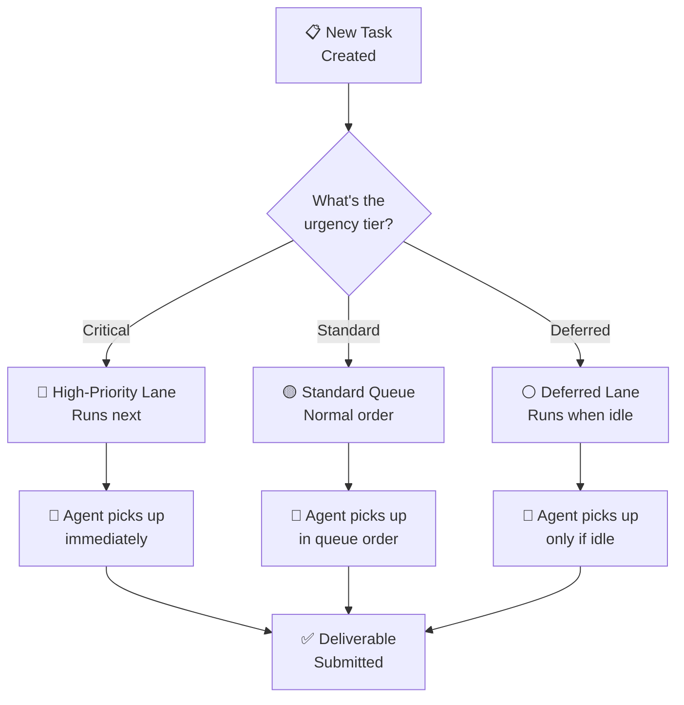

Your queue has 40 tasks in it. Three are blocking a customer delivery. Two are part of a nightly batch job. The rest are background research tasks that can wait until morning.

Your agents are working through them in arrival order. You haven't set any way to prioritize AI agent tasks — and right now it shows.

That's the problem with first-in, first-out. It works when task urgency is roughly equal. In production, task urgency is never equal. A contract review agent sitting behind 30 content generation tasks will miss a deadline and someone downstream takes the hit.

You don't need a custom scheduler to fix this. You need a priority system before tasks land in the queue, and visibility into what's running when load spikes.

## What Task Priority Actually Means for Agents

Priority for AI agents isn't just a label. It controls which tasks an agent picks up next, which tasks get deferred when capacity is full, and which tasks you drop entirely if the queue gets too long.

Three tiers work for most teams:

- **Critical** — Blocking another person, another agent, or a hard deadline. A sales agent waiting on research to send a proposal. A review agent holding a deployment.
- **Standard** — Normal production work with no immediate blocker. Most of your queue should live here.
- **Deferred** — Background enrichment, non-time-sensitive reports, batch jobs with flexible windows. These run when agents have nothing better to do.

The goal isn't to move everything to Critical. Priority inflation is its own failure mode — more on that below.

## How to Set Up Agent Task Prioritization

### 1. Define your priority tiers before you have a backlog problem

Don't wait until the queue is backed up to decide what matters most. Do it now, when you can think clearly.

Write down the three or four task types your agents handle most often. For each, ask: "If this task takes 4 hours longer than expected, what breaks?" If the answer is "nothing," it's Deferred. If the answer is "a human is blocked," it's Critical.

Document this in your agent runbook. Whoever creates tasks needs to know the criteria.

### 2. Tag tasks at creation time, not after

Priority should be set when a task is created, not when someone notices it's been sitting for 6 hours.

In [AgentCenter](https://agentcenter.cloud/features/task-orchestration), you can assign priority and due dates directly on the task card. Make this a required field in your team's task creation process. If a task arrives without a priority tag, default it to Standard — not Critical.

### 3. Structure your Kanban board with priority lanes

A flat "In Progress" column hides urgency. Create separate swimlanes or columns for Critical, Standard, and Deferred tasks.

AgentCenter's Kanban board supports this directly. Add three columns in the active stage: Critical, Standard, and Deferred. When an agent pulls a new task, it checks Critical first. This gives you visual priority management without any custom scheduling code.

### 4. Set WIP limits per lane

Work-in-progress limits control how many tasks can be active at once per priority tier. Without them, priority labels are just decoration.

A reasonable starting point for a team running 5-10 agents:

- Critical: max 2 active at once
- Standard: max 5 active at once
- Deferred: max 2 active at once

If Critical is full and a new urgent task arrives, you either free up an agent by pausing a Deferred task or escalate to a human.

### 5. Build a triage check into your morning routine

Once a day, look at your [agent monitoring dashboard](https://agentcenter.cloud/features/agent-monitoring) and answer three questions:

- Is anything Critical that's been in queue more than 2 hours?
- Is the Deferred lane growing faster than agents are clearing it?
- Are Standard tasks getting blocked behind a full Critical lane?

This 5-minute check catches priority drift before it compounds. Set a recurring task in AgentCenter to remind you.

## Real Example: Unblocking a Deployment Review Agent

We had a review agent that checked code changes before deployments. It shared a queue with 12 content generation agents. During a high-traffic week, the review agent sat behind a batch of blog posts and missed three deployment windows.

The fix was straightforward. We created a Critical lane in AgentCenter for anything touching deployment reviews and gave it a WIP limit of 1. The content generation tasks stayed in Standard. After that, review tasks went from taking 4+ hours to completing within 45 minutes.

Nothing changed in the agent logic. Priority lanes did the work.

## Common Mistakes

**Making everything Critical.** If half your queue is Critical, none of it is. Teams do this because it feels safe. It breaks your triage system and leaves you with the same problem you started with.

**Setting priority on task types instead of individual tasks.** "All research tasks are Standard" works until a research task is blocking a client deliverable. Evaluate priority per task, not per category.

**Ignoring WIP limits.** Priority without WIP limits means agents pile up on Critical tasks while Standard and Deferred tasks age out. Cap active tasks per lane.

**Forgetting to re-evaluate during a load spike.** When your queue doubles overnight, check whether yesterday's Standard tasks should be re-prioritized. A morning triage habit catches this before it becomes a fire.

## Bottom Line

Task priority only works when it's set before the queue fills up, enforced with WIP limits, and reviewed regularly. A flat queue with no priority signals leaves your agents doing whatever arrived first — which is rarely what matters most.

The setup takes an afternoon. The payoff is visible every time load spikes and your agents keep working the right tasks without manual intervention.

---

*The best time to set this up is before your agents start failing. [Try AgentCenter free for 7 days](/pricing) — cancel anytime.*
