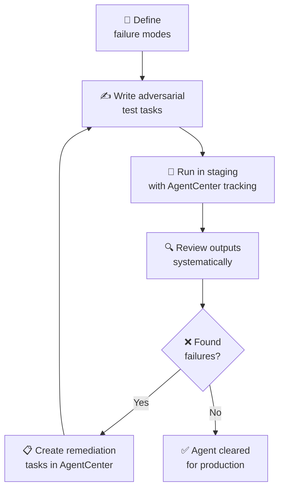

You've written the prompts, run the unit tests, checked the happy path a dozen times. The agent works. You ship it.

Three days later it produces something terrible because someone submitted an edge-case input you never thought to test. Or it loops on a malformed context. Or it confidently outputs nonsense in a format your downstream system doesn't catch.

Red-teaming is what you do before that happens. It's not about breaking your agent for sport — it's about finding the inputs and conditions that expose real gaps before your users do.

## What Red-Teaming Means for AI Agents

In software security, red-teaming means attacking your own system to find vulnerabilities. For AI agents, the concept is similar but broader. You're not just looking for injection attacks. You're looking for:

- Inputs that send the agent into an infinite reasoning loop
- Edge cases that produce confident but wrong output
- Ambiguous tasks where the agent picks the wrong interpretation
- Context combinations that cause unexpected behavior
- Boundary conditions the agent wasn't designed to handle

The goal is a list of known failure modes before production — not a surprise list after.

## How to Red-Team Your Agents: Step by Step

### Step 1: List the failure modes you're actually worried about

Don't start with test cases. Start with failure modes. Ask yourself: what's the worst thing this agent could plausibly do?

For a research agent: confidently summarizing a source that doesn't say what the agent claims. For a customer-facing reply agent: generating a response that's technically accurate but tone-deaf. For a data extraction agent: silently skipping records that don't match the expected format.

Write down 5-10 failure modes specific to this agent's job. These become the test categories.

### Step 2: Write adversarial test tasks for each failure mode

Now write test inputs designed to trigger each failure mode. Be specific and deliberate:

- For format assumptions: submit inputs with missing fields, extra fields, and wrong types
- For context length: test at 20%, 80%, and 120% of typical context size
- For ambiguous instructions: write task descriptions that could be interpreted two different ways
- For tool call behavior: give the agent a task where the right answer requires NOT calling a tool
- For tone and framing: test with inputs that are emotionally loaded, poorly written, or incomplete

You don't need 100 test cases. 5-10 well-chosen adversarial inputs per failure mode are more useful than a large set of variations on the happy path.

### Step 3: Run the tests in staging and track them in AgentCenter

Don't run red team tests in production. Create a staging project in [AgentCenter](/features) and assign each adversarial task there. This gives you a clean record of what you tested, when, and what came back.

Track each test as a separate task with a description that explains what failure mode you're probing. When the agent completes the task, submit the output as a deliverable for review — just like you would in production.

This step is important: if you run tests in a notebook or a script and never record the outputs, you'll forget what you found. Treating each test as a tracked task means the failure evidence survives the test session.

### Step 4: Review outputs systematically

Go through each test output and score it against the failure mode you were testing. Was the output acceptable? If not, how did it fail?

Use three categories:

- **Pass**: output was correct and the failure mode did not appear
- **Soft fail**: output was degraded but wouldn't cause a serious downstream problem
- **Hard fail**: output was wrong, dangerous, or would break something

Hard fails need immediate remediation before the agent ships. Soft fails are worth logging as known limitations with monitoring thresholds. Use AgentCenter's [deliverable review workflow](/features/agent-monitoring) to document these outcomes so nothing gets lost.

### Step 5: Create remediation tasks for every hard fail

Each hard fail becomes a task: update the prompt, add input validation, add an output schema constraint, or change the failure handling logic.

Assign these tasks like any other development work. Once they're done, run the adversarial test again to confirm the fix held. Don't close the task until the failure mode no longer reproduces.

## A Real Example: Red-Teaming a Content Drafting Agent

We ran this process on a blog drafting agent that was being deployed for a content team. The agent took a brief (a topic, audience, and key points) and returned a 400-word draft.

Failure modes we identified:

1. Agent uses filler sentences when key points are vague
2. Agent ignores the audience field and writes for the wrong reader
3. Agent produces markdown that breaks in the rendering pipeline when the title contains special characters
4. Agent loops when the brief is internally contradictory

We wrote test briefs for each. Three of the four failure modes reproduced on the first run. The loop behavior (failure mode 4) only appeared when we deliberately submitted a brief with "do not write about X, but X should be in the headline." The agent ran for 45 seconds and output nothing.

We caught all four before a single real user saw the agent's output.

## Common Mistakes

**Testing only the inputs you expect.** Real users don't submit clean inputs. Include inputs that are messy, contradictory, poorly formatted, or too short.

**Not recording the outputs.** A red team session that lives in a Slack message is useless two months later. Track every test and its result in a permanent location.

**Treating a pass as a guarantee.** Passing your red team tests means you didn't find those failure modes. It doesn't mean they don't exist. Re-run red team tests after every significant prompt or behavior change.

**Running too many similar tests.** 20 variations of the same input don't tell you more than 2. Spend the effort on test diversity, not test volume.

## Bottom Line

Red-teaming an agent takes 2-4 hours for a focused effort. Debugging a production failure after the fact takes much longer — and costs real trust with whoever received the bad output.

Find your failure modes on purpose, not by accident.

---

*The best time to set this up is before your agents start failing. [Try AgentCenter free for 7 days](/pricing) — cancel anytime.*
