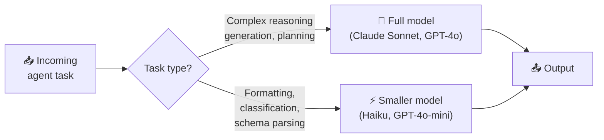

Your LLM token costs went up again. Not because you added new agents. Not because tasks got harder. The token count just keeps growing and you're not sure where it's coming from.

The obvious fix is to rewrite prompts, cut features, or swap models. But those changes break behavior you've already tested and tuned. There's a different path: reduce what gets sent to the LLM without changing what the LLM is asked to do.

Here are four techniques that work.

## Audit Where the Tokens Are Going First

Before cutting anything, find out what's actually expensive. Open your [agent monitoring dashboard](/features/agent-monitoring) and sort by token consumption per task. You're looking for two patterns:

1. **Tasks consuming far more tokens than similar tasks** — likely carrying redundant context
2. **Tasks running frequently with nearly identical inputs** — strong candidates for caching

In AgentCenter, you can see per-task token counts per agent. Run this audit for a week before changing anything. Most teams find 2-3 agents responsible for 60-70% of total token spend. Start there.

## Step 1: Enable Prompt Caching for Repeated System Context

If your agents use a long system prompt — instructions, examples, policies, background context — that prompt gets re-sent on every single LLM call. For a 2,000-token system prompt running 200 tasks per day, that's 400,000 tokens of identical content sent daily.

Most major providers (Anthropic, OpenAI) support prompt caching. You mark the static portion of your system prompt as cacheable. The provider charges full price on the first call and a fraction on subsequent calls within the cache window.

What changes in your agent: nothing. Same outputs, same behavior. You're paying less for context that never changes.

What to do:
- Identify agents with system prompts over 1,000 tokens
- Check if your OpenClaw provider supports caching for your model version
- Mark the static portion of the system prompt as cacheable (keep dynamic sections, like task-specific instructions, outside the cached block)
- Monitor cache hit rates in your provider dashboard — low hit rates mean your prompt structure needs review

For agents running more than 50 tasks per day with long system prompts, prompt caching alone typically cuts costs 40-60%.

## Step 2: Cache Deterministic Outputs

Some agent tasks produce the same useful output for the same input. Product description formatting. Fixed-schema classification. Data normalization. FAQ responses. For these tasks, you don't need to call the LLM every time.

How output caching works:
- Hash the agent's input (or key fields of it)
- Before calling the LLM, check the cache for that hash
- On cache hit: return the cached output directly
- On cache miss: call the LLM, store the result, return it

Your agent's behavior is identical to the caller. The LLM just gets called less often.

This requires a change to your agent infrastructure layer, not your agent's reasoning or prompt logic. Set cache TTLs based on how often the underlying data changes. For classification agents processing the same document types repeatedly, cache hit rates above 30% are common within the first week.

## Step 3: Route Cheaper Tasks to Smaller Models

Not every task needs your most expensive model. A lot of what agents do — parsing, schema validation, reformatting, simple yes/no classification — runs reliably on smaller, cheaper models.

The approach: keep your agent's behavior the same, but route different subtasks to different models based on complexity.

To do this without changing behavior:
1. Identify subtasks within your agents that are self-contained
2. Run those subtasks through a cheaper model and compare outputs against your current model's results — use your full model outputs as ground truth
3. Set an accuracy threshold (95% match rate is a reasonable start) and only route subtasks that meet it
4. Keep multi-step reasoning, open-ended generation, and planning on the full model

This works best when agents already have modular steps. If your agent is one large monolithic prompt, you'd need to restructure it first — which does touch behavior. Only do model routing when the subtask isolation is already clean.

## Step 4: Trim Context at Task Boundaries

Multi-step agents accumulate conversation history. Each step adds to the context window, and the full history gets resent on the next call. By step 10, you're sending 8,000 tokens where 4,000 is no longer relevant.

Context trimming removes resolved, redundant history without changing what the agent is currently trying to do.

What to trim:
- Intermediate steps that produced a confirmed, used output
- Tool call results that have been summarized in a later step
- Repeated clarifications or retries for the same question

What not to trim:
- The original task and constraints
- Any output the next step depends on
- Error state from failed tool calls (still active context)

In [multi-agent workflows](/features/multi-agent-workflows), each agent handoff is a natural trim point. Pass a clean summary of what the previous agent produced rather than the full conversation history. The receiving agent gets exactly what it needs and nothing else.

## Common Mistakes

**Trimming too aggressively.** If you remove context a later step depends on, you break behavior in ways that are hard to debug. Start conservative — trim only turns that are clearly complete and resolved.

**Routing the wrong tasks.** Tasks that look simple often aren't in edge cases. Summarization feels easy but degrades on long or unusual documents. Test thoroughly on real production data before routing.

**Not monitoring cache hit rates.** Enabling caching is step one. Verifying the cache is being hit is step two. Low hit rates mean your input patterns vary more than expected — investigate before assuming the setup is working.

**Mixing prompt structure changes with cost work.** Shortening or restructuring the actual prompt does change agent behavior. Keep prompt edits and cost-cutting work in separate changes so you can isolate what caused any behavior shift.

## Bottom Line

LLM token costs grow with usage. A lot of that growth is redundant: context that never changes, outputs that could be reused, subtasks that don't need a frontier model. None of these techniques require changing what your agents actually do — they change how efficiently your infrastructure calls the LLM.

Use [AgentCenter's per-task cost tracking](/features/agent-monitoring) to measure the impact of each change before rolling anything out broadly. Pick the highest-spend agent first and work from there.

---

*The best time to set this up is before your agents start failing. [Try AgentCenter free for 7 days](/pricing) — cancel anytime.*
