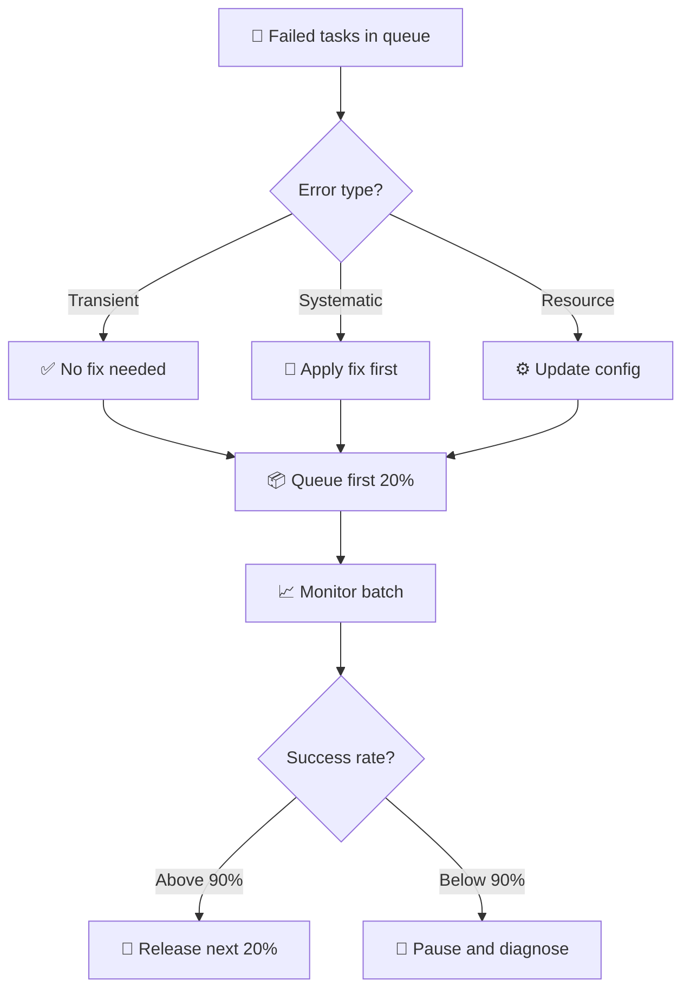

Something went wrong. Maybe your LLM provider had a 15-minute outage and 200 queued tasks errored out. Maybe a prompt template broke and 40 tasks failed before anyone noticed. Whatever the reason, you're now looking at a list of red tasks and wondering how to recover.

Bulk rerunning failed AI agent tasks is a different problem from debugging a single failure. The goal is recovery at scale. But recovery done wrong creates a second wave of failures just like the first.

Here's how to do it right.

## Why Bulk-Retrying Failed Agent Tasks Goes Wrong

Two mistakes account for most botched recoveries.

**Retrying before understanding the failure type.** Not all failed tasks are safe to retry. Some fail because of a transient issue like a rate limit or a provider outage. Others fail because the input was wrong, the prompt broke, or the agent hit a resource ceiling. Retrying the second kind without fixing anything just fails again, faster.

**Queuing everything at once.** A flood of 200 simultaneous retries can hit rate limits again, spike token costs past the hourly ceiling, and make it impossible to tell which tasks succeeded and which failed again. You end up running a second incident investigation on top of the first.

The fix is a three-step process: understand the failure, fix what's broken, release retries in controlled batches.

## Step 1: Identify the Failure Type

Before touching retry, open the [agent monitoring view](/features/agent-monitoring) and filter tasks by status: failed. Look at the error messages.

Sort them into one of three buckets:

**Transient failures** look like: "429 rate limit from OpenAI", "provider timeout after 30s", "connection reset". These are safe to retry without any changes. The underlying problem was temporary.

**Systematic failures** look like: "agent could not parse input schema", "required field 'source\_url' missing", "context window exceeded on step 3 of 4". These will fail again unless you fix the root cause first.

**Resource failures** look like: "task exceeded per-task budget of $0.20", "token limit hit at 90k context". These need a configuration change before retrying.

If 80% of your failed tasks share one error message, that's your signal. You have a systematic problem. Fix it first.

## Step 2: Fix Before You Retry

For transient failures, no fix is needed. Move to Step 3.

For systematic or resource failures, apply the fix before queuing a single retry:

- **Input format changed?** Update the schema validation at the task level.
- **Prompt broken for new data?** Update the prompt template first.
- **Agent hitting cost ceiling?** Raise the per-task budget or reduce task scope.
- **Missing tool dependency?** Restore the tool before the agents need it.

To confirm your fix works before committing the full batch, pick 3 representative failed tasks and rerun them manually. If they succeed, the fix is good. If they fail again, something is still missing.

## Step 3: Stage the Retry Batch

Don't release all failed tasks at once. Release the retry batch in waves using the [task orchestration board](/features/task-orchestration):

1. Filter tasks confirmed safe to retry. Tag or label them separately from tasks still under investigation.
2. Release 20% of the verified batch first.
3. Wait for that wave to complete. Check the success rate.
4. If 90% or more of the first wave succeeds, release the next 20%.
5. Continue until the batch is clear.

This keeps token usage spread over time, avoids a repeat of rate limit failures, and makes it easy to catch a partial fix that works for some tasks but not others.

## Step 4: Monitor the Rerun in Real Time

While the batch runs, stay on the monitoring view. Three signals to watch:

**Same error message coming back.** Your fix didn't work or there's a second layer to the problem. Pause the batch and investigate.

**New error messages appearing.** Your fix introduced a new problem. Pause and check before releasing more tasks.

**Success rate below 90% on the first wave.** Something unexpected is happening. Stop before releasing the rest.

If the first wave clears cleanly, accelerate the remaining waves. If it doesn't, you've limited the blast radius to 20% of the batch instead of 100%.

## Step 5: Handle Double-Failures Separately

Some tasks will fail again even after a fix. These need a different response than automatic retry.

Flag any task that fails twice. Use AgentCenter's deliverable review workflow to assign these directly to an engineer for manual inspection. Don't let them re-enter the failed queue alongside tasks waiting for a first retry.

Double-failures usually mean one of two things: the task input itself is broken in a way that no agent can handle, or there's a deeper config problem specific to that task type. Automatic retry isn't the right tool for either situation.

## Common Mistakes

**Skipping error categorization.** Three minutes of sorting failures by error message saves two hours of re-recovery.

**Releasing 100% of the retry batch at once.** This is the fastest way to create a second incident.

**Not watching the first retry wave.** Starting the rerun and stepping away means you find out about partial failures the next morning.

**Letting double-failures stay in the queue.** They create noise that hides how much of the queue has actually recovered.

## Bottom Line

Bulk rerunning failed AI agent tasks has a clear order: understand the failure type, fix the root cause, stage the retries. The order matters more than the speed. Teams that skip straight to "retry everything" spend twice as long in recovery than teams that take 10 minutes to sort failures first.

---

*The best time to set this up is before your agents start failing. [Try AgentCenter free for 7 days](/pricing) — cancel anytime.*
