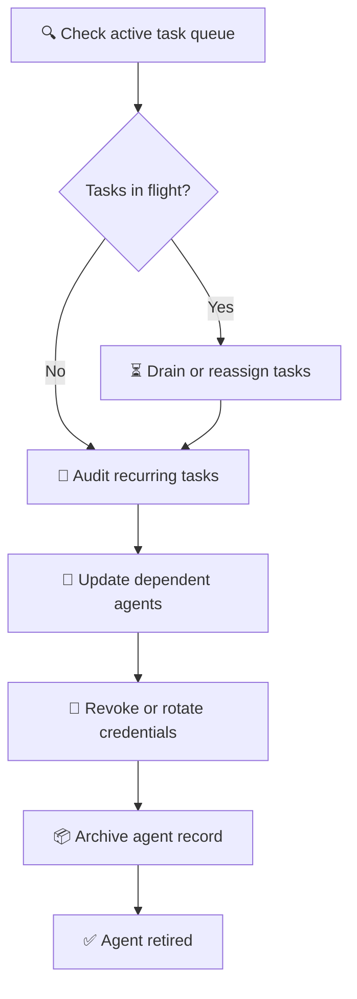

When an agent stops being useful, most teams just stop assigning it new work. No formal decommission. No checklist. They assume it'll fade out on its own.

It doesn't. That agent keeps running. It picks up tasks from shared queues. Its API keys stay active. Dependent agents still route work to it. Three months later you're debugging an unexpected failure and the root cause turns out to be a "retired" agent that nobody remembered was still running.

That's a zombie agent. They're common. They're avoidable.

Retiring an agent correctly takes about 45 minutes the first time. After that it's a 10-minute checklist.

## What retiring an agent actually means

Rolling back an agent reverts its behavior to a previous version while keeping it active. Retiring an agent removes it from your production fleet permanently.

They look similar from the outside but have different failure modes. Rollback keeps the agent alive. Retirement shuts it down — which means you need to confirm:

- All in-flight tasks are complete or reassigned
- Recurring tasks are cancelled or rerouted
- Any agent that hands off work to this one is updated
- Credentials the agent uses are revoked or rotated

Skip any of these and you'll hit broken pipelines, orphaned tasks, or dangling API keys.

## The retirement checklist

### Step 1: Check what the agent is currently running

Before touching anything, look at the agent's active task queue. You want to know:

- How many tasks are in progress right now?
- How many are queued but not started?
- When was the last task completed?

In AgentCenter, the [agent dashboard](/features/agent-dashboard) shows real-time status including active tasks, queue depth, and last heartbeat. An agent with 4 active tasks and 12 queued needs a drain period. An agent with 0 active and 0 queued can be shut down today.

### Step 2: Drain or reassign active tasks

For active tasks, you have two options: let them finish or reassign them to another agent.

If the tasks are short-running (under 30 minutes), let them complete. Check back and verify the completions. If they're long-running or have already hit errors, reassign them manually rather than waiting.

Don't cancel active tasks unless you've confirmed the work isn't needed. A cancelled task often means a gap in downstream output that nobody notices for days.

### Step 3: Cancel or reroute recurring tasks

This is where most teams slip up. A recurring task fires again next Tuesday whether the agent is retired or not. If the agent is gone when it fires, you'll get an error — or worse, a silent failure.

Find every recurring task assigned to this agent. For each one, decide:

- Is this work still needed? Assign it to a different agent.
- Is this work no longer needed? Cancel the recurring task entirely.

In AgentCenter, [task orchestration](/features/task-orchestration) lets you filter recurring tasks per agent. Pull up the list before you shut anything down and clear it completely.

### Step 4: Update dependent agents

Some agents hand tasks off to other agents. If any agent in your fleet has this one set as a downstream recipient, update that routing before retirement.

Check your multi-agent workflows for any step that routes to the agent you're retiring. Update those to point at the replacement or remove the step entirely.

If you skip this step, the upstream agent will attempt to hand off work to a decommissioned agent. Depending on your error handling, that's either a silent failure or a loud cascading one.

### Step 5: Revoke or rotate the agent's credentials

Every agent uses API keys. Some share keys with other agents. Some have their own.

Before revoking anything:

1. Check whether the key is shared with other agents. If yes, don't revoke — remove just this agent's access.
2. For keys that belong only to this agent, revoke them immediately after shutdown.

Leaving active keys attached to decommissioned agents is a security gap. Keys don't expire just because the agent does.

### Step 6: Archive the agent record

Don't delete the agent. Archive it.

You want to keep the task history, deliverable log, and configuration for at least 30 days. Post-mortems and audits often reach back to understand what an agent was doing before retirement. If you delete the record immediately, that data is gone.

Archiving an agent marks it inactive and removes it from active views, but preserves the full history. You can reactivate it if you discover a problem after the fact.

## A real example

Say you're retiring a research agent that pulled competitor data weekly. It had one recurring task (fires every Monday at 9am), one downstream handoff to a reporting agent, and its own API key for an external data source.

Here's what the retirement looks like in AgentCenter:

1. Open the agent's dashboard. Queue depth: 0. Last task: 3 days ago. Good to proceed.
2. Navigate to recurring tasks. One active weekly task. Assign it to the replacement research agent.
3. Open the reporting agent's task template. Update the "receives from" field to the new research agent.
4. Revoke the API key in the external data source's settings. Remove it from the agent's environment config.
5. Archive the agent. The six months of deliverable history stays accessible for review.

Total time: about 20 minutes.

## Common mistakes

**Retiring without checking recurring tasks.** An agent can look idle for weeks but still have a recurring task firing every Friday. Always audit the full list before shutdown.

**Deleting instead of archiving.** You lose the history. That history matters when you're explaining to a stakeholder why a report stopped updating, or when you're tracing a multi-agent failure back to a config that was active six weeks ago.

**Revoking shared credentials.** If the agent used a key shared with other agents, revoking it breaks those agents too. Always check whether keys are shared before revoking. Remove access, don't delete the key.

**Not telling the team.** If another engineer thinks the agent is still running and doesn't know you retired it, they'll spend time debugging something that's intentionally gone. A one-line message before you start saves 30 minutes of confusion.

## Bottom line

Retiring an agent isn't just shutting off a process. It's clearing the agent from your coordination layer: tasks, workflows, credentials, and history. The teams that handle it cleanly are the ones who built the checklist before they needed it.

---

*The best time to set this up is before your agents start failing. [Try AgentCenter free for 7 days](/pricing) — cancel anytime.*
