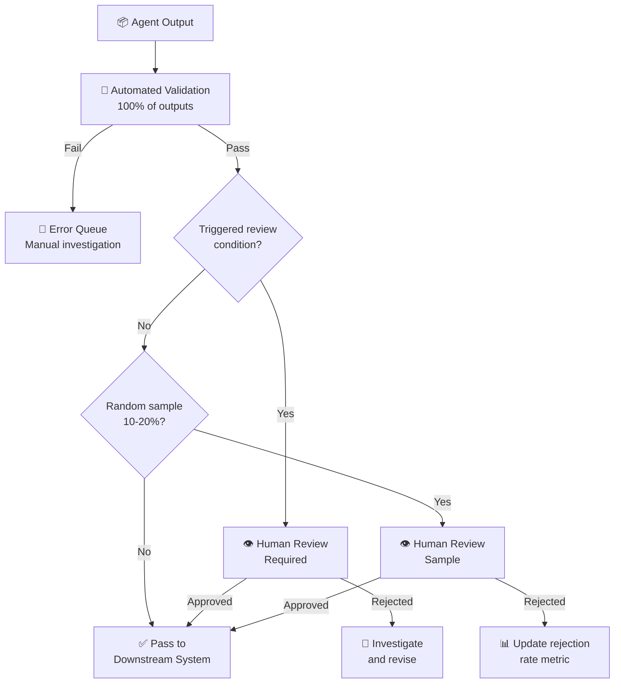

If you have one agent producing 20 outputs per day, reviewing all of them manually is feasible. If you have 10 agents producing 200 outputs per day, reviewing everything manually is a full-time job. At some point, the volume makes comprehensive review impossible without scaling the review team proportionally to the agent fleet.

Here's how to build a review process that scales without losing quality control.

## The Baseline Mistake: Review Nothing or Review Everything

Most teams start at one extreme. They either review every agent output manually (which works fine until volume grows, then breaks) or they skip review entirely after the first few weeks when it "seems to be working fine" (which is how you discover quality problems late).

Neither extreme is sustainable. You need a middle path: systematic sampling with escalation paths for flagged content.

## The Scaled Review Framework

### Tier 1: Automated Validation (100% of outputs)

Every agent output should pass automated checks before entering the review queue. These don't require human judgment — they're format and constraint checks:

- Output is in the expected format (JSON, markdown, plain text)
- Required fields are present and non-empty
- Output length is within bounds
- No obviously disqualifying content (e.g., sensitive data patterns)

Outputs that fail automated validation go to an error queue for investigation. They don't go to downstream systems.

### Tier 2: Random Sampling (10-20% of outputs)

A random sample of outputs goes to a human reviewer. The reviewer is not looking for all possible errors — they're getting a quality signal. Is the overall quality level acceptable? Is there a pattern to what the agent gets wrong?

Track the rejection rate on sampled outputs. If 5% of sampled outputs are rejected, extrapolate: roughly 5% of all outputs may have quality issues. If that rate climbs to 20%, investigate the whole population.

### Tier 3: Triggered Review (Specific conditions)

Certain conditions should automatically trigger full human review, regardless of sampling:

- Outputs above a cost threshold (expensive tasks suggest unusual input)
- Outputs that automated validation flagged but didn't fail outright
- Outputs on sensitive topics or high-stakes use cases
- Outputs for new task types the agent hasn't seen before

Triggered review is not random — it's targeted at the highest-risk outputs.

## Setting Up the Review Queue

In AgentCenter, the [deliverable review workflow](/features/agent-monitoring) supports this structure. You can configure:

- Which deliverable types go to automatic review (triggered by cost or sensitivity flags)
- Which go to random sampling pools
- Who reviews which categories

The review queue shows reviewers what's waiting, the context for each deliverable, and the task brief it was responding to. Reviewers make decisions in context, not in isolation.

## Tracking Rejection Rate Over Time

Rejection rate is your primary quality metric. Track it per agent, per task type, and overall.

Healthy state:

- Rejection rate stable at 3-8%
- No particular task type with rejection rate above 15%
- Rejection rate not trending upward week-over-week

Unhealthy signals:

- Rejection rate climbing week-over-week (quality drift)
- One task type with rejection rate above 25% (that type needs prompt work)
- Sudden spike in rejection rate (something changed — model, prompt, or input distribution)

The rejection rate from sampling extrapolates to the full population. If you're rejecting 15% of your sampled outputs, roughly 15% of all outputs are problematic. Whether that's acceptable depends on the stakes.

## Reviewer Calibration

Two reviewers looking at the same output shouldn't disagree too often. If they consistently disagree, your review criteria aren't clear enough.

Write down what "approve" means and what "reject" means for each agent type. Be specific. "Correct and on-brand" is not a criterion. "Uses at least 2 specific examples, doesn't exceed 600 words, doesn't mention competitor names" is a criterion.

Run calibration sessions quarterly. Show both reviewers the same 10 outputs and compare decisions. Where they disagree, discuss why and update the criteria.

## What Not to Do

**Don't review everything yourself indefinitely.** You'll be reviewing outputs instead of improving the agents. The whole point is to catch problems, not to personally curate every output.

**Don't assume stable rejection rate means everything is fine.** Sample rejection rate tells you about sampled outputs. It doesn't tell you about specific high-risk outputs that weren't sampled. Keep the triggered review conditions active.

**Don't skip reviewer calibration.** Inconsistent reviews produce inconsistent feedback to the agents and inconsistent quality signals to the team.

## Bottom Line

Scale review by automating what can be automated, sampling what you can't review fully, and triggering full review for high-risk cases. Track rejection rate as your quality signal. Calibrate reviewers so the signal is consistent. This approach keeps quality control viable as your agent fleet grows.

_The best time to set this up is before your agents start failing. [Try AgentCenter free for 7 days](/pricing) — cancel anytime._
