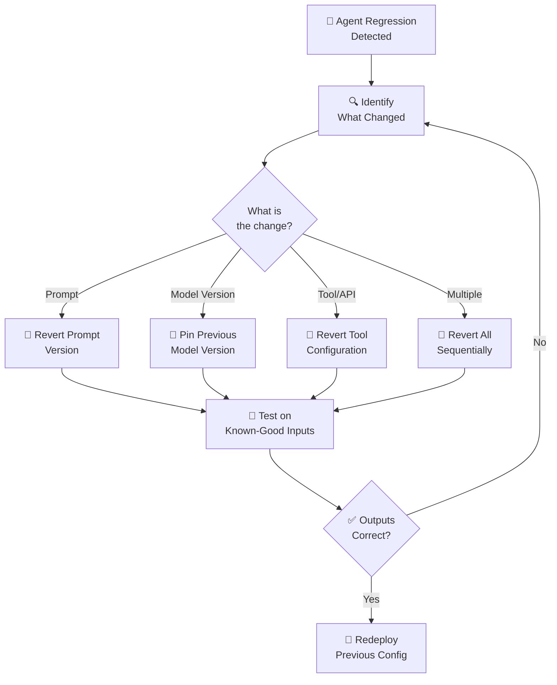

Rolling back an AI agent is harder than rolling back a service. With a service, you revert the container image and redeploy. With an agent, the "version" isn't just the code — it's the prompt, the model version, the tools the agent has access to, and potentially the memory or context it's accumulated.

Rollback is possible. It just requires knowing what you're actually reverting.

## Why Agent Rollback Is Different

When a service breaks, you usually know it immediately. An exception, a 500 error, a crash. The failure is hard to miss.

When an agent regresses, it might keep running for days before anyone notices. The outputs are subtly wrong. Quality drops gradually. No exceptions. Just drift. By the time you decide to roll back, you might have 3 days of bad outputs that downstream systems have already processed.

That context matters for rollback planning. You're not just reverting the agent — you might need to reprocess work it did while broken.

## Step 1: Know What Changed

Before you roll anything back, figure out what changed between the last good state and the current broken state.

Check these in order:

- **Model version:** Did your provider update the model? Some providers update model defaults without explicit versioning. If you're not pinning the model, it may have changed under you.
- **Prompt or system message:** Who last edited the prompt? When? Even small edits can shift agent behavior significantly.
- **Tool or API access:** Did any external service the agent calls change its API response format?
- **Input data:** Did the inputs change format or distribution? An agent can "break" because it's receiving inputs it wasn't designed for.

In AgentCenter, the task history shows agent configuration at the time of each run. If you have a task that succeeded two days ago and one that failed today, you can compare the configs side by side. That's often enough to identify the change without further investigation.

## Step 2: Stop New Work Before Reverting

Before you revert, pause the agent's task queue. You don't want new tasks starting while you're mid-rollback, or while you're running tests.

In AgentCenter: change the agent's status to idle and stop task pickup. Tasks stay in the queue. Nothing gets lost. You're just pausing processing while you sort out the configuration.

## Step 3: Identify the Rollback Target

A rollback target is a known-good state: a specific combination of prompt version, model version, and tool configuration that you know produced correct outputs.

If you've been tracking this — and you should be — it's a record in your history. A specific task run with a specific configuration. Your rollback target is "make the agent look like it did when task #4729 ran successfully."

If you haven't been tracking this, your rollback options are more limited. You're reverting to your best guess, not a confirmed good state. This is why tracking matters before something breaks.

## Step 4: Revert One Variable at a Time

If the issue is unclear, don't revert everything at once. You won't know what fixed it, and you might mask other issues.

Revert the most likely cause first, test with known-good inputs, then decide if further reverts are needed. The sequence:

1. Revert prompt (easiest, fastest to test)
2. Pin model version if prompt didn't help
3. Check external tool configurations if neither helped

## Step 5: Validate Before Resuming

After reverting, test the agent on inputs you know the expected output for. Don't just run one test. Run at least 5-10 representative inputs across the range of what the agent normally handles.

This is the step people skip when they're in a hurry. Skip it and you might resume the queue on a still-broken agent.

## Step 6: Handle In-Flight and Recent Work

If the agent was broken for 48 hours, what do you do with the work it produced during that time?

Three options:

- **Reprocess:** Mark affected tasks as pending, rerun them with the fixed agent.
- **Manual review:** Route recent deliverables to human review before they go further downstream.
- **Accept as-is:** If the regression was minor or the downstream impact is low, document it and move on.

The right choice depends on how bad the regression was and what the deliverables were used for. Don't assume "reprocess everything" is always the answer — sometimes it's expensive and unnecessary.

## What Good Rollback Hygiene Looks Like

- Pin model versions in your agent configuration. Never use defaults in production.
- Track prompt versions the same way you track code versions — in source control.
- Keep at least 30 days of task history with full configuration snapshots.
- Know your rollback target before you need it. Write it down somewhere obvious.

## Bottom Line

Agent rollback is manageable if you've done the prep work. Know what changed, stop new work, revert one variable at a time, validate, then resume. The teams that struggle are the ones who don't track what they deployed and have no snapshot to revert to.

_The best time to set this up is before your agents start failing. [Try AgentCenter free for 7 days](/pricing) — cancel anytime._
