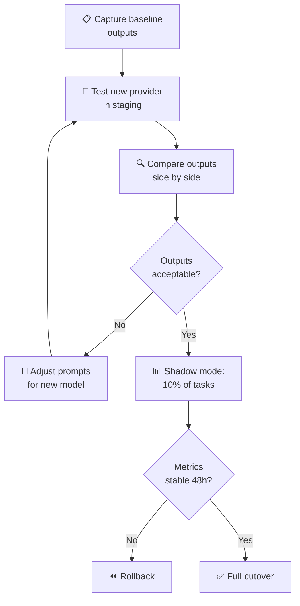

At some point your team will need to rotate LLM providers. Maybe GPT-4 rates went up. Maybe a new Claude model is faster on your specific task. Maybe you hit rate limits during a traffic spike and want to shift load.

The switch sounds simple: update an endpoint, swap an API key, done. In practice, rotating LLM providers is one of the more disruptive changes you can make to a running agent pipeline — and the teams that do it wrong spend days debugging problems that look like agent failures but are actually prompt-model mismatches.

Here's the process that avoids that.

## Why Provider Rotation Breaks Things

Different models behave differently by default. Temperature sensitivity, output verbosity, formatting tendencies, how they interpret ambiguous instructions — these all vary across providers.

A prompt you iterated on for GPT-4 over three months carries assumptions about how that model responds. Those assumptions don't transfer cleanly to Claude or Gemini. The new model might follow your instructions more literally, or less literally, or produce longer outputs, or format tool calls differently.

None of this is impossible to fix. But you have to expect it and plan for it.

## The Provider Rotation Process

### Step 1: Capture Your Baseline

Before touching anything in production, pull 20-30 recent task outputs from your current provider. You need to know what "good" looks like before you can tell if the new provider is producing it.

In AgentCenter, use the activity feed and the deliverable review panel to find recent completed tasks. Save representative outputs — especially for your trickiest task types. These become your reference set.

If you skip this step, every disagreement about output quality after the switch becomes a debate with no ground truth to resolve it.

### Step 2: Test the New Provider in Staging

Set up a separate project in AgentCenter that points to your new provider. Run the same agent configuration and the same task inputs as your baseline.

Queue 10-15 tasks and review the deliverables. What to check:

- Does the output format match what downstream systems expect?
- Are there new refusals or errors the old provider didn't produce?
- Is output length consistent with your baseline?
- Do edge cases behave the same way?

Different outputs aren't automatically a problem. Sometimes the new provider is genuinely better. The question is whether your users and downstream processes still get what they need.

### Step 3: Adjust Prompts for the New Model

If staging outputs are off, adjust your prompts before going further. Common fixes:

- Add explicit output format instructions — models vary on how literally they follow format hints
- Adjust example count in few-shot prompts
- Tighten constraints on output length if the new model is more verbose
- Rewrite tool call definitions if the model interprets parameter descriptions differently

Test again in staging after each change. A prompt that's "mostly working" will cause problems at scale.

### Step 4: Shadow Mode Rollout

Once staging looks good, run both providers in parallel on a small slice of real traffic. Send 10% of tasks to the new provider while keeping 90% on the old one.

In AgentCenter, track these as separate task queues in the same project. Use the [agent monitoring](/features/agent-monitoring) view to compare error rates, cost per task, and task completion times between the two queues.

Watch for:
- Higher retry rates on the new provider
- Cost per task increasing more than expected
- New error categories appearing in the activity feed

### Step 5: Gradual Cutover

Once the 10% slice looks stable after 24-48 hours, move to 50%. Then 100%.

Set your rollback threshold before you start: "if error rate exceeds X% or cost per task doubles, I roll back immediately." Make the decision criteria explicit so it's not a judgment call in the middle of an incident.

At each increment, check the [agent monitoring dashboard](/features/agent-monitoring) for at least 24 hours. Some failure modes only surface after several runs, once the model's behavior interacts with your specific data patterns.

### Step 6: Document the Switch

After full cutover, add a one-paragraph note to your agent runbook: what provider you switched from and to, when, why, and what prompt changes you made.

This takes five minutes. It saves hours when someone else inherits the agent six months from now and wonders why the prompt looks different from the original design doc.

## What Goes Wrong

**Assuming prompts transfer.** They don't, not cleanly. Budget a few hours for prompt adjustments even if the switch feels minor.

**No baseline.** Without captured outputs from the old provider, you have no reference point. "This seems worse" is not actionable feedback.

**Switching the whole fleet at once.** One agent at a time, or one agent type at a time. If something breaks, you want to know exactly where.

**Skipping the 48-hour observation window.** Most issues appear quickly. Some don't. Don't move from shadow mode to full cutover on the same day unless you have high confidence in the specific task type.

**Ignoring cost per task.** A provider that produces better outputs might cost twice as much per run. Monitor costs throughout the transition, not just at the start. Check [pricing](/pricing) to make sure your plan can absorb the change if token usage shifts significantly.

**Treating it as a one-time event.** Providers update their models. What works today may need adjustment when the underlying model changes under you. Periodic comparison runs in staging are cheap insurance.

## Bottom Line

Rotating LLM providers is an operational event, not a config change. The teams that do it cleanly treat it like a deployment: baseline first, staging tests, shadow mode, gradual rollout, monitoring at each step, documentation at the end.

The teams that get burned change the endpoint and find out something broke three days later from a user complaint about bad output.

---

*The best time to set this up is before your agents start failing. [Try AgentCenter free for 7 days](/pricing) — cancel anytime.*
