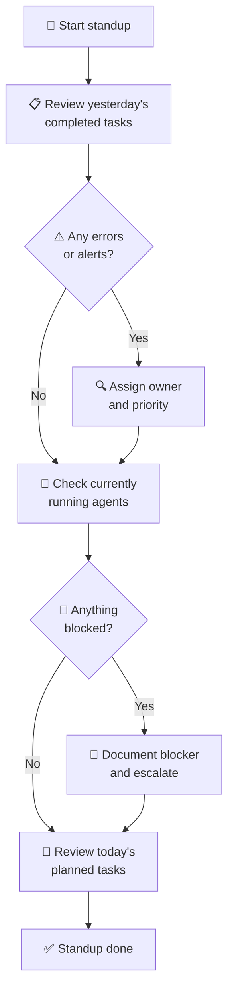

The more agents you run, the easier it is to lose track of which one is stuck and which is fine. A daily agent standup fixes that. Not a long meeting — just a focused 15-minute check that keeps your team aware of what's running, what's blocked, and what shipped yesterday.

## What Is a Daily Agent Standup?

It's the same idea as a developer standup, but centered on agent status instead of individual code tasks. You're answering three questions:

1. What did the agents complete since yesterday?
2. What's currently running or blocked?
3. Are there any errors or alerts that need an owner?

You don't need a meeting to do this. Some teams run it async in Slack. Others hold a quick huddle three times a week. The format matters less than the habit.

## Who Should Be in the Room

For most teams, the right group is small:

- The engineer who owns agent monitoring (or whoever is on-call)
- Anyone whose work depends on agent output — editors, ops, product, whoever reviews deliverables
- A decision-maker if there's an active incident

Don't invite everyone. If you have 12 people on a 15-minute call about 5 agents, at least 8 of them shouldn't be there.

## What to Check Each Day

Here's what to run through, in order:

### 1. Completed tasks since yesterday

Pull up the completed task list in AgentCenter. Scan for anything that finished but wasn't reviewed. If an agent delivered output that nobody looked at, flag it before moving on.

### 2. Active errors and alerts

Check the error count on your [agent monitoring dashboard](/features/agent-monitoring). If anything spiked overnight, it needs an owner before the call ends. "We'll look at it later" is not an answer.

### 3. Currently running tasks

Which agents are active right now? Are any of them running longer than their baseline? A task that normally finishes in 10 minutes and has been running for 45 is already failing in slow motion. This is the check most teams skip, and it's the one that matters most.

### 4. Blocked tasks

Tasks waiting on input, an approval, or a dependency that hasn't resolved. These don't fix themselves. Someone on the call needs to own moving them forward before you close the standup.

### 5. Today's planned workload

Anything scheduled to kick off today that the team should know about? First-time prompts, high-stakes tasks, or anything touching external APIs are worth a 30-second mention so nobody is caught off guard.

## A Real Example Using AgentCenter

A content team running 6 research agents holds a 10-minute standup three times a week. Here's their flow:

1. Open the [Kanban task board](/features/task-orchestration) at the start of the call and filter for "last 24 hours."
2. Scan everything in the "Completed" column. Did the output meet the brief? If not, it goes back into review.
3. Look at "In Progress" for tasks older than 2x their expected runtime. Flag anything over that threshold.
4. Every item in "Blocked" gets a name next to it before the call ends.
5. Check the activity feed for any errors or retries that fired overnight.

The whole thing runs under 10 minutes. They use a shared doc to track recurring blockers so the same issue doesn't surface three weeks in a row without being fixed.

## Common Mistakes

**Making it a reporting session instead of a decision session**

If your standup sounds like "Agent A ran, Agent B ran, Agent C ran," you're reading a log out loud. Focus on exceptions. Anything that completed cleanly doesn't need airtime.

**Not assigning owners before the call ends**

Every blocked task or unresolved error needs a name next to it when you close the call. Ambiguous ownership means the thing won't get fixed.

**Skipping the @mention follow-through**

When someone takes an action item from the standup, use AgentCenter's @mention thread on that task to log what was decided. If the context only lives in the meeting, it's gone by end of day.

**Inviting people who don't need to be there**

Your data analyst doesn't need to hear about a slow file-processing agent unless it directly affects their work. Keep the group tight. Add others only when they're actually needed.

**Running it daily when your agents don't move that fast**

If your agents produce output twice a week, a daily standup creates noise. Match the cadence to how quickly your agents actually change state.

## Bottom Line

A daily agent standup doesn't have to be a meeting. It's a rhythm. Fifteen minutes of focused attention on what's running, what's broken, and what needs a decision. Teams that skip this spend their time reacting to failures that were visible 36 hours before they became urgent.

---

*The best time to set this up is before your agents start failing. [Try AgentCenter free for 7 days](/pricing) — cancel anytime.*
