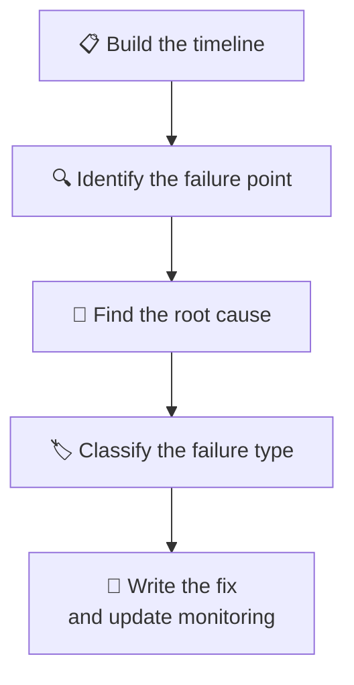

Your document review agent ran overnight and processed 300 contracts. Twelve came back with missing fields. You found out the next morning when the ops team started asking questions. Time to run a post-mortem.

No crash. No error code. The agent ran, finished, and reported success. The outputs were just wrong.

That's the thing about agent failures. They often don't look like failures until someone downstream catches them.

## What an Agent Post-Mortem Is

A post-mortem is a structured review of what went wrong, why, and what changes will prevent it from happening again. For software systems, this is routine. For AI agents, most teams skip it, or they treat it as a five-minute conversation and move on.

That's a mistake. Agent failures tend to repeat. If you don't understand the root cause, you'll hit the same wall again under different conditions.

The goal isn't to blame a model, a prompt, or the person who wrote it. The goal is to finish the session with a clear timeline, a root cause (not just a symptom), and at least one concrete change that reduces the chance of recurrence.

## The 5-Step Process

### Step 1: Build the Timeline

Before you discuss anything, reconstruct what happened in order. Pull logs, activity feeds, and task history.

You want to answer: When did the agent run? What inputs did it receive? What did it produce? When was the failure detected?

In AgentCenter, the [agent monitoring dashboard](/features/agent-monitoring) keeps a timestamped activity feed for every task. You can see when a task started, what the agent did at each step, and what the final output was. This replaces the manual log-hunting that slows most post-mortems down.

Don't skip this step. A surprising number of "agent failures" turn out to be data problems. The agent did exactly what it was asked, but the input data was corrupted or incomplete.

### Step 2: Identify the Failure Point

Once you have the timeline, find where things went wrong. This is different from the root cause. The failure point is the moment the output diverged from what was expected.

Examples:
- The agent called the wrong tool because the context was ambiguous
- The model returned a partial result after stopping mid-generation
- The agent looped and exhausted its token budget before finishing
- The output format was valid but contained empty fields

In the contract review case, the failure point was step 3 of the agent's process: the extraction step was returning empty strings for specific clause types instead of flagging them as missing.

### Step 3: Find the Root Cause

This is where most teams stop short. The root cause is rarely "the AI got it wrong." Push deeper.

Ask "why" at least three times:
- Why were 12 contracts missing fields? The extraction prompt returned empty strings.
- Why did it return empty strings? The clause structure in those contracts used different formatting than the examples in the prompt.
- Why was the prompt brittle to formatting differences? It was written against a single document type and never tested against the full input range.

Root cause: the prompt was tested against a narrow input distribution.

This distinction matters. If you fix "the AI got it wrong," you'll re-run the task or swap the model. If you fix the root cause, you'll update the prompt, expand the test set, and add validation that catches empty fields before they ship.

### Step 4: Classify the Failure Type

Not all agent failures are the same. Knowing which category you're in shapes what you fix.

| Failure Type | What It Means | Example Fix |
|---|---|---|
| Input failure | Bad or unexpected input data | Add input validation before the agent runs |
| Prompt brittleness | Works for narrow cases, breaks on others | Expand examples, add edge cases |
| Tool error | External API returned bad data | Add retry logic, check tool outputs |
| Context overflow | Agent lost track due to long context | Break task into smaller chunks |
| Model behavior | Model response shifted unexpectedly | Pin model version, add output validation |
| Integration failure | Downstream system rejected the output | Validate output format before sending |

Most failures are prompt brittleness or input failures. Model behavior issues are real but less common than teams assume.

### Step 5: Write the Fix and Update Monitoring

A post-mortem with no action items is just a meeting. Write down the specific change being made (and who owns it), the test that proves the fix works, and the alert that will catch this failure type faster next time.

In AgentCenter, you can set up [approval workflows](/features/task-orchestration) to add a human review gate on high-stakes outputs. If the contract review agent had one, a reviewer would have caught the empty fields before they reached the ops team.

You can also set monitoring thresholds on output quality signals. If an agent starts returning empty fields at an unusual rate, you want to know in minutes, not the next morning.

## Common Mistakes Teams Make

**Stopping at "the prompt was wrong."** That's a symptom. The root cause is almost always something upstream: wrong input format, insufficient examples, missing validation, or untested edge cases.

**Not tracking action items.** Post-mortems feel complete when the meeting ends. They're only complete when the fix ships and the monitoring update is live.

**Treating every failure the same.** An input failure requires different work than a prompt brittleness issue. Fixing the wrong layer wastes time.

**Skipping post-mortems for "minor" failures.** A 4% error rate feels minor until it compounds. Twelve bad contracts per week for a month is a process problem, not a one-off.

## Bottom Line

Agent failures repeat. A post-mortem that identifies the actual root cause and produces a concrete fix breaks that loop. Build the timeline, find the failure point, find the root cause, classify it, write the fix, and update your monitoring.

The harder part is doing it consistently. Not just after the big failures, but the medium ones too.

---

*The best time to set this up is before your agents start failing. [Try AgentCenter free for 7 days](/pricing), cancel anytime.*
