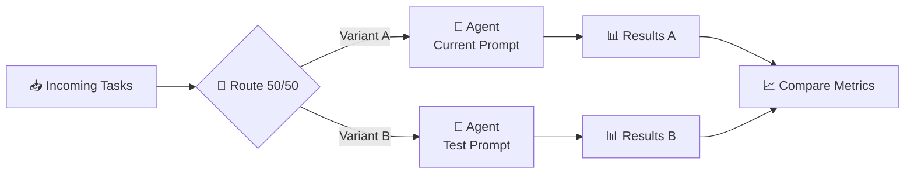

When you change an agent's prompt, you're usually guessing. You think the new version is clearer. You hope the output quality improves. But unless you measure it against the old version on the same inputs, you don't actually know.

That's the problem A/B testing solves.

## What Prompt A/B Testing Actually Means

A/B testing agent prompts means running two prompt versions in parallel — same tasks, different prompts — and comparing results against a metric you defined before the test started.

It's not complicated in theory. In practice, most teams skip it because they don't have a clean way to split traffic or compare outputs at scale. They push the new prompt, watch for a few days, and call it good. That works until you have 30 agents and a production incident traced back to a prompt change you can't roll back cleanly.

Here's how to do it properly.

## Step 1: Define What "Better" Looks Like

Before you write a single prompt variant, decide how you'll measure success. The metric needs to be something you can actually check — not "feels more natural."

Examples that work:

- **Task completion rate**: Did the agent finish without errors or retries?
- **Output accuracy**: Does the deliverable match the expected schema or pass review?
- **Review rejection rate**: How often do reviewers reject the output?
- **Token cost per task**: Is one prompt doing the same work in fewer tokens?

Pick one primary metric. Track others if you want, but rank them. If you try to win on three metrics at once, you'll end up with no clear winner.

## Step 2: Create Two Prompt Variants

Version A is your current prompt (the control). Version B is the change you want to test.

Keep the change focused. If you're testing a new instruction about output format, don't also change the task framing and the few-shot examples in the same test. When a test has two variables, you can't explain the result.

Document both versions in your prompt history before the test starts. If something breaks, you need to roll back fast without hunting through Slack messages to find the old prompt text.

## Step 3: Route Tasks to Each Variant

This is where most teams hit friction. You need a way to send some tasks to Prompt A and the rest to Prompt B without mixing results or disrupting your existing workflow.

The simplest approach is a tag-based split. In AgentCenter's [task orchestration board](/features/task-orchestration), you can create two task lanes:

- `prompt-variant-a` — uses the current prompt
- `prompt-variant-b` — uses the test prompt

Assign tasks to each lane based on a simple rule: every other task, or a random 50/50 split. If your workload is high-volume and fairly uniform, this works well. If you have sequential or dependent tasks, make sure the two variants are truly independent — don't let a Variant A output feed into a Variant B task.

Run the test for at least 50 task completions per variant before drawing conclusions. 20 tasks isn't enough signal.

## Step 4: Compare Results

Once tasks from both variants are flowing through, use AgentCenter's [deliverable review workflow](/features/agent-monitoring) to score outputs. Look for differences in:

- How often outputs need revision before approval
- Error rates and retry counts
- Token usage per task (visible in the agent monitoring panel)
- Time to completion

You don't need to review every task manually. Sample 20-30 outputs per variant and score them against your primary metric. If the difference is obvious after 30 reviews, you don't need to wait for 50 completions. If it's close, keep going.

## Step 5: Pick a Winner and Promote It

When you have enough data, make a decision. If Variant B wins clearly on your primary metric, promote it: update the canonical prompt, tag the version in your prompt history, and archive Variant A.

If results are mixed — Variant B is cheaper but gets rejected more often — decide which trade-off matters more for this specific agent. That's a judgment call. But now it's a *decision* rather than a guess.

If there's no meaningful difference, keep Variant A. Don't change a prompt just because you wrote a new one.

## Common Mistakes

**Testing too many changes at once.** One variable per test. Otherwise you can't explain the result.

**No upfront success criteria.** If you decide what "good" looks like after the test ends, you'll find a metric that flatters whatever result you got. Define it first.

**Ending the test too early.** If Variant B looks better after 10 tasks, that's noise. Wait for enough completions to have real signal.

**Ignoring cost differences.** A prompt that costs 40% more tokens to run might not be worth a small quality improvement. Always check token usage alongside quality metrics in your [agent cost view](/features/agent-monitoring).

**Not documenting the test.** When someone asks "why did we change this prompt six months ago?" the answer shouldn't be "I don't remember." Write down what you tested, what metric you used, and what you found.

## Bottom Line

Prompt quality degrades silently if you don't measure it — and it improves silently too. You might be running a subpar prompt for months without realizing a small tweak would fix it.

A/B testing isn't heavy. Tag your tasks, run them in parallel, compare the outputs, make a call. The setup takes an hour. Skipping it means your prompt changes are just hopes dressed up as improvements.

---

*The best time to set this up is before your agents start failing. [Try AgentCenter free for 7 days](/pricing) — cancel anytime.*
