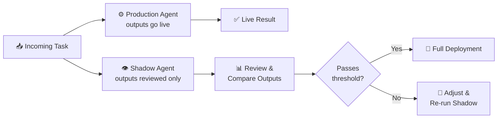

Staging environments are useful, but they don't replicate what actually hits your agents in production. The edge cases, the oddly formatted inputs, the late-night batch jobs with mangled data — those only show up when real traffic runs through the system.

That's the gap shadow mode fills for AI agents.

## What Shadow Mode Means for AI Agents

Shadow mode means running a new agent on real production inputs at the same time as your existing process, but not using its outputs. You're observing, not acting. The existing system keeps doing its job. The shadow agent runs in parallel and produces outputs that your team reviews manually.

You get two things from this: real-world evidence of how the agent behaves, and a direct comparison against what the current process produces. Neither a staging environment nor a gradual rollout gives you both at once.

## When Shadow Mode Is Worth It

Shadow mode makes sense when:

- You're replacing a manual process with an AI agent
- You're shipping a new version of an existing agent where the outputs feed a downstream system
- The task is high-stakes and errors are expensive to fix after the fact

It's less useful for low-volume tasks where the cost of a bad output is low. If you're generating social media captions and one is off, that's easy to catch and fix. If you're generating invoice data or contract summaries, the bar is higher.

## How to Set Up Shadow Mode in AgentCenter

Here is a concrete process.

**1. Create a shadow project**

Set up a separate project in AgentCenter for the shadow agent. Use the same task templates as your live project. Prefix project and task names with "SHADOW" so it's visually distinct. Assign only the new agent to this project.

**2. Mirror incoming tasks**

For every task your production agent picks up, create an identical task in the shadow project. For low volume, you can do this manually. For anything above a few tasks per day, use the AgentCenter REST API to duplicate task creation automatically when a task is submitted to the live project. That ensures inputs are identical, which matters for a clean comparison.

**3. Run both in parallel**

The production agent processes its tasks and your team gets results as usual. The shadow agent processes the duplicate tasks at the same time. Neither waits for the other.

**4. Review shadow outputs against production outputs**

This is the whole point. Use AgentCenter's deliverable review workflow to evaluate shadow outputs. Build a simple rubric:

- Did the shadow agent produce output in the right format?
- Is the content quality equal to or better than production?
- Were there any failures, retries, or errors?

Run this across at least 50 to 100 shadow tasks before drawing conclusions. Less than that and you're not seeing the tail cases.

**5. Run a cost comparison**

Check per-task spend in the [agent monitoring dashboard](/features/agent-monitoring) for both agents side by side. A shadow agent that produces better output but costs 3x more is not ready to go live without a model or prompt change first.

## What to Measure

Don't just look at whether outputs seem good. Track these numbers:

- **Failure rate**: How often does the shadow agent error out? Compare it to production.
- **Completion time**: Is it faster or slower than your current process?
- **Output quality score**: Use your rubric consistently across every review so comparisons are honest.
- **Token cost per task**: Monitor this per-agent in AgentCenter to catch cost drift early.

Set a pass threshold before you start, not after. Something like: fewer than 3% errors, quality matching production on 90% of tasks, over 75 tasks reviewed. Defining success criteria upfront keeps the decision clean when the data comes in.

## Common Mistakes

**Stopping too early.** Fifty tasks sounds like a lot. It isn't. Edge cases need volume to appear. A week of shadow mode gives you more confidence than 50 tasks in a single afternoon.

**Using cleaned inputs.** If you're feeding the shadow agent sanitized or simplified inputs instead of the real thing, you're testing a different scenario. The point is exposure to the actual mess that production traffic brings.

**Ignoring shadow failures.** Shadow failures don't affect your production output, which makes it easy to skip over them. Write every failure down. A pattern that shows up in shadow mode will become a production incident if you ignore it.

**Letting the shadow project linger.** Shadow mode is temporary. Once the agent passes your threshold, archive the shadow project and shut it down. Leaving it running costs money and creates confusion about which project is the real one.

## Moving to Full Deployment

Once you hit your threshold, the transition is straightforward. Stop creating duplicate tasks for the shadow project. Point all incoming tasks to the new agent. Archive the shadow project in [AgentCenter's dashboard](/features/agent-dashboard) so the history is preserved but it doesn't clutter your active view.

Keep the old agent or process running for 48 hours in a reduced capacity in case you need to roll back quickly. After that window, you're done.

## Bottom Line

Shadow mode is the closest thing to a risk-free production test for AI agents. You're using real inputs and a real agent, but the outputs stay inside your review queue until you've decided they're ready. For any agent that replaces a manual process or feeds into something downstream, the setup time pays off before the first edge case surfaces.

---

*The best time to set this up is before your agents start failing. [Try AgentCenter free for 7 days](/pricing) — cancel anytime.*
