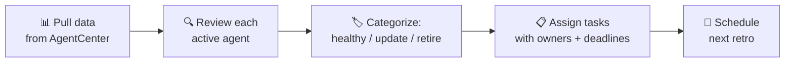

Most engineering teams run retrospectives for their sprints. Almost none run them for their AI agents.

By the time you notice quality has dropped or costs have crept up, you've been running degraded agents for weeks without knowing it. A monthly retro catches that.

## What an Agent Retrospective Is

An agent retrospective is a scheduled, structured review of how your production agents are actually performing. Not a post-mortem (that's for failures). A retro happens on a fixed cadence — regardless of whether anything went wrong — so you can spot drift before it becomes a crisis.

The questions it answers:

- Are these agents still doing the right work?
- Is the output quality holding up?
- Are costs in line with what we'd expect?
- Is there an agent we should retire, update, or expand?

Teams that run retros regularly catch cost bleed, prompt drift, and scope creep early. Teams that don't usually find out when a stakeholder asks why the reports have been wrong for six weeks.

## How Often to Run One

Monthly works for most teams. If you have fewer than 5 agents, quarterly is fine. If you're running 20 or more, consider a monthly fleet check plus a quarterly deep-dive.

Consistency matters more than frequency. An informal retro you actually do every four weeks beats a thorough one you keep rescheduling.

## The Retro Process

Here's the flow from start to finish:

### Step 1: Pull the Numbers Before You Meet

Spending 15 minutes pulling data before the meeting saves you from debating opinions in the room. From [AgentCenter's monitoring dashboard](/features/agent-monitoring), pull:

- Task completion rate per agent (last 30 days vs previous 30 days)
- Error rate and most common error types
- Cost per agent and cost per task
- Output approval rate if you're using deliverable review

You're looking for direction, not perfection. A completion rate that dropped from 94% to 73% is a signal. A cost spike on one specific agent is a signal. Flag these before the meeting starts.

### Step 2: Review Each Active Agent

Go through your agent list one by one. For each agent, answer three questions:

1. Is it completing the work it was set up to do?
2. Is the quality of its output holding up?
3. Is the cost proportional to the value it delivers?

If the answer to any of these is no, it goes on the action list. Don't try to debug in the retro itself. Just classify: healthy, needs attention, or needs a decision.

### Step 3: Categorize and Decide

For every agent flagged during review, pick one:

- **Retire** — The agent isn't delivering value, has been superseded, or its task is no longer relevant. Archive it. Don't let dead agents sit in your fleet consuming overhead.
- **Update** — The prompt needs revision, the context window is too loose, or you need to tune its behavior based on recent output patterns.
- **Expand** — The agent is working well. It's worth giving it more scope, more capacity, or a cleaner input pipeline.
- **Watch** — Something looks off but you need more data before deciding. Create a monitor and check in at the next retro.

### Step 4: Assign Owners and Create Tasks

Every action item needs a name and a date. Without that, nothing happens.

Create tasks in [AgentCenter](/features/task-orchestration) for every action that comes out of the retro. Assign them to the right person before the meeting ends. A retro that produces a list of things to maybe do someday is a wasted hour.

### Step 5: Schedule the Next Retro Before You Leave

Put the next retro on the calendar before you close the meeting. If you wait until after, it won't happen.

## A Concrete Example

We ran a retro on a pipeline with 8 production agents. One of them — a research summarization agent — had a 91% task completion rate. Looked completely healthy.

But the cost per task had doubled over two months. Nobody had noticed because they were watching task counts, not cost per task.

In AgentCenter, we filtered the agent's task history by date range and noticed it was pulling in roughly 4x the context it used to. A prompt change from six weeks earlier had unintentionally loosened the retrieval scope. Twenty minutes to diagnose. An hour to fix.

Without the retro, that cost bleed would have continued for another quarter.

## Common Mistakes

**Running the retro only after something breaks.** That turns it into a blame session. Run it on schedule, even when everything looks fine — especially then.

**Reading dashboards instead of outputs.** Completion rates and green status indicators tell you the agent ran. They don't tell you whether the output was useful. Pull a sample of recent outputs and actually read them before the meeting.

**Skipping owners and deadlines.** An action item with no name attached is not an action item. Someone has to own it, and they need to know by when.

**Conflating the retro with the post-mortem.** Post-mortems are triggered by specific failures and dig into root cause. Retros are scheduled regardless. They serve different purposes — run both.

## Bottom Line

A monthly agent retro takes 45 minutes. It catches the quality drift, cost creep, and scope misalignment that daily monitoring misses. Set a recurring calendar block, pull the data beforehand, and make sure every action item has a name and a date on it.

---

*The best time to set this up is before your agents start failing. [Try AgentCenter free for 7 days](/pricing) — cancel anytime.*
