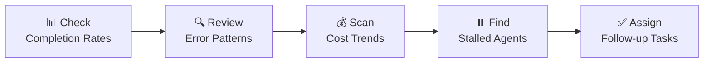

Most teams find out their agents have been failing when a stakeholder asks why the weekly report is wrong. Not because they checked. Because someone else noticed.

That's what happens when you run an agent fleet without regular reviews. Problems compound quietly. An agent returning partial results for two weeks creates 14 days of bad data downstream. A prompt that's slowly drifting never triggers an alert. It just gets worse, week by week, until it's someone's problem.

A weekly agent fleet review changes that. It's 30 minutes, once a week. You look at the numbers you should already have. You catch what's broken before someone else does.

## What a Weekly Agent Fleet Review Is

It's not a debugging session. Not a planning meeting. It's a structured scan across your running agents to find degradation, cost creep, and blocked work before they become incidents.

The point isn't to fix everything in the review. It's to know what's worth fixing and assign someone to do it.

Teams that do this weekly spend less time firefighting. Teams that skip it end up in reactive mode constantly, chasing problems that were visible three weeks ago if anyone had looked.

## The 5-Step Weekly Review Process

Here's the process that works for teams running anywhere from 5 to 50 agents:

### Step 1: Check Task Completion Rates

Start here. You want the 7-day task success rate for each agent. If an agent is completing 95% of tasks this week but was at 99% last week, that's a signal. Not an emergency, but worth watching. A drop below 85% needs immediate attention.

Pull this from AgentCenter's [agent monitoring dashboard](/features/agent-monitoring). The completion rate view shows task outcomes per agent, filterable by time window. Scan for anything that changed since your last review.

### Step 2: Review Error Patterns

Don't just count errors. Look at the types. A single agent throwing the same error repeatedly is different from random errors scattered across the fleet.

The AgentCenter activity feed groups errors by agent and type. Scroll through and note: any error type you saw last week that's still there? That means nobody fixed it. Add it to this week's action list.

### Step 3: Scan Cost Trends

Check which agents consumed the most tokens this week compared to their baseline. Cost spikes mean something changed: a prompt getting longer, more retries than expected, or a task scope that's quietly expanded.

In the [agent monitoring view](/features/agent-monitoring), sort agents by weekly cost. Look for anything that jumped more than 20% from the previous week without a matching increase in workload.

### Step 4: Find Stalled Agents

An agent that's "working" but hasn't completed a task in 48 hours is stalled. It's not crashing. It's just not producing. That's often harder to catch than a crash because your status board stays green.

In AgentCenter's [task orchestration view](/features/task-orchestration), look for tasks stuck in "In Progress" longer than your normal task duration. Anything over 24 hours in most workflows is a flag worth investigating.

### Step 5: Assign Follow-up Tasks

This is the step teams skip, and it's why reviews don't work. If you end the review without creating specific action items with owners and deadlines, nothing changes.

Use @mentions in AgentCenter to assign follow-up tasks to specific team members directly in the platform. Each finding becomes a task: "Fix retry logic on [agent name]" with an owner and a due date. If it doesn't have a name on it, it won't get done.

## A Real Review Session in AgentCenter

Here's what this looks like in practice for a team running 12 agents:

Open the Analytics tab. Filter to the last 7 days. Check the completion rate table for any agent below 90%.

Switch to the Activity Feed. Filter by "error." Scroll through quickly — you're looking for patterns, not individual events. The same error on the same agent three days in a row is a pattern.

Open Agent Monitoring. Sort by cost, descending. Compare this week to last week. Flag any agent with a cost increase over 15%.

Open the task board. Filter by "In Progress." Look for anything created more than 36 hours ago.

Create tasks for each flag. Assign them before the review ends. Move on.

The whole session takes 25 to 30 minutes with 12 agents. Larger fleets take longer, but the structure stays the same.

## Common Mistakes

**Reviewing without a checklist.** If you don't have a fixed list of things to check each week, you check different things every time. You can't spot trends if your measurement keeps changing.

**Doing it alone.** The person running the review sees one set of things. The engineer who built the agents sees another. You need at least two people in the room.

**Taking notes but not creating tasks.** If findings don't become tickets with owners, they disappear. Every flag you raise should exit the review as a task assigned to someone.

**Skipping it when things look fine.** That's often when something is quietly failing. Reviews are most valuable when nothing seems wrong, because that's when you catch slow-moving problems.

**Reviewing the same problem three weeks in a row.** If the same agent keeps appearing on your list, it's not bad luck. Something structural is broken. That's a deeper fix, not a weekly note to yourself.

## Bottom Line

A weekly agent fleet review is not a complex process. It's 30 minutes with a consistent checklist. What it gives you is signal before things break, not silence followed by an incident. Most teams that skip it aren't saving time. They're paying for it later when the problems are much harder to untangle.

---

*The best time to set this up is before your agents start failing. [Try AgentCenter free for 7 days](/pricing) — cancel anytime.*
