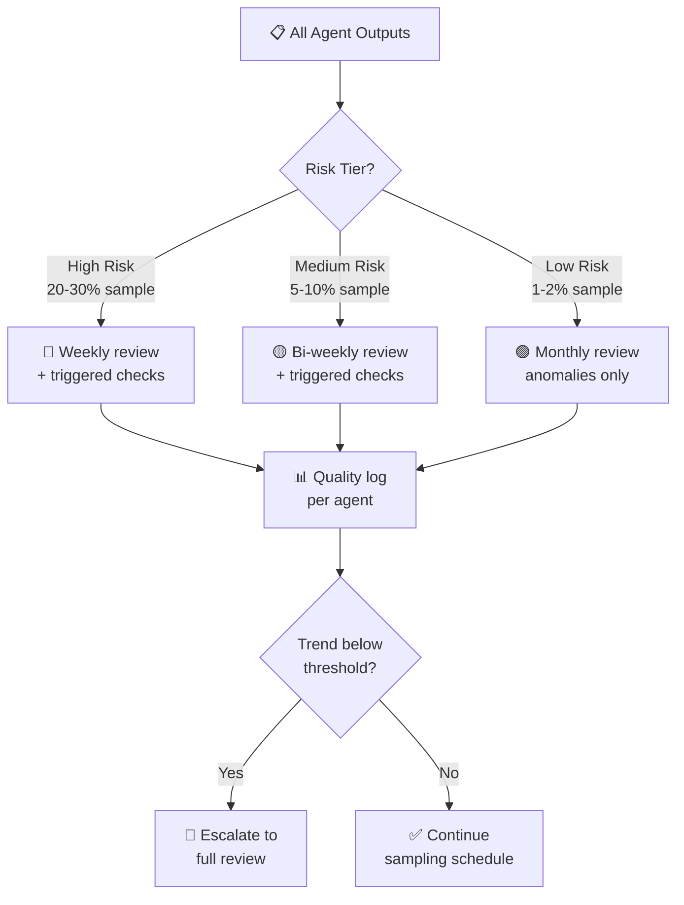

At some point you're running 15 agents that together complete 300 tasks per day. You can't review all of them. Reviewing 10% at random doesn't tell you much if 90% of your quality problems are concentrated in two agents. And reviewing nothing means you're flying blind until a stakeholder notices something wrong.

This is the output sampling problem. Here's how to solve it.

## What Output Sampling Actually Is

Output sampling means reviewing a structured subset of your agent outputs on a regular basis. The goal isn't to catch every error. The goal is to catch the patterns of errors early, before they compound.

Random spot-checking is not a sampling strategy. A sampling strategy tells you: which agents to check, how often, what percentage of their outputs, and what to look for when you do.

Without a plan, quality reviews tend to default to the loudest failure. You review the agent that someone complained about this week. The other 14 agents run unreviewed for another month. That's how drift gets discovered six months too late.

## How to Sample AI Agent Outputs for Quality Review

Here's a practical approach that scales from 10 agents to 100.

### Step 1: Tier Your Agents by Risk

Not all agent outputs carry the same cost if they're wrong. A research agent that summarizes competitors getting something slightly off is inconvenient. A compliance agent that flags the wrong contract clause is a real problem.

Group your agents into three tiers:

- **High risk:** Outputs that go to customers, trigger financial actions, or have regulatory implications. Review 20-30% of outputs.
- **Medium risk:** Internal reports, handoffs to other agents, or content that gets human review downstream anyway. Review 5-10%.
- **Low risk:** Agents doing pure data extraction, formatting, or summarization for internal use only. Review 1-2%.

This alone reduces your review volume significantly while concentrating attention on the agents that matter most.

### Step 2: Add Triggered Sampling on Top

Percentage sampling catches gradual drift. It won't always catch sudden failures. Add triggered reviews for specific conditions:

- Output length drops more than 40% below the rolling average for that agent
- A task retried more than twice before completing
- A new prompt version was deployed in the last 24 hours
- The output contains phrases that signal uncertainty, like "I was unable to" or "I couldn't find"

These triggers don't replace percentage sampling. They add a second layer that catches anomalies your random sample might miss.

### Step 3: Set Up the Review Queue

In AgentCenter, every task submission creates a deliverable you can review through the [deliverable review workflow](/features/agent-monitoring). You can filter by agent, by date, and by task status.

The practical way to implement sampling is to set a review window each week and pull a fixed number of tasks per agent per tier. For a high-risk agent running 50 tasks per week, that might be 12-15 outputs. For a low-risk agent running 200 tasks per week, that might be 4-6.

Build this into a recurring task in AgentCenter so the review doesn't get skipped when things get busy.

### Step 4: Score What You Review

Reviewing outputs without a consistent scoring method produces noise, not signal. You need at least three dimensions:

1. **Format:** Does the output match the expected schema or structure?
2. **Accuracy:** Is the content correct and complete for the task?
3. **Usefulness:** Would a human act on this output directly, or does it need editing first?

Keep scoring simple: pass, minor issue, major issue. Log these in your review notes. After four weeks, you can spot which agents are trending down and exactly what type of failure is increasing.

### Step 5: Close the Loop Weekly

The review is only useful if something happens with it. Once a week, look at your failure rate by agent. If an agent's major issue rate crosses 10%, that's your signal to investigate the prompt, check for input drift, or increase your sample rate temporarily.

Use the [agent activity feed](/features/agent-monitoring) to trace what changed around the time quality started slipping. Most of the time you'll find a model change, a task description that got edited, or an upstream data source that started feeding different inputs.

## Common Mistakes with Output Sampling

**Sampling only when something already broke.** By then you're in reactive mode. Sampling works best as a routine, not a response.

**Reviewing too many dimensions at once.** If you score format, accuracy, usefulness, tone, length, and citation quality all at once, reviews become exhausting and inconsistent. Pick three dimensions and stick with them.

**Ignoring low-risk agents completely.** Low-risk means low impact per output, not zero impact. An agent processing 500 tasks per day at a 5% error rate is still producing 25 bad outputs daily. Monthly sampling of even 1-2% will catch systematic problems before they accumulate.

**Not logging your reviews.** Spot-checking without logging means you can't see trends over time. Even a simple tag in your AgentCenter review notes ("format ok," "accuracy issue," "escalated") gives you searchable history.

**Sampling the same tasks every week.** If you always review Monday morning tasks, you'll miss weekend runs. Vary when you sample within each week to avoid blind spots in timing.

## Bottom Line

You don't need to review every output. You need to review the right outputs at the right frequency. Tier your agents by risk, set sample rates for each tier, add triggered reviews for anomalies, and score consistently. After four to six weeks you'll have a quality baseline per agent that tells you, before anyone complains, which agents are starting to drift.

The [Pro plan](/pricing) includes deliverable review workflows and recurring tasks so you can run this process without building anything custom.

---

*The best time to set this up is before your agents start failing. [Try AgentCenter free for 7 days](/pricing) — cancel anytime.*
