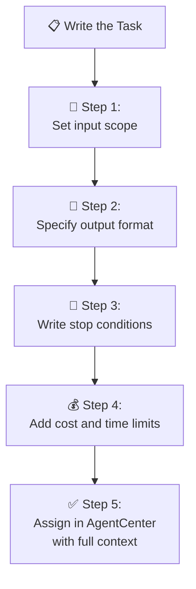

An agent given a vague task will do vague work for a very long time.

We had an agent running a "research and summarize" task on a document corpus. No output format defined. No limit on how many documents to check. No stop condition. It ran for 40 minutes before we killed it. The output was a 6,000-word wall of text that nobody read.

That's a scoping failure — and it's the most common reason agents waste money and produce unusable results.

## What Task Scoping Means for AI Agents

Task scoping is the act of defining three things before an agent starts:

1. **What the agent works on** — input scope, meaning exactly what data, files, or context it has access to
2. **What it produces** — output constraints, meaning format, length, structure
3. **When it stops** — stop conditions, meaning when "done" is actually done

Without all three, an agent will do one of two things: run too long and do too much, or stop early and deliver too little. Both are hard to catch until after the fact.

## Why Vague Tasks Fail

When a human gets a vague request, they ask a clarifying question. Agents don't. They pick an interpretation and run with it.

"Analyze the customer feedback from last week" could mean:
- Read all 300 tickets and produce a sentiment score
- Pick the top 10 complaints and write summaries
- Identify themes and write a structured report
- List the raw data with no analysis

An agent will pick one interpretation at random. That interpretation might not match what you wanted. You won't know until the task finishes.

Vague tasks also make cost control impossible. If you don't know what "done" looks like, you can't set a token limit. If you can't set a token limit, you find out about runaway spend at the end of the month.

## How to Scope an Agent Task in 5 Steps

### 1. Set Input Scope

Tell the agent exactly what it has access to — and explicitly exclude what it doesn't.

Bad: "Review the support tickets."
Good: "Review the 50 support tickets tagged `billing` created between May 1 and May 7."

The more specific the input, the less room for the agent to go off-course. If you're using AgentCenter, write the input scope directly in the task description. Your agent should never have to guess where to start.

### 2. Specify Output Format

Define what the output looks like before the agent starts. Length, structure, format — all of it.

Bad: "Write a summary."
Good: "Write a summary in JSON with three keys: `top_issues` (array of strings), `sentiment` (positive/negative/neutral), and `action_items` (array of strings). Max 200 words total."

If you need a Markdown report, say so. If you need exactly 5 bullet points, say 5. Ambiguous output requirements lead to output that looks complete but isn't usable.

### 3. Write Explicit Stop Conditions

A stop condition answers one question: when is this task done?

Bad: "Done when you've analyzed everything."
Good: "Done when you've checked all tickets in the input set. Stop after producing one JSON summary. Do not loop back or retry completed items."

Stop conditions prevent looping. Agents that revisit the same work, retry failed steps endlessly, or keep refining output past the point of usefulness are almost always missing a clear stop condition.

### 4. Add Cost and Time Limits

Every agent task should have a ceiling. In AgentCenter, you can monitor token spend per task from the [agent monitoring dashboard](/features/agent-monitoring). Use it.

Even with good scope, LLM behavior isn't deterministic. A task that took 800 tokens last week might take 3,000 tokens this week. Limits are a fallback, not a substitute for good scoping — but they matter.

A practical rule: set a cost limit at 2x your expected spend. If a task normally costs $0.05, cap it at $0.10. If it hits the cap, it should fail loudly, not silently.

### 5. Assign to the Right Agent with Full Context

Once you've scoped the task, the final step is assigning it in AgentCenter with all the context intact. Use the task description field to capture your full scope — input, output format, stop conditions — not just a title.

This matters for auditing too. When something goes wrong, you want a task log that includes what the agent was told to do, not just what it returned. The [task orchestration view](/features/task-orchestration) makes this visible for every task in your board.

## Common Scoping Mistakes

**Giving directions instead of destinations.** "Research this topic" is a direction. "Produce a 3-paragraph summary of the top 3 findings from this list of URLs, citing only those URLs" is a destination. Directions lead to exploration. Destinations lead to output.

**Forgetting exclusions.** What an agent should NOT do matters as much as what it should. If your agent should only read, say "do not write or modify files." If it should only use your data, say "do not query external APIs." Agents don't have implicit limits — only explicit ones.

**Writing scope for the average case.** Your scope will be tested by the edge case. A task with 100 normal inputs and 1 malformed one will fail on the malformed one if your scope doesn't account for it. Write your stop conditions to handle bad inputs: "If an input is malformed or missing required fields, skip it and log a warning. Do not retry."

**Confusing scoping with acceptance criteria.** Acceptance criteria answer "is this output good enough?" — that's for review. Scoping answers "what should the agent do?" — that's for task creation. Both matter. Neither replaces the other.

## Bottom Line

Most agent failures aren't model failures. They're scoping failures. The agent did exactly what it was told — you just didn't tell it the right things.

Write input scope, output format, and stop conditions before every agent task. It takes 5 extra minutes. It prevents hours of debugging and unexpected token spend.

---

*The best time to set this up is before your agents start failing. [Try AgentCenter free for 7 days](/pricing) — cancel anytime.*
