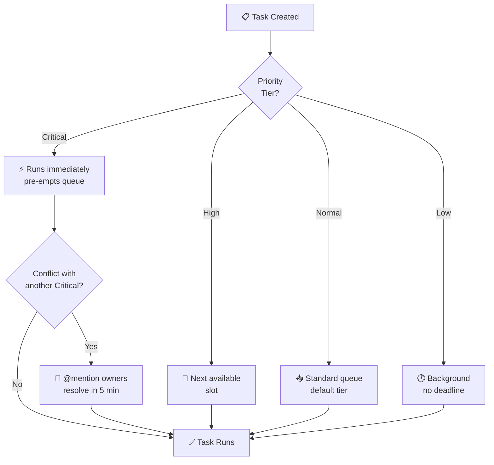

When your first agent went live, task priority wasn't a problem. You had one team, one queue, and a rough sense of what mattered.

Then you scaled to three teams and 12 agents. Now the data engineering team's nightly pipeline job is queued behind the growth team's A/B test report, and neither team knows why their tasks aren't running on schedule.

Shared agents without priority rules create a slow, invisible problem: work gets delayed, teams get frustrated, and the person who shouts loudest ends up moving their tasks to the front of the queue. That's not a system. That's chaos with extra steps.

Here's how to set AI agent task priorities across multiple teams before the arguments start.

## Why Priority Conflicts Happen

Most teams start with one implicit rule: first in, first out. That works fine when you're the only team. It breaks the moment two teams with different goals share the same agent.

The data team needs a pipeline to finish before 6am. The content team needs articles drafted by end of day. The sales team has a lead enrichment run they've been pushing for a week. Nobody agreed on what runs when.

The result: whichever team checks their queue most often wins. That's not sustainable when you have more than two teams on shared agents.

## Step 1: Map Your Agents to Teams

Start by listing every agent your organization uses and which teams depend on it. This sounds obvious, but most teams skip it.

For each agent, note:
- Which teams assign tasks to it
- What types of tasks those are
- Whether any tasks have hard deadlines (for example, a nightly report that must finish before 6am)

In [AgentCenter](/features/agent-dashboard), you can see all active agents and the projects they're assigned to. Use the Projects view to spot which agents are shared across multiple teams. That list is your starting point.

## Step 2: Define Agent Task Priority Tiers

Set four tiers. Keep them simple:

| Tier | Label | When to use |
|------|-------|-------------|
| 1 | Critical | Blocks a production system or external delivery. Must run now. |
| 2 | High | Business-day deadline. Needs to run in the next few hours. |
| 3 | Normal | Standard work. Can wait in queue. This is the default. |
| 4 | Low | Background or exploratory work. No deadline. |

Write these down and share them with every team that uses a shared agent. The descriptions matter more than the labels. "Critical" means nothing until you define what qualifies.

## Step 3: Assign Defaults Per Task Type

For each type of task your agents run, set a default tier.

For example:
- Nightly pipeline reports: Critical (must run before market open)
- Lead enrichment: Normal (batch, no hard deadline)
- A/B test summaries: High (needed before standup)
- Exploratory data pulls: Low (nice to have)

When teams create tasks in [AgentCenter's Kanban board](/features/task-orchestration), they pick the priority tier at creation time. Default to Normal so teams have to actively upgrade — not downgrade — from the baseline. This stops priority inflation where everyone marks their work High.

## Step 4: Set Per-Team Priority Limits

If every team can mark everything Critical, Critical loses meaning. Set limits.

Each team gets a fixed number of Critical slots per day. The number depends on your context, but a starting point is 2 Critical tasks per team per day. More than that, and they need to make a case.

Document this in your team's shared runbook and enforce it through team norms at first. Most teams self-correct when they see that abusing Critical just gets the limit tightened.

## Step 5: Build an Escalation Path

Even with clear rules, genuine conflicts will happen. The data team's nightly run and the growth team's pre-launch test can both be legitimately Critical at the same time.

Your escalation path should be:
1. Teams flag the conflict using @mentions in AgentCenter to loop in the relevant owners
2. Both parties agree on which task runs first — takes five minutes if the context is clear
3. If they can't agree, one designated decision-maker (usually a senior engineer or team lead) makes the call

Log the outcome. These conflicts are data. If the same two teams conflict every week, your default priorities are wrong and need updating.

## Common Mistakes

**Making everything high priority.** If 80% of tasks are marked High or Critical, you've lost the system. Do a monthly review of task distribution. If Normal isn't the most common tier, something's wrong with how teams are using the labels.

**Not reviewing the rules.** Priority rules go stale. New agents get added, new teams start using shared agents, and the original tier definitions no longer fit. Set a calendar reminder to review and update them quarterly.

**Allowing exceptions to become defaults.** "Just this once, bump mine to Critical" turns into every task being bumped. Track exceptions. If a team uses the exception path more than once a week, fold their use case into the default rules.

**Not assigning each agent a clear owner.** Priority conflicts get resolved faster when each agent has a named owner who can make the final call. AgentCenter lets you assign agents to specific team members. Use it. An unowned agent is one where the loudest person always wins.

## Bottom Line

Shared agents without priority rules aren't a technical problem — they're a coordination problem. Define the tiers before the first conflict, not after. Four tiers, written-down criteria, per-team limits, and a clear escalation path will handle 95% of cases. The other 5% need a human decision, and that's fine.

The teams that fight most about agent priorities are the ones that didn't write anything down. The teams that don't fight are the ones that did it in week two, not month six.

---

*The best time to set this up is before your agents start failing. [Try AgentCenter free for 7 days](/pricing) — cancel anytime.*
