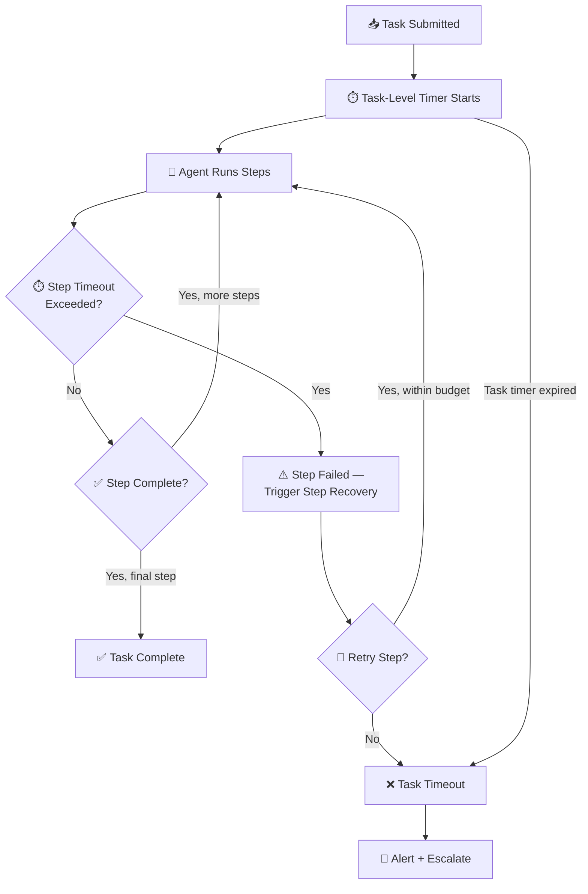
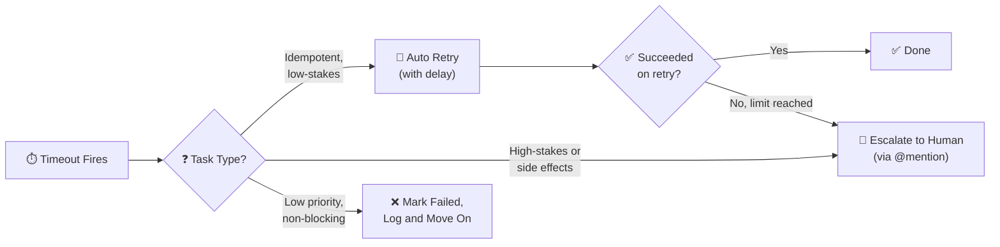

You deploy an agent on a Tuesday. It's supposed to summarize 200 documents in under an hour. By Thursday, it's still running. You haven't been alerted. It has processed 19 documents. The other 181 are stuck somewhere between step 3 and step 4 of a loop it has been circling for 36 hours.

This happens more than people admit. Agents don't crash cleanly. They stall. They loop. They make API calls that hang indefinitely. Unless you've set a timeout, your agent just keeps going, silently burning tokens and blocking downstream work.

Timeouts are one of those things you think you don't need until you really, really do.

## What "Timeout" Means for an Agent Task

A timeout for an agent task isn't just "stop after N minutes." You need to think at two levels:

**Task-level timeout**: How long is a single task allowed to run before it's marked as failed and handed to recovery logic?

**Step-level timeout**: How long can any single step inside the task run before it's interrupted?

Most teams only think about the first one. The second is where agents actually get stuck. One tool call, one API hit, one wait loop that never resolves. If a single step can block for hours, a 30-minute task-level timeout does nothing until it's too late.

## How to Define Sensible Timeouts

You can't pick timeout values without data. Start here:

**1. Measure actual task durations first**

Run 10 to 20 real tasks per type. Record start and end timestamps. Look at the p50 (median) and p95 (slowest 5%) of actual durations.

Don't pick a timeout based on how fast you hope tasks run. Use p95 multiplied by 1.5 as your starting value. If the p95 for your summarization task is 40 minutes, set the timeout to 60 minutes.

**2. Separate timeouts by task type**

A quick extraction task and a multi-step research task can't share the same limit. Create per-task-type budgets. Even a rough split helps: short-running (under 5 minutes), medium (5 to 30 minutes), long-running (30 minutes or more).

**3. Set step-level limits separately**

Any external API call needs a timeout. Any loop needs a max iteration count. Any wait for a response needs a hard cutoff. These aren't optional. They're the main reason agents get stuck without the task-level timer ever firing.

## Building the Recovery Workflow

A timeout without recovery is just a failure. The real work is deciding what happens after the timeout fires. There are three recovery paths, and you should define which applies to each task type before you deploy:

**Retry automatically**: Good for transient failures. The agent restarts after a short delay. Risky if the task has side effects — you don't want a billing agent to charge a customer twice because it retried from step 1 after completing step 3.

**Escalate to a human**: Good for tasks where partial completion creates problems. A human reviews what completed, then decides whether to restart, finish manually, or discard. This is the right call for high-stakes outputs.

**Mark as failed and log**: Good for low-priority tasks where it's cheaper to skip and move on than to retry. The task stays in a failed state for review, but nothing blocks on it.

## Real Example: Tracking Stuck Tasks in AgentCenter

If you're running agents through AgentCenter, the [agent monitoring dashboard](/features/agent-monitoring) shows task status in real time, including tasks running longer than expected.

Here's a setup that works:

1. You configure a recurring task that runs a content extraction agent every morning at 9am.
2. You define 30 minutes as the expected max duration for that task type.
3. AgentCenter's [task orchestration](/features/task-orchestration) flags tasks that exceed the window.
4. When a task hits the flag, a follow-up task is created and assigned to the human reviewer: "Agent stuck — manual check needed."
5. The reviewer sees the @mention in the task thread, reviews partial output, and decides whether to retry or close.

This only works if you've defined expected durations per task type in advance. That's the step most teams skip, and then wonder why agents keep running forever.

## Common Mistakes

**Setting the same timeout for all tasks.** A 10-minute cap kills long-running research tasks. A 4-hour cap lets short summarization tasks run three times longer than they should before anyone notices.

**Only tracking task-level timeouts.** If one tool call can block for hours, your 30-minute task-level timeout is irrelevant. Step-level limits matter.

**Retrying without checking for side effects.** If your agent wrote to a database, sent a webhook, or billed a customer at step 3, restarting from step 1 can cause duplicates. Log what completed before retrying.

**No notification when timeouts fire.** A timeout is a signal worth acting on. If it fires silently, you'll find out about the stuck task when a customer complains, not before.

## Bottom Line

Timeouts are the floor, not the ceiling. They don't guarantee agent reliability. They guarantee that unreliable agents fail fast instead of failing slowly. Set them per task type, build recovery paths before you need them, and make sure someone gets notified when they fire. The alert is the point.

---

*The best time to set this up is before your agents start failing. [Try AgentCenter free for 7 days](/pricing) — cancel anytime.*
