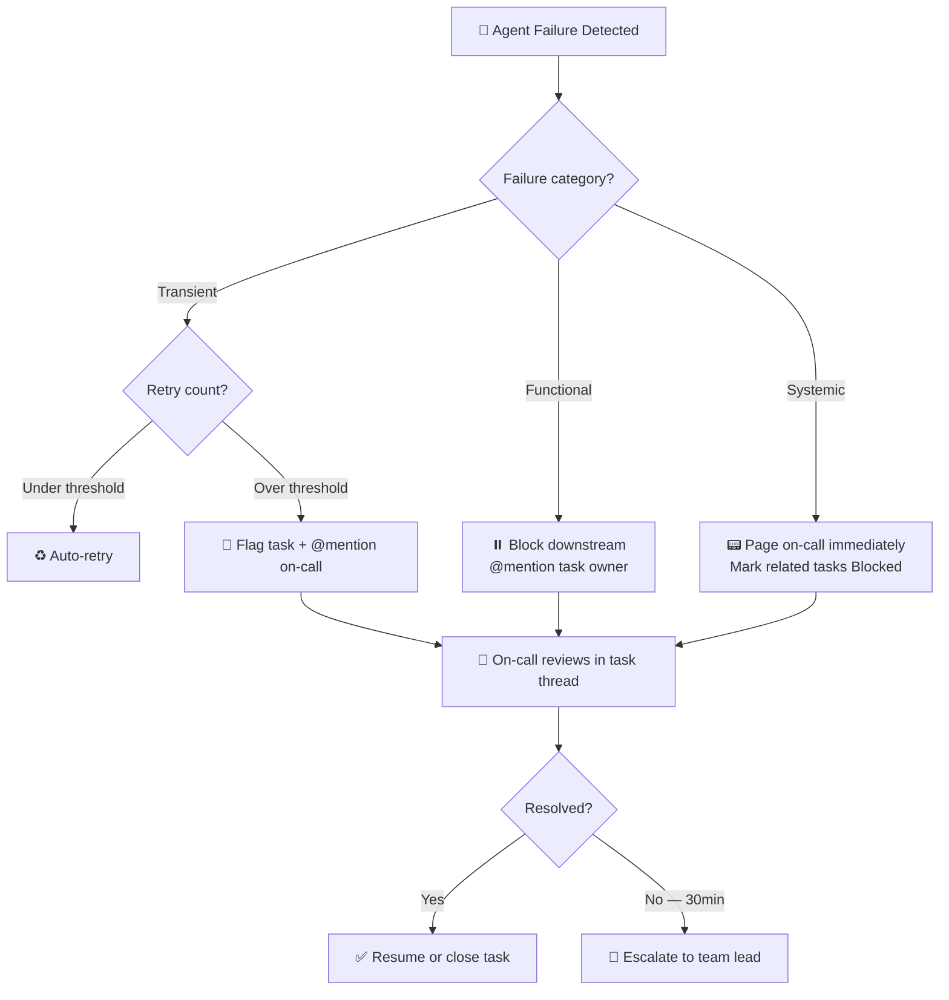

Most teams handle agent failures one of two ways: they either escalate everything (and burn out whoever's on point) or they escalate nothing (and let problems compound silently). Neither works past a handful of agents.

Escalation rules fix this. They're predefined thresholds that decide automatically whether a failure is something the agent should retry, something that needs a flag in the task thread, or something that requires a human to intervene right now.

Here's how to build them.

## What Escalation Rules Are

An escalation rule is a decision: given this failure type and these conditions, this is who gets notified and what action they take.

They're not just alerts. An alert says "something went wrong." An escalation rule says "this class of failure, at this frequency, goes to this person, with this expected response time."

The rule lives in your process: how you've configured your agent tasks, your monitoring setup, and your notification routing. In AgentCenter, this maps to task status, @mentions in task threads, and the activity feed.

## Step 1: Define Your Failure Categories

Not all agent failures are equal. Before setting thresholds, you need a working taxonomy of what can go wrong.

Three categories cover most cases:

**Transient failures**: the agent hit a rate limit, a timeout, or a network error. These are expected in any production setup. Retry handles them.

**Functional failures**: the agent completed but produced output that's wrong, incomplete, or off-spec. These need human review before anything downstream uses the result.

**Systemic failures**: the same failure repeating across multiple tasks or agents. This signals a broken prompt, a changed API, or a data issue upstream. Needs immediate human attention.

Write these down and agree on them with your team before touching any configuration.

## Step 2: Set Thresholds for Each Category

Thresholds turn categories into actual rules.

A reasonable starting point:

| Failure Type | Threshold | Action |
|---|---|---|
| Transient | 1–3 retries | Auto-retry, no alert |
| Transient (repeated) | 3+ consecutive failures | Flag task, notify on-call |
| Functional | Any | Block downstream, notify task owner |
| Systemic | 2+ agents hit same failure | Page on-call immediately |

Start conservative. If you don't know your baseline error rates yet, set thresholds low and tune after two weeks of real data.

## Step 3: Map Failures to a Named Responder

Every escalation path needs a named person at the end, not "the team."

Three levels work for most setups:

1. **Task owner**: the person who set up the task. Gets notified for functional failures on their tasks.
2. **On-call engineer**: whoever is covering agent incidents that shift. Gets notified for repeated transient failures or any systemic failure.
3. **Team lead**: the fallback if on-call doesn't respond within the SLA window.

In AgentCenter, the task owner is whoever created the task. @mention them directly in the task thread when something needs review. For on-call, connect the notification to your incident tool or use a shared @mention alias.

## Step 4: Wire Up the Escalation Flow in AgentCenter

In AgentCenter, escalation triggers live in a few specific places:

- **Task status**: When an agent task fails, move it to Blocked. This surfaces immediately in the Kanban view so nothing gets missed.
- **@Mentions**: Your agent's error handler can drop an @mention in the task thread with failure details. The mentioned person gets a notification and can respond in context.
- **Activity feed**: The [agent monitoring feed](/features/agent-monitoring) shows failure events in real time. Have on-call check it at the start of each shift.

For systemic failures, include a task comment listing all affected task IDs so the responder sees the full picture when they arrive.

## Step 5: Test the Path Before You Need It

Run a fire drill. Deliberately trigger a functional failure on a test task. Verify:

- The @mention fires to the right person
- The task shows as Blocked in the [task board](/features/task-orchestration)
- The responder sees failure context, not just a bare notification
- They know what action to take

Do this quarterly. Rotations change, people forget procedures, and a quiet test costs far less than a real incident that nobody knew how to handle.

## Common Mistakes

**Escalating everything.** If every failure pages someone immediately, pages stop feeling urgent. Reserve immediate escalation for systemic failures only.

**Vague ownership.** "Notify the team" means nobody. Every escalation path needs a named person.

**Setting thresholds and forgetting them.** Your baseline error rate changes as agents evolve. Review thresholds every 4–6 weeks during the first few months.

**No context in the escalation.** An @mention that just says "agent failed" is useless at 2am. Include the task ID, what the agent was working on, and the last error message or output.

## Bottom Line

Escalation rules convert reactive firefighting into a repeatable process. You decide in advance, while things are calm, exactly what happens when they're not. That decision made once and written down saves hours of confusion during an actual incident.

Start with three failure categories, name a responder for each, test the path, and tune from real data.

---

*The best time to set this up is before your agents start failing. [Try AgentCenter free for 7 days](/pricing) — cancel anytime.*
