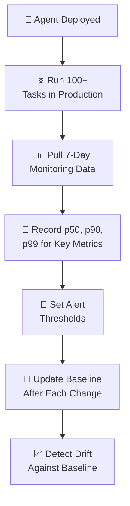

If your agent takes 18 seconds on average, that number means nothing unless you wrote it down three weeks ago. Agent performance changes. Models get slower. Tool dependencies creep. Context windows grow. Without a baseline, you're guessing at what normal looks like.

A baseline isn't an SLA. It's not a target. It's a measured snapshot of how your agent performs when it's working correctly. Everything else — alerts, drift detection, incident response — depends on having that snapshot.

Here's how to build one.

## What a Performance Baseline Is

A performance baseline is a set of measurements that describe your agent's normal behavior, taken at a specific point in time when the agent is running well.

It should cover at least three things:

- **Task completion time**: how long a typical task takes, end to end
- **Token usage per task**: how many tokens the agent consumes on average
- **Success rate**: what percentage of tasks complete without errors or retries

You might add output quality scores, cost per task, or tool call counts depending on what your agents do. Start with those three. They cover the most common failure modes.

## Step 1: Wait Until the Agent Has Stabilized

Don't capture a baseline during the first week of deployment. The agent hasn't settled yet. You'll have outliers from configuration changes, debugging sessions, and edge cases you're still working through.

Wait until the agent has run at least 100 tasks under normal production conditions. That gives you enough data to separate noise from signal.

## Step 2: Collect the Right Numbers

Pull metrics from the last 7 days of stable operation. You want:

- **p50 (median)**: what a typical task looks like — half run faster, half slower
- **p90**: what a slow-but-normal task looks like
- **p99**: the worst cases you'd expect under normal conditions

Averages hide tail latency. A p99 of 180 seconds matters even if the average is 22 seconds, because some tasks do hit that ceiling. You need to know that before you can set a meaningful alert.

In AgentCenter, the [agent monitoring dashboard](/features/agent-monitoring) shows per-agent performance data including task duration, error rates, and token usage. Pull the last 7 days and record those numbers.

## Step 3: Record It Where Your Team Can Find It

Put the baseline in the agent's runbook — not a private note, not a spreadsheet only you know about. Include:

- The date you captured it
- The agent version and any prompts in use at that time
- The three core metrics at p50, p90, and p99

A simple table works. The goal is that anyone on the team can look it up and know what normal looked like on a given date. That matters a lot when you're debugging at 11pm and someone else originally set up the agent.

## Step 4: Set Alert Thresholds Based on the Baseline

Now you have a starting point for monitoring alerts. A common starting point:

- **Warning**: p90 task time exceeds 2x the baseline p50
- **Critical**: task success rate drops below 90% of the baseline rate

These aren't fixed rules. Adjust them based on your tolerance. A report-generation agent that needs to be fast might use a 1.5x threshold. An overnight batch agent might use 3x. The point is that your thresholds are anchored to a real measurement, not a guess.

In AgentCenter, you can configure monitoring notifications against performance metrics. When an agent consistently runs over your threshold for 10+ consecutive tasks, you get notified — before users start noticing and before the slowness compounds into something worse.

## Step 5: Update the Baseline After Intentional Changes

Every time you change the agent, plan to capture a new baseline two weeks later. New prompt, different model, added tool, changed context — these all shift performance.

If you don't update the baseline, you'll get one of two problems: alerts firing constantly after a legitimate improvement you made, or alerts staying quiet through a real regression because the threshold is calibrated to old behavior.

The rule: intentional change to the agent means a new baseline capture after a two-week settling period.

## Common Mistakes

**Capturing the baseline too early.** Data from the first week includes setup noise. Wait for the agent to stabilize in production before you write anything down.

**Using averages only.** Average task time can look fine while the p99 is three times what it should be. Percentiles tell the full story.

**Never updating the baseline.** A six-month-old baseline in a system that's been through three model updates and two prompt rewrites is worse than no baseline. It gives you false confidence.

## Bottom Line

A performance baseline takes one hour to set up and saves you from weeks of reactive debugging. Measure the agent when it's working correctly, record the percentiles, and set your alerts relative to actual measured behavior.

The [agent monitoring panel](/features/agent-monitoring) in AgentCenter gives you the data. Your runbook holds the numbers. The alerts tell you when something has changed.

---

*The best time to set this up is before your agents start failing. [Try AgentCenter free for 7 days](/pricing) — cancel anytime.*
