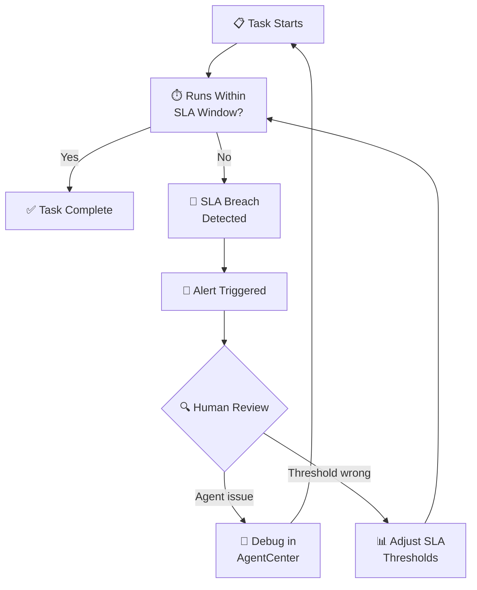

When a human misses a deadline, someone notices. When an agent misses one, you often don't find out until a downstream task fails or a user complains.

That's the SLA problem with AI agents. You know what the agent is supposed to do. You don't always know how long it's supposed to take, or what "done correctly" actually means. Without those definitions, you can't tell when something is wrong.

Setting SLAs for agent tasks isn't complicated. But most teams skip it entirely until they're in a firefight.

## What an Agent SLA Actually Covers

An SLA for an AI agent task has three parts:

- **Latency**: How long the task should take, end to end
- **Quality**: What the output should look like (or not look like)
- **Reliability**: What percentage of runs should succeed without human intervention

You don't need to define all three for every agent right away. Start with latency. It's the easiest to measure and the most obvious to breach.

## Step 1: Define Your Task Tiers

Not all tasks have the same urgency. A customer-facing agent that generates a reply in real time has a completely different profile than a batch summarization agent that runs overnight.

Group your agents by urgency:

- **Tier 1**: Real-time tasks. Latency matters in seconds.
- **Tier 2**: Near-real-time tasks. Latency matters in minutes.
- **Tier 3**: Background tasks. Latency matters in hours.

Most teams have two or three tiers. You probably don't need more than that.

## Step 2: Pick Your Metrics

For each tier, choose one or two metrics to track:

- **P95 completion time**: The time by which 95% of tasks should finish. Useful for latency.
- **Error rate**: Percentage of tasks that fail outright. Useful for reliability.
- **Retry count**: How many retries before a task completes. High retry counts often signal a problem before hard failures show up.
- **Output rejection rate**: If you have a human or automated review step, track how often outputs get rejected. It's a rough proxy for quality.

Pick metrics you can actually measure. If you have no way to know when a task finished, you can't track P95 completion time. Start with what your current setup exposes.

## Step 3: Set Thresholds from Real Data

Don't make up thresholds. Run your agents for a week and measure what they're actually doing.

If your summarization agent finishes 90% of jobs in under 4 minutes, set your latency SLA at 6 minutes. That gives you buffer for normal variance without hiding real problems.

A few starting rules that work in practice:

- Tier 1 latency: 2x your current median
- Tier 2 latency: 3x your current median
- Error rate ceiling: no more than 2% for Tier 1, 5% for Tier 3

Revisit these after 30 days. The first version is always wrong.

## Step 4: Wire Up Alerting

An SLA that doesn't trigger an alert when breached is just a note nobody reads.

In AgentCenter, you can use the [agent monitoring dashboard](/features/agent-monitoring) to watch task completion times and error rates in real time. When a task exceeds its expected window, it shows up in the activity feed as blocked or delayed. You can configure alerts from there so your team gets notified before a small delay turns into a bigger problem.

One thing worth building in: alert on trend, not just threshold. If your Tier 1 agent is running at 80% of its latency SLA consistently, that's worth investigating before it crosses the line.

## Step 5: Review and Adjust Monthly

SLAs for agents are not permanent. Your agent workload changes. Your prompts change. The models you use change.

Once a month, look at your breach rate. If you're breaching less than 1% of the time, your SLA might be too loose. If you're breaching 15% of the time, either your threshold is too tight or your agent has a real problem.

Both are useful signals. The goal isn't zero breaches. It's knowing which breaches matter.

## Real Example: A Document Processing Agent

Say you're running a document extraction agent. It reads incoming PDFs and outputs structured data. Your team receives about 200 documents a day.

You track it for a week. Median completion time is 45 seconds. Occasionally it takes 3 minutes on complex documents.

You set:

- Latency SLA: 90 seconds (P95 target)
- Error rate SLA: 3%
- Retry threshold: alert if any task retries more than twice

You wire up task tracking through the [AgentCenter features dashboard](/features) to log each run. Over the next two weeks, you notice a pattern: tasks that take over 90 seconds are almost always PDFs with more than 30 pages. You add a separate Tier 3 SLA for large documents.

Problem solved before it became a complaint.

That's what SLAs actually do. They make the invisible visible.

## Common Mistakes

**Setting thresholds from theory, not data.** "30 seconds feels right" is not a threshold. Measure first, then decide.

**Tracking only failures.** Slow-but-successful tasks are often the early warning sign. Don't wait for errors.

**One SLA for all agents.** Your real-time chatbot and your overnight report generator need different standards. Treat them separately.

**Never reviewing them.** An SLA you set 6 months ago doesn't reflect what your agents are doing today. Review monthly or after any significant prompt change.

## Bottom Line

SLAs for AI agents are a formalized version of expectations your team probably already has informally. Writing them down forces you to decide what "good" looks like. Measuring them tells you when you're not there.

Start with one agent. Pick one metric. Set one threshold. That's enough.

---

*The best time to set this up is before your agents start failing. [Try AgentCenter free for 7 days](/pricing) — cancel anytime.*
