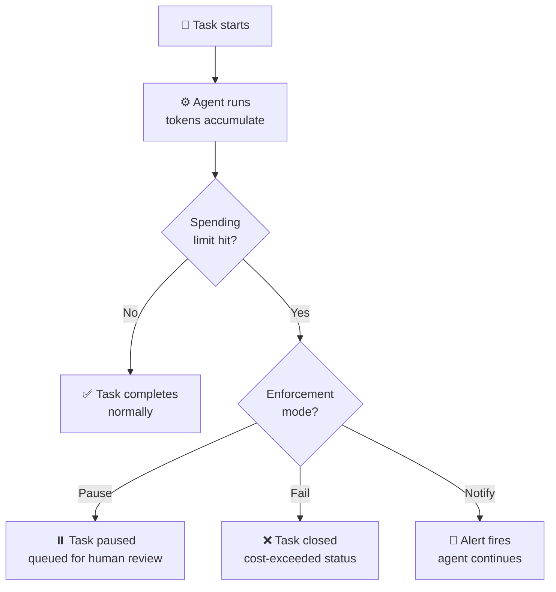

One of our agents spent $340 in four hours last month. No one noticed until the billing alert fired. The agent wasn't broken — it just ran a task on a dataset three times larger than expected and iterated without stopping. Alerts helped us catch the damage. A spending limit would have stopped it at $50.

This is the difference between monitoring and enforcement. Alerts tell you what happened. Spending limits stop it from getting worse.

Here's how to set them up.

## What a Spending Limit Actually Is

A spending limit is a hard cap on how much a single agent or task run is allowed to spend before it gets paused, stopped, or flagged for human review. It's distinct from an alert. An alert sends you a notification. A limit halts the work.

You can set limits at a few different levels:

- **Per task** — each individual task gets a budget ceiling
- **Per agent** — the agent accumulates cost across all tasks, up to a daily or monthly cap
- **Per project** — shared budget across every agent in a project

Most teams start with per-task limits because that's where runaway spending usually happens. A looping task or an unexpectedly large input can push one task to 50x the normal cost while every other agent stays fine.

## Step 1: Find Your Actual Baseline Cost Per Task

Before setting a limit, you need to know what normal looks like for each agent.

Pull your [agent cost data from AgentCenter's monitoring dashboard](/features/agent-monitoring). Look at the last 30 days and find:

- Average cost per task
- 90th percentile cost (the top 10% most expensive runs)
- Any outliers that spiked more than 3x the average

The 90th percentile number is your starting point. You want limits that stop genuine runaway spending, not block normal heavy tasks.

If an agent typically costs $0.80 per task with occasional spikes to $2.40, your initial limit should be around $5 to $8. Tight enough to catch a loop or an unexpectedly large context injection, loose enough to let legitimate expensive tasks finish.

## Step 2: Decide What Happens When the Limit Is Hit

This is the most important design decision before you configure anything. You have three choices:

1. **Pause the task** — agent stops mid-run, task stays in the queue for human review
2. **Mark as failed** — task closes with a cost-exceeded status, agent moves to the next task
3. **Notify and continue** — limit fires a notification but does not stop the agent (soft limit)

For production agents handling sensitive work, option 1 or 2 is safer. Option 3 is useful when you are still calibrating thresholds and do not want to interrupt running workflows.

## Step 3: Set the Limits in AgentCenter

In [AgentCenter's agent monitoring settings](/features/agent-monitoring), each agent has a cost threshold field under its configuration. Set your per-task cap and choose the enforcement mode (pause, fail, or notify).

For per-project caps, open the project settings and set a daily or monthly budget. AgentCenter tracks cumulative spend across all agents in the project and enforces the cap when the total is reached.

If you want task-level caps rather than agent-level caps, set the limit in the task template. Any task created from that template inherits the spending limit automatically.

## Step 4: Test the Limit Before Going Live

Before turning on hard limits for production agents, test them with a staging agent or a lower-traffic agent first. Run a task representative of your average workload and confirm:

- The limit fires at the right threshold
- The enforcement mode works as expected
- Your team receives the right notification

One thing that catches teams off guard: limits apply to token cost at the point of enforcement, not projected cost. If your agent calls a tool that returns a large context window before you expect it, the limit may fire earlier than you planned. Test with real inputs that reflect actual production conditions.

## Step 5: Review Limits After Every Major Prompt Change

Spending limits are not fire-and-forget. Every time you update a prompt, add a tool, or change the context your agent receives, its cost profile changes.

After any significant prompt change, check the cost baseline again before assuming old limits still fit. A prompt that adds a document retrieval step might push average task cost from $0.80 to $2.50. Your old $5 limit is suddenly too tight.

Set a recurring task in AgentCenter to review limits monthly alongside your cost dashboard, or flag limit reviews as part of your prompt deployment checklist.

## Common Mistakes

**Setting limits based on expected cost, not observed cost.** Agents almost always cost more than estimates during development. Pull real production data for at least two weeks before setting hard limits.

**Skipping the per-task level and only using per-agent or per-project caps.** Project caps are useful but they do not stop a single runaway task. They just stop new tasks from starting once the daily total is blown.

**Treating a soft limit like a hard limit.** If you choose "notify and continue," you are not capping spending. You are just getting alerted. Both have their place, but they are different things.

**Not updating limits after scaling agents.** If you go from 5 to 25 agents in a project, a $50/day project cap gets exhausted in an hour instead of end-of-day. Limits need to scale with your fleet.

## Bottom Line

Alerts tell you when something went wrong. Spending limits stop the damage from compounding. Set per-task caps based on observed 90th-percentile cost, test them before going live, and update them whenever your prompts or agent scope change.

---

*The best time to set this up is before your agents start failing. [Try AgentCenter free for 7 days](/pricing) — cancel anytime.*
