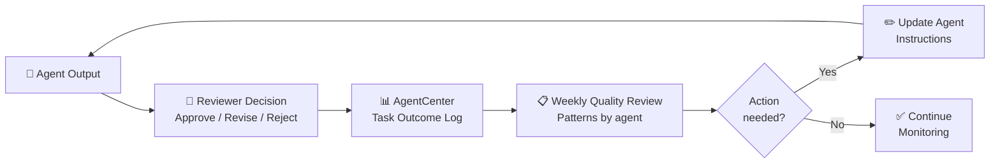

Your agents run. Tasks complete. Output shows up.

What you don't know is whether the output is getting better or worse over time. That's the gap. Without a feedback loop for AI agents, you're flying blind, and quality drift becomes invisible until a human escalates something that should have been caught weeks earlier.

This is how to fix that.

## What a Feedback Loop Means for AI Agents

A feedback loop for agents has three parts: capture, route, and act.

**Capture** means recording whether each agent output was good, needs revision, or failed outright. This isn't about logging errors. The agent might return a 200 OK while producing bad output. You need humans reviewing deliverables to record their verdicts.

**Route** means getting that feedback to the people or systems who can act on it. A rejected output that sits unread helps nobody.

**Act** means closing the loop: updating prompts, adjusting instructions, or retiring an agent that consistently underperforms.

Most teams only do the first part. They review outputs. They reject some. They move on. The pattern never changes.

## Step 1: Define "Good" Before You Collect Feedback

Before you can capture useful feedback, you need to define what you're measuring. Vague categories produce vague signals.

For each agent, write down:
- What a passing output looks like (format, completeness, accuracy)
- What a revision looks like (one or two things wrong but fixable)
- What a rejection looks like (fundamentally wrong, needs to restart)

This becomes your review rubric. It doesn't need to be a spreadsheet; a few lines in the agent's task description works. The goal is consistency: different reviewers should land on the same verdict for the same output.

In AgentCenter, you can attach this rubric to the task type so every reviewer sees it when they open a deliverable for approval.

## Step 2: Capture Reviewer Decisions in AgentCenter

AgentCenter's [approval workflows](/features/task-orchestration) let you route agent deliverables to a human reviewer before they're marked complete. Use this as your collection point.

When a reviewer opens a deliverable, they see the output and can:
- Approve it (mark complete)
- Request a revision (send back to the agent with notes)
- Reject it (flag as failed)

These decisions are recorded per task. Over time, you have a dataset: agent X produced 47 outputs, 38 were approved on first pass, 7 needed revision, 2 were rejected outright.

That's your quality baseline. Without it, you're guessing.

## Step 3: Route Feedback to the Right Person

Capturing verdicts is only useful if someone sees the patterns.

Set up a weekly digest. It doesn't have to be automated; a manual pull works fine. Track:
- Approval rate per agent
- Most common revision reasons
- Rejection patterns by task type

The [agent monitoring dashboard](/features/agent-monitoring) in AgentCenter shows task outcomes and completion data per agent. Use this alongside your reviewer notes to spot which agents are producing consistent problems.

Route the digest to whoever owns each agent. If no one owns it, that's the first problem to fix. Unowned agents don't improve.

## Step 4: Close the Loop

This is the step most teams skip. You have the data. You have the patterns. Now do something with it.

Common actions after a weekly review:

- **High revision rate on a specific output type**: Update the prompt with more explicit formatting instructions or constraints
- **Consistent rejection on edge case inputs**: Add handling for those inputs in the task definition or agent instructions
- **Approval rate dropping over two consecutive weeks**: Check if the agent's upstream data source changed, or if a model update affected behavior

In AgentCenter, you can update task instructions directly in the task definition. When you make a change, note the date so you can see whether the approval rate improves the following week.

## Step 5: Set a Cadence

Without a cadence, the loop stalls. Reviews happen ad hoc. Patterns accumulate unseen. Agents drift.

Pick one based on your output volume:
- **Weekly**: Good for teams with 5 to 15 active agents producing daily output
- **Monthly**: Fine for slower-moving workflows or agents running weekly tasks
- **Per 50 tasks**: Works well for high-volume agents where time-based cadences miss volume spikes

Put it on the calendar. Assign who pulls the data and who acts on it. That's the whole system.

## Common Mistakes

**Reviewing outputs without recording verdicts.** Reviewers approve or reject mentally but don't log it anywhere. You lose all signal. Make the decision inside AgentCenter so it's captured automatically.

**Treating all agents the same.** An agent writing first drafts of customer emails needs tighter quality tracking than one that formats internal data exports. Set review thresholds based on the stakes of each agent's output.

**Acting on one bad week.** A single spike in rejections might be a bad batch of inputs, not an agent problem. Look for trends over two or three weeks before changing anything.

**Improving the prompt without versioning the change.** You update the prompt, the approval rate goes up, but two months later you can't remember what changed. Keep a changelog in the task description: one line per change with the date.

## Bottom Line

Agents don't get better on their own. They drift, get worse at edge cases, and produce subtly wrong outputs while your dashboard shows everything green. A feedback loop isn't a heavy process. It's a weekly habit of pulling reviewer verdicts, spotting patterns, and updating instructions. Teams that do this consistently end up with agents they can trust. Teams that don't end up with agents that require constant babysitting.

---

*The best time to set this up is before your agents start failing. [Try AgentCenter free for 7 days](/pricing) — cancel anytime.*
