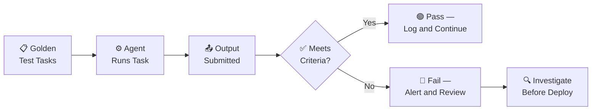

Your agent worked fine last week. Then someone updated the underlying model. Or tweaked the prompt. Or an upstream API quietly changed its response format. Now the agent is producing bad output and nobody noticed for two days.

That's the problem a golden test suite solves.

## What Is a Golden Test Suite?

A golden test suite is a small set of representative tasks with known-good expected outputs. You run these tasks against your agent on a schedule or before any deployment. If outputs meet expectations, you proceed. If they don't, you investigate before anything reaches production.

Unlike unit tests on deterministic code, you're not testing for exact string matches. You're testing for output quality signals: Did the agent include the required fields? Did it stay within scope? Did it avoid the failure patterns you've seen before?

This is not the same as a monitoring dashboard. Monitoring tells you the agent ran. A golden test suite tells you the agent ran *correctly*.

## How to Build One

Here's a 5-step process to set up a working golden test suite for your agents.

### Step 1: Pick 5 to 10 Representative Tasks

Pull from real production tasks your agent has already handled. You want variety — common cases, edge cases, and tasks that have caused problems before. If your agent summarizes customer support tickets, grab a few from each category: billing, technical, feature requests, and one or two that stumped it previously.

Start small. Five tasks you trust beats 50 tasks nobody reviews.

### Step 2: Define What "Good" Looks Like Per Task

For each task, write down what a passing output looks like. Not an exact match — a checklist. For a summarization agent, passing might mean:

- Includes the issue category
- Under 100 words
- No invented details not in the source ticket
- Sentiment matches the original ticket

Write these criteria down before you run the tests. If you can't define what good looks like, you can't catch what bad looks like.

### Step 3: Set Up a Dedicated Project in AgentCenter

Create a separate project in the [AgentCenter agent dashboard](/features/agent-dashboard) specifically for your golden tests. Name it clearly — something like `agent-name — Golden Tests`. This keeps test runs out of your main task history and makes results easy to review in isolation.

Add your test tasks as [recurring tasks](/features/task-orchestration) on whatever schedule works for your team — daily, or triggered before every deployment. Recurring tasks on the Pro plan handle the scheduling automatically. Your agents pick them up and submit deliverables the same way they do for real work.

### Step 4: Review Outputs After Every Run

Don't automate this away entirely. Have someone read the outputs each time the suite runs. Automated checks catch format failures — a missing field, an output that's too long, a JSON parse error. Quality drift — where the output is technically valid but subtly worse — needs a human eye.

Build this into your team's routine. Ten minutes of output review after the suite runs. If you're on a daily schedule, that's under an hour a week to catch problems that would otherwise cost hours to debug in production.

Use the deliverable review feature in AgentCenter to mark each test output as approved or flagged. This gives you a running record of when quality changed and makes it easy to spot patterns across multiple runs.

### Step 5: Update the Suite When the Agent Changes

The golden test suite only works if it stays current. When you change the agent's scope, its prompt, or the underlying model, add new test cases that cover the change. Remove old cases that no longer reflect what the agent does.

Treat the test suite like any other documentation — review it in the same week you make any significant agent change.

## Real Example: A Competitor News Summary Agent

Say you run a research agent that monitors competitor news and produces a weekly summary for your product team. Your golden test suite has six tasks: two standard news items from the last quarter, one irrelevant item the agent should filter out, one very long article that tests how the agent handles truncation, and two edge cases pulled from past failures.

Before every Monday run, the test suite fires in a separate AgentCenter project. If the irrelevant item ends up in the summary, you know the filter broke. If the truncation case is missing key points, you know something changed in prompt handling. You catch it Sunday night instead of Monday morning when your product team reads a summary that's wrong.

## Common Mistakes

**Testing for exact output matches.** Agent outputs aren't deterministic. If you fail the test every time a word changes, you'll tune out every alert. Test for structural properties — required fields, output length, absence of hallucinated content — not exact strings.

**Only covering happy-path inputs.** Three easy cases isn't a test suite. Include the inputs your agent has actually struggled with. Every incident you've had should leave behind a permanent test case.

**Not updating after prompt changes.** The most common reason golden tests stop catching problems is the team updates the agent without updating the test criteria. The suite then catches stale expectations, not actual failures. Update test criteria the same day you change the agent.

**Running tests only before big deployments.** Run them on a schedule too. Production environments shift without code deployments — API schema updates, upstream data format changes, model provider updates on their end. A daily run catches these.

## Bottom Line

A golden test suite takes a few hours to build and about 10 minutes per day to maintain. In exchange, you catch the silent quality failures that don't appear as errors — they show up as customers noticing something is off before your team does.

Build it before you need it.

---

*The best time to set this up is before your agents start failing. [Try AgentCenter free for 7 days](/pricing) — cancel anytime.*
