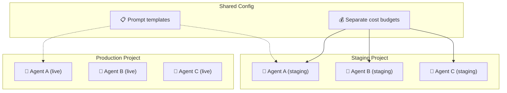

Your agents work fine in development. Then you push to production and something breaks that you've never seen before. A rate limit. A timeout. An API response that's slightly different from what you tested against. The problem isn't the agent — it's that you never had a real staging environment for AI agents.

Here's how to build one.

## Why Agents Need a Staging Environment

Code staging is standard. Agent staging usually isn't.

The difference: agents are stateful, expensive to run, and they interact with real external systems. A rogue test run can burn through API credits, hit production databases, or send real notifications to real customers. That's a different class of risk from a bad unit test.

You need a staging environment that mirrors production as closely as possible — but stays isolated from it.

## What to Isolate

Before building anything, be clear about what you're separating.

**API keys and credentials.** Production keys stay in production. Staging agents get their own keys with their own rate limits. If a test run burns through the staging quota, it doesn't touch anything live.

**Cost tracking.** You want to see what your agents cost before they run at full scale. Mixing staging and production cost data makes this impossible to interpret.

**Data sources.** If your agents read from a database or CRM, staging agents should read from a copy or test fixture, not live data. One misfire in staging shouldn't corrupt production records.

**External integrations.** If your agents send emails, post to Slack, or write to a ticketing system, staging should point to test accounts or sandboxes. Not the real thing.

## Setting Up Staging in AgentCenter

The cleanest approach is a separate project in AgentCenter for your staging environment. Here's how to structure it.

**Step 1: Create a staging project.** In your AgentCenter [agent dashboard](/features/agent-dashboard), create a new project. Name it clearly — "Agents (Staging)" or something that's impossible to confuse with production at a glance.

**Step 2: Clone your production agents.** Don't rebuild staging agents from scratch. Clone each one into the staging project. This means you're testing the same prompt, same tool calls, same config — just with different credentials and data connections.

**Step 3: Swap credentials.** Replace every production API key with staging equivalents. In AgentCenter, credentials are scoped per project, so there's no risk of a staging agent accidentally running with a live key.

**Step 4: Set a cost budget.** Use AgentCenter's [agent monitoring](/features/agent-monitoring) to cap spending on the staging project. Set a monthly or per-task limit. This protects you from runaway test loops eating your real token budget.

**Step 5: Point to staging data.** Update each agent's data source config to use a test database, mock API, or fixture file. If you don't have staging data yet, even a small representative sample is enough for smoke testing.

## Running Tests in Staging

Once the environment is ready, run a small set of tasks before every production change.

Pick inputs that mirror production patterns — not real user data, but representative ones. Check that outputs look correct. Watch the cost per task. Confirm you're not hitting rate limits. If you've added a new agent or changed a prompt, test it end-to-end in staging before it touches anything live.

AgentCenter's Kanban board makes this visible in real time. You can see every staging task in progress, check status, and spot failures before they reach users. If something fails, you catch it here, not in production.

## Promoting to Production

Staging is only useful if you act on what you find.

When a staging run passes, the promotion checklist is short:

1. Swap credentials from staging keys to production keys
2. Re-verify the data source connection points to live data
3. Confirm the agent config matches exactly what ran in staging
4. Move the agent to your production project in AgentCenter

If it fails in staging, you've just saved yourself a production incident and probably a late-night debugging session.

## Common Mistakes

**Using the same API key for staging and production.** The most common error by far. One heavy staging test run can exhaust a shared rate limit at exactly the wrong moment.

**Testing with production data.** Even in a staging environment. If the agent writes anything back, it can corrupt live records. Always use a copy or a mock.

**Skipping staging for "small" changes.** A one-line prompt edit can change agent behavior in ways you don't expect. Staging applies to prompt changes just as much as code changes.

**No cost cap on staging.** Loop bugs in staging can burn through significant API credits before anyone notices. Set a budget and treat it like production discipline.

**Not testing the full pipeline.** It's easy to test Agent A in isolation. But if your pipeline passes output from Agent A to Agent B, test the handoff too. Failures often happen at the seam between agents, not inside any single one.

## Bottom Line

A staging environment for AI agents doesn't need to be elaborate. A separate project, cloned agents, isolated credentials, and a spending cap gets you most of the protection you need. The setup takes an afternoon. Finding the same bugs in production costs much more than that.

---

*The best time to set this up is before your agents start failing. [Try AgentCenter free for 7 days](/pricing) — cancel anytime.*
