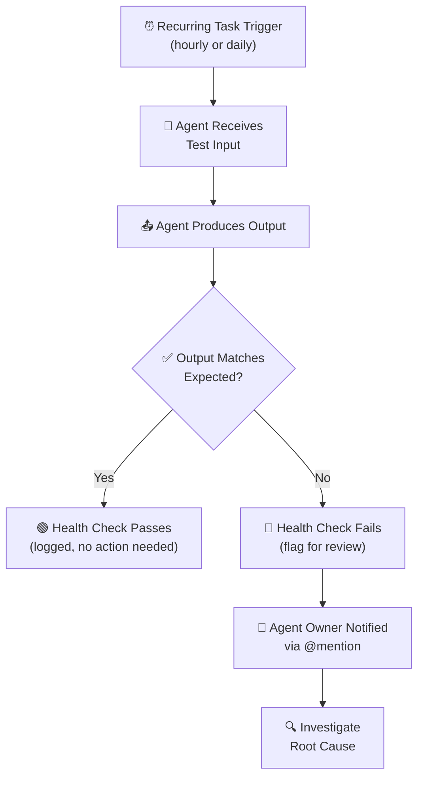

Monitoring catches failures after they happen. A health check routine catches them before they become visible.

There's a difference between watching an agent and testing it. Your monitoring setup alerts you when an agent errors out or hits a timeout. That's reactive — you find out the agent broke after it broke. A health check routine is proactive: you verify the agent is actually working correctly before it gets assigned real work.

If you've ever had an agent that passed all status checks but produced bad output for two days before anyone noticed, this is what you're missing.

## What a Health Check Routine Actually Is

A health check routine is a scheduled process that runs test tasks against your agents, validates the outputs, and flags anomalies before they reach your real workload. Think of it like a smoke test that runs automatically every few hours.

It's not the same as a monitoring dashboard showing green lights. Green status means the agent is running. A health check confirms it's running *correctly*.

For most teams, the minimum viable health check covers three things:

1. **Functional correctness** — does the agent complete a known task and return the expected output?
2. **Performance** — is the response time within an acceptable range?
3. **Cost** — is the agent consuming tokens at the expected rate?

## Step 1: Define a Canonical Test Task for Each Agent

For every agent in your fleet, write one or two test inputs where you already know the expected output. These shouldn't be trivial — pick inputs that actually exercise the agent's main function.

For a document summarization agent, your test input might be a 200-word passage with a known one-paragraph summary. For a data extraction agent, it could be a structured record with specific fields you expect returned.

Store these test cases somewhere your whole team can see. In AgentCenter, create a dedicated project or board just for health check tasks so they stay separate from production work.

## Step 2: Set Up Recurring Tasks to Run the Checks

AgentCenter's recurring task feature (available on Pro and Scale plans) is the right tool for automating health checks. Create a recurring task for each agent test case and set the frequency based on how critical the agent is — every hour for agents handling high-volume production work, daily for lower-priority ones.

Each recurring task should include:

- The test input as task context
- A clear expected output (or output criteria) in the task description
- The agent assigned to the task
- A reviewer assigned to your team lead or agent owner

When the health check runs, the output appears in AgentCenter's activity feed. If it looks wrong, it's flagged for review before any real tasks reach that agent.

## Step 3: Validate Outputs, Not Just Completion

This is where most teams stop short. They set up the recurring task but never add output validation. Running a test input and checking that the agent "completed" isn't a health check — it's a liveness check.

Real validation means comparing the output to what you expect:

- **Exact match** for structured data extraction tasks
- **Format check** — does the output include required fields?
- **Length or content range** — is the summary between 50 and 150 words?
- **Manual spot-check** — if automated validation isn't feasible, route the task to a human reviewer on a fixed schedule

Write your expected output criteria directly into the AgentCenter task description. This gives reviewers a clear standard instead of a gut feeling.

## Step 4: Route Failures to the Right Person

Health check failures need to go somewhere. If no one is watching for them, they're pointless.

Use @mentions inside recurring tasks to notify the agent's owner when output is flagged. Keep the escalation path simple: a failing health check triggers an @mention to the owner, who acknowledges within a window that fits your SLA.

Set this up once per agent. Once the pattern is in place, adding a new agent to your health check routine takes about five minutes.

## Step 5: Track Pass Rates Over Time

Running health checks is only half the value. Tracking them over time is where you catch gradual drift.

An agent that passes health checks 99% of the time one month and 91% the next is telling you something changed. The change might be subtle — a model update, a prompt edit, a shift in input format from an upstream system.

AgentCenter's [agent monitoring](/features/agent-monitoring) surfaces task history, completion rates, and error patterns per agent. Filter a specific agent's task history to health check tasks and you'll see immediately if the pass rate is trending down.

You don't need a separate dashboard. The data is already there if you label your health check tasks consistently.

## Common Mistakes

**Running health checks too infrequently.** Daily health checks on a high-volume agent mean you could have a failing agent for 23 hours before you know. Match check frequency to how much damage a failing agent can do in that window.

**Testing the wrong thing.** Some teams pick test inputs that are too simple. If the test input never triggers the agent's actual logic, the health check is worthless. Use a real representative task.

**Not updating test cases when agents change.** When you change an agent's prompt or scope, update the health check test cases at the same time. Stale tests give you false confidence.

**Mixing health check tasks with production tasks.** Keep them in a separate board in AgentCenter. You want to see health check status at a glance without scrolling through production work.

## Bottom Line

Monitoring tells you what broke. Health checks tell you what's about to break.

Setting up recurring health check tasks in AgentCenter takes less than an hour per agent. Once it's running, you'll catch output degradation, silent failures, and regressions after prompt changes before your downstream systems ever see the bad output.

Check which [AgentCenter features](/features) your plan includes, then start with the agents handling the most tasks per day.

---

*The best time to set this up is before your agents start failing. [Try AgentCenter free for 7 days](/pricing) — cancel anytime.*
