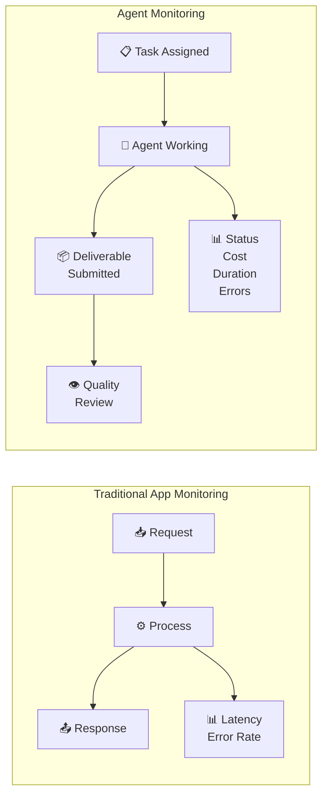

Most teams set up monitoring after something breaks. That's backwards. By the time you're scrambling to figure out why your research agent stopped producing results, you've already wasted hours of compute and probably missed a deadline.

Here's how to instrument your agents before anything goes wrong.

## Why Agent Monitoring Is Different from App Monitoring

Standard app monitoring asks: did the request succeed? Did the response time spike? These are useful questions. But agents aren't request-response systems.

An agent can "succeed" from a technical standpoint while producing completely wrong output. It can run for 20 minutes, make 40 API calls, and return a deliverable that misses the actual task. No exception thrown. No 500 error. Just bad work.

Agent monitoring has to track quality and intent, not just availability.

## Step 1: Define What "Working" Looks Like

Before you write a single line of monitoring code, answer these questions for each agent:

- What is the expected output format?
- How long should a normal task take?
- What's the maximum acceptable cost per task?
- What does "blocked" look like for this agent?

Write these down. If you can't answer them, you'll build monitoring that catches the wrong things.

For example: a summarization agent should complete in under 90 seconds and cost less than $0.05 per run. A research agent might run for 10 minutes and cost $0.40. Those are different baselines. Treating them the same is how you miss real problems.

## Step 2: Instrument Status Transitions

Every agent should report its state at each transition point. At minimum:

1. Task received
2. Processing started
3. External call made (API, search, DB)
4. Processing complete
5. Deliverable submitted

If you're using [AgentCenter's agent monitoring](/features/agent-monitoring), this is built in. The dashboard shows real-time status: online, working, idle, or blocked. You can see exactly where in a pipeline an agent stopped.

If you're building your own: at minimum, emit a log event at each transition with agent ID, task ID, timestamp, and state.

## Step 3: Set Thresholds, Not Just Alerts

Most monitoring tools make it easy to alert on errors. The hard part is alerting on slow-but-wrong agents.

Set three types of thresholds for each agent:

- **Duration threshold:** If a task runs more than 2x the expected time, flag it
- **Cost threshold:** If a single task costs more than $X, page someone
- **Silence threshold:** If an agent hasn't reported a heartbeat in N minutes, assume it's stuck

These aren't fire-and-forget alerts. Review them weekly for the first month and adjust. Your initial estimates will be wrong.

## Step 4: Add a Deliverable Review Gate

Monitoring agent behavior gets you halfway there. The other half is monitoring agent output.

Build a review step into every pipeline. Even a simple thumbs-up/thumbs-down from a human reviewer catches problems that no metric will surface. In AgentCenter, every agent can submit deliverables to an approval queue. The lead orchestrator or a human reviewer checks before the next task starts.

This isn't bureaucracy. It's how you catch the agent that's technically completing tasks but producing work that doesn't match the brief.

## Step 5: Track Costs Alongside Quality

Cost without quality is meaningless. Quality without cost is unsustainable. Track both on the same dashboard.

For each agent, track:

- Tokens used per task
- Cost per task
- Task completion rate
- Error rate
- Average task duration

If an agent's cost goes up 40% but its output quality stays the same, something changed in the prompt or model. If quality drops and cost stays flat, the agent is hitting fewer edge cases or cutting corners.

You want to catch that correlation early.

## Common Mistakes

**Monitoring the framework instead of the agent.** LangChain logs tell you about chain execution. They don't tell you if the agent's output was any good.

**Setting alerts you'll ignore.** If you get 50 alerts a day and most are noise, you'll start ignoring all of them. Start with 3-5 high-signal alerts and expand only when you trust them.

**Not tracking blocked state.** An agent that's waiting for input isn't failing — it's blocked. That's a different problem. Make sure your monitoring distinguishes between the two.

**Skipping the review gate on "low stakes" tasks.** Every agent has a first bad day. The review gate is cheapest when stakes are low.

## Bottom Line

Set up monitoring before you need it. Define baselines per agent. Track status transitions, costs, and output quality together. Add a deliverable review gate even for internal workflows.

The teams I've seen do this from day one spend a fraction of the time debugging compared to teams that instrument reactively. It's not glamorous work, but it's the difference between knowing what your agents are doing and just hoping they're doing it right.

_The best time to set this up is before your agents start failing. [Try AgentCenter free for 7 days](/pricing) — cancel anytime._
