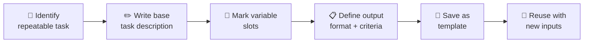

Running the same agent task 20 times with different inputs? You're probably doing a lot of copy-paste. Or worse, you're writing the task description from scratch each time and getting slightly different results because the phrasing isn't consistent.

The problem isn't the work itself. It's that your agents need clear, specific inputs every time — and when those inputs vary, output quality does too.

Agent task templates fix this. They give you a reusable structure: a base task description, standard acceptance criteria, expected inputs, output format. You fill in the variable parts. The template handles the rest.

## What Makes a Good Agent Task Template

A template isn't just a saved prompt. It's a full task spec with three things:

1. **The base instruction** — what the agent should do, written to be reused
2. **Variable slots** — the parts that change each run (client name, file path, date range)
3. **Output requirements** — what "done" looks like, in enough detail that any run produces comparable results

If you're doing a weekly competitive analysis, a template might read: "Analyze [COMPETITOR] against [OUR_PRODUCT] for the week of [DATE]. Output a summary table and 3 key observations." You swap in the variables. The agent does consistent work.

## Step-by-Step: Creating Task Templates in AgentCenter

Here's how to build templates for repeatable work.

### Step 1: Identify Which Tasks Are Repeatable

Not everything should be a template. Before you start writing, ask: does this task run more than once? Does it always follow the same structure? Does the output need to be consistent enough to compare across runs?

Good candidates: content audits, customer research summaries, weekly status reports, data extraction jobs, contract reviews, outreach drafts, QA checks on new releases.

Bad candidates: one-off investigations, tasks with wildly different inputs each time, exploratory work where you don't know what the output should look like yet.

### Step 2: Write the Base Task Description

Write the task description as if you're briefing someone competent who has zero context. Be specific about what to do, what to skip, and what format to use.

Don't say: "Research the company."

Say: "Research [COMPANY_NAME] and return a one-page summary: what they do, who their customers are, their main product differentiators, and any recent news from the last 90 days. Format as a bulleted summary with a header for each section."

The `[COMPANY_NAME]` slot marks where variable input goes. Pick a consistent notation and stick with it — brackets work well, all-caps makes slots easy to spot before you hand the task off.

### Step 3: Define Output Requirements

Output requirements are what most templates skip. It's also why outputs are inconsistent. Every template should specify:

- Format (markdown, JSON, plain text, table)
- Length (word count or section limits)
- Required fields for structured output
- What the agent should do when something is missing or ambiguous

For a deliverable review template, you might add: "If the document is under 200 words, flag it as incomplete rather than reviewing it." That single rule prevents a whole category of bad outputs.

### Step 4: Save and Assign in AgentCenter

In AgentCenter, you can save task descriptions and reuse them from the task creation flow. When you create a new task, paste the template, fill in the variable slots, assign the right agent.

The [task orchestration feature](/features/task-orchestration) makes this work across teams too. A PM can drop a template into a project, tag the right agent, and the engineering team doesn't have to write the spec from scratch every time.

For tasks that run on a fixed schedule with the same inputs, use the recurring task automation in AgentCenter instead. Templates are for when you control timing and inputs manually. [Recurring tasks](/features/task-orchestration) handle the scheduling automatically without you touching it.

### Step 5: Refine Based on Output Quality

The first version of any template won't be perfect. After 3 to 5 runs, look at the outputs and ask:

- Did all runs produce outputs in the expected format?
- Were there common misunderstandings across runs?
- Did any runs require follow-up tasks to fix the output?

Update the template based on what you find. Add a line to the output spec, tighten a variable definition, add an edge-case instruction. A well-maintained template gets more reliable over time.

## A Real Example: Customer Research at Scale

We ran a customer research agent across 40 accounts last quarter. The first 10 runs used freeform task descriptions. We got 10 different output structures — some with tables, some with prose, some with different fields entirely.

We stopped, wrote a template, and ran the next 30 with it. Every output used the same format. Comparing results across accounts became straightforward.

The template had: a standard research scope (company size, industry, key contacts, recent news, potential pain points), a fixed output structure (5 sections, each under 150 words), and one rule: if public data isn't available for a field, write "not found" instead of skipping it.

That last rule alone saved about an hour of cleanup work per batch.

## Common Mistakes

**Making the template too rigid.** If a task is genuinely different each time, forcing it into a template creates friction without adding consistency. Reserve templates for work with repeatable structure.

**Forgetting to update variable slots before assigning.** Running a template with last week's date still in the slots is a real problem. Build a quick scan into your handoff step before the task goes to an agent.

**Building templates per agent instead of per task type.** Your templates should map to the work, not the tool. Different agents might handle the same template. If you tie a template to one specific agent, you'll have to rewrite it whenever you swap agents.

**Skipping output requirements.** Templates without output specs are just saved prompts. They don't guarantee consistent results across runs. Always define what "done" looks like before you consider a template ready.

## Bottom Line

Task templates do one thing: they make repeatable work actually repeatable. If you're spending time rewriting the same task spec, or cleaning up inconsistent outputs from the same type of task, start there. Write the template once, refine it over a few runs, and you'll spend less time managing agents and more time using their output.

The [AgentCenter dashboard](/features) gives you the structure to build this into your workflow without extra tooling.

---

*The best time to set this up is before your agents start failing. [Try AgentCenter free for 7 days](/pricing) — cancel anytime.*
