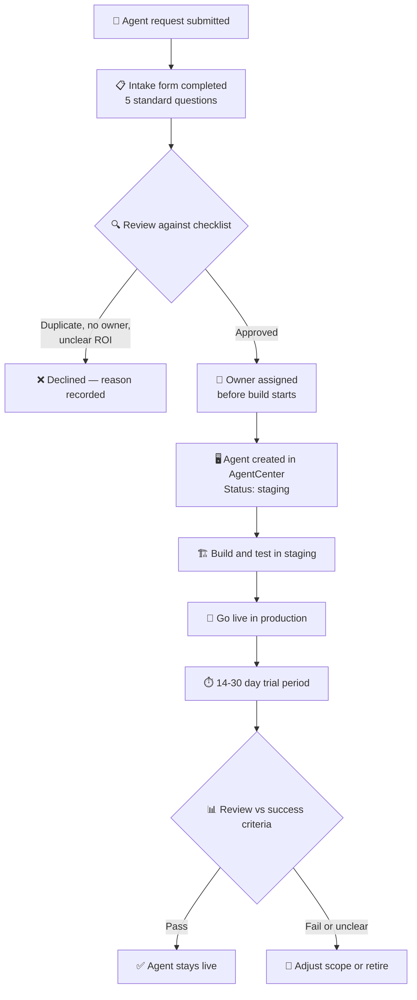

We had six agents at the start of the year and fifteen by March. Four had no clear owner. Two were doing roughly the same thing. Nobody could say for certain when three of them were last checked. The intake process for adding a new agent was: someone asked, someone built it.

That's the problem an agent intake process fixes. Without one, every new request turns into an unreviewed deployment. With one, you know exactly what each agent is supposed to do, who owns it, and what happens if it fails.

## What an Agent Intake Process Is

An intake process is the defined path from "we want an agent for X" to "yes, build it, here's who owns it." It's not a lengthy approval chain. For most teams, it's five questions, a 30-minute review, and a named owner.

The goal is to catch bad ideas before you invest time building them, and to make sure every new agent starts with the information you'll need when something goes wrong six weeks from now.

## How to Set It Up

### Step 1: Define What Counts as a New Agent Request

Not every automation idea is an agent. Decide on your threshold. A working definition that fits most teams: if a task requires an LLM to reason over open-ended inputs and produce output a human would normally review, it qualifies.

Write this down. One sentence is enough. Paste it wherever your team tracks work.

### Step 2: Create a Standard Request Form

Every new agent request answers the same five questions:

1. What problem does this agent solve, and how often does that problem come up?
2. What does a good output look like? What does a bad one look like?
3. Who will own and monitor this agent?
4. How often will it run, and what does each run cost at the expected scale?
5. What does success look like in 30 days?

A shared doc works fine. A task in your project management system works too. The format matters less than the fact that everyone answers the same questions.

### Step 3: Review the Request

Someone needs to say yes or no. In a small team, that's usually the engineering lead. In a larger team, it's whoever manages the agent fleet.

Before approving, check four things:

- Is there already an agent that does this, or one that could be extended to do it?
- Has an owner agreed to be responsible for it, including handling failures?
- Is the expected cost in proportion to the expected value?
- Can the agent be tested safely in staging before going near production data?

If the answer to any of these is no, don't approve it until it is.

### Step 4: Assign an Owner Before Building Starts

This is the step most teams skip. Ownership gets assigned after the agent is live, usually when something breaks and nobody steps up. By then the original builder may have moved on.

Name the owner during the review step. The owner is the person who monitors performance, handles failure escalations, and decides when the agent should be retired. If nobody volunteers for that role, that's a clear signal not to build the agent.

### Step 5: Set the Agent Up in AgentCenter from Day One

When you approve a new agent, create it in your [AgentCenter dashboard](/features/agent-dashboard) immediately, even before development starts. Add the owner as the assigned team member and set the initial status to "staging."

This gives the whole team visibility from the start, not just after launch. It also means your [agent monitoring](/features/agent-monitoring) records start from the first test run, so you have actual baseline data when the agent goes live rather than trying to reconstruct it later.

### Step 6: Define a Trial Period and Success Criteria

Before launch, agree on a trial window (14 to 30 days is typical) and specific pass/fail criteria. Examples that are concrete enough to actually evaluate:

- Completes at least 90 percent of tasks without human intervention
- Average cost stays under a defined amount per run
- No more than two escalated failures per week
- Owner has reviewed at least a sample of outputs each week

At the end of the trial, the owner reviews the numbers and makes a call: keep it, adjust it, or shut it down. Document the decision either way.

## Real Example: Using AgentCenter to Run the Process

A content team we spoke with handles roughly one new agent request per week. Their intake process lives entirely in AgentCenter. Each request starts as a task in a dedicated "Agent Requests" project, with the five intake questions in the task description.

When a request is approved, the owner creates the agent under the relevant project, sets up a staging task group, and links the approval task. The [task orchestration](/features/task-orchestration) view shows them exactly where each new agent is in the process: in review, in staging, in trial, or live.

After 30 days, they close out the trial task with a short note: what worked, what didn't, and what they changed. That record becomes useful when the next similar request comes in.

## Common Mistakes

**Approving everything.** If every request gets a yes, you don't have an intake process. You have a form nobody reads. The value comes from the questions and the review, not the paperwork.

**Assigning ownership after launch.** Once an agent is live and working, nobody wants to volunteer to own it. Assign it before the first line of code is written.

**Vague success criteria.** "Works well" gives you no way to evaluate the trial. "Handles 90 percent of tasks without intervention at under $12 per run" does.

**Skipping staging.** Every new agent should run in staging before touching production. This catches output format problems, cost surprises, and edge cases before they affect real work.

**No retirement plan.** Most agents have a useful lifespan. Agree up front on what would cause you to shut this one down so the conversation isn't awkward when that time comes.

## Bottom Line

An intake process doesn't have to be formal. Five questions, a short review, and a named owner before build starts will catch most of the problems that come from adding agents too fast. The cost is 30 minutes per request. The alternative is spending hours debugging agents that nobody remembers commissioning.

---

*The best time to set this up is before your agents start failing. [Try AgentCenter free for 7 days](/pricing) — cancel anytime.*
