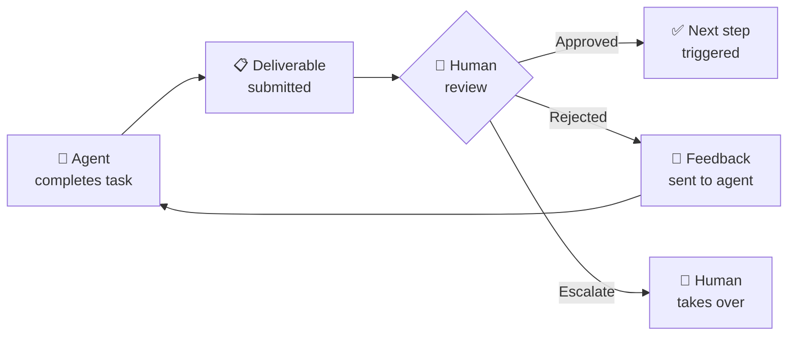
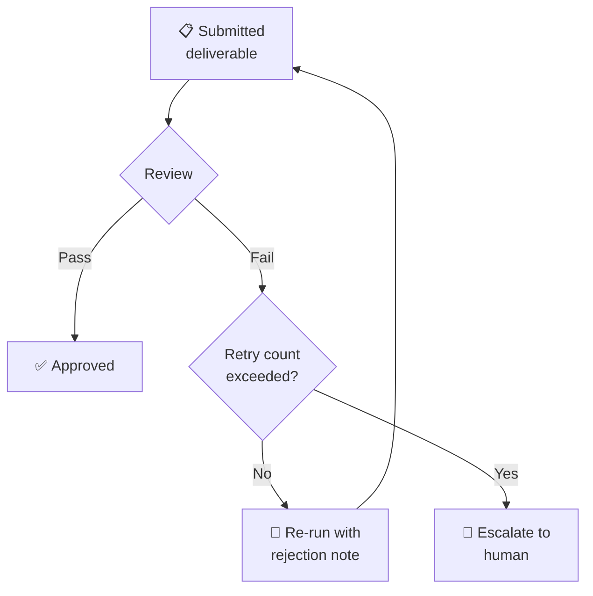

An agent writes 40 outreach emails. Or summarizes 25 contracts. Or generates a week of social posts. Without a review step, all 40 go out — including the 4 that missed the mark entirely.

That's the problem approval workflows solve. Not because agents are bad. Because some outputs need a human check before they cause problems downstream.

## What an Approval Workflow Actually Is

An approval workflow adds a checkpoint between an agent's output and whatever happens next. The agent finishes its work, submits it as a deliverable, and the output sits in a queue. A reviewer looks at it. They approve or reject. If approved, the next step in the pipeline runs. If rejected, the agent either gets feedback and tries again, or the task escalates to a human.

The goal isn't to review everything. It's to catch the outputs that matter most before they ship.



## Step 1: Decide What Needs a Human Gate

Not every agent output needs approval. Routing approvals for everything creates a bottleneck that people stop respecting.

Ask one question: if this output is wrong and ships without review, what's the cost?

High cost means requires approval. Low cost means let it run. Some examples:

| Output Type | Approval Needed? |
|---|---|
| Customer-facing email draft | Yes |
| Internal research summary | Spot-check |
| Database write or API call | Yes |
| Log entry or status update | No |
| Contract summary | Yes |
| Slack notification to team | No |

Start narrow. Pick 2-3 output types where a mistake genuinely matters. You can expand the scope once the workflow is running.

## Step 2: Configure Deliverable Submission in AgentCenter

In [AgentCenter](/features/agent-monitoring), every task has a deliverable slot. When your agent completes a task, it submits output to that slot via the API.

Set the task type to require review before the next step triggers. This tells AgentCenter to hold the task in "pending review" state instead of advancing automatically.

Your agent's final API call should include a flag that marks the output as requiring review:

```json
{
  "task_id": "task_abc123",
  "deliverable": "...",
  "status": "submitted",
  "review_required": true
}
```

The task now sits in the review queue in [the dashboard](/features/task-orchestration). Nobody needs to go looking for it.

## Step 3: Assign Reviewers

In AgentCenter, reviewers can be assigned by project, by task type, or per task. The right setup depends on your team:

1. **Solo or small team**: You review everything yourself. Set one reviewer role per project and you're done.
2. **Functional team**: Assign reviewers by domain. Legal output goes to legal, product copy goes to product.
3. **Larger team**: Use round-robin assignment or auto-assign based on agent type.

Don't leave reviewer assignment open. If anyone can review but nobody is specifically assigned, tasks pile up in the queue until someone notices the backlog.

## Step 4: Define What "Approved" Means

This sounds obvious but most teams skip it. The result is inconsistent rejections that confuse agents and frustrate reviewers.

Before turning on approvals, write 3-5 criteria for each output type. Short checklists work better than long rubrics. Put them somewhere visible during review. For a research summary, that might look like:

- Sources cited and dated within the last 6 months
- No unsupported claims
- Matches the required format (company, funding stage, key contacts)
- Under 400 words

If it takes more than 30 seconds to decide whether something passes, your criteria are too vague.

## Step 5: Handle the Rejection Path

Rejections only work if the agent gets useful feedback. A rejection with no context is just a failure state. A rejection with a note becomes signal the agent can act on.

When a reviewer rejects in AgentCenter, they leave a note explaining why. That note goes back to the agent on the next run.

Set a max retry count. After 2-3 failed attempts, the task should escalate to a human instead of cycling. This prevents loops where an agent keeps retrying something it fundamentally can't fix without intervention.



## Step 6: Track Approval Rates Over Time

The approval rate for a given agent and task type is a quality signal. If it drops, something changed: a model update, new edge cases in the inputs, or behavioral drift.

In AgentCenter's analytics, you can track:

- Approval rate per agent
- Average review turnaround time
- Most common rejection reasons
- Task types with the highest rejection rates

A healthy approval rate for most task types sits above 85%. Below that, the agent needs work. You won't know you're below 85% without tracking.

## Common Mistakes

**Requiring approval for everything.** This kills velocity. Teams start rubber-stamping to clear the queue, which defeats the purpose. Apply review gates only where failures have real downstream cost.

**Not recording rejection reasons.** Clicking "reject" with no note gives you a count but no signal. Require a short reason on every rejection.

**Never updating the criteria.** Approval criteria get stale. Review them each quarter or whenever the rejection rate spikes without an obvious cause.

**Using email threads for approvals.** One person goes on leave, the thread buries itself, the queue backs up, nobody knows the state. A centralized queue in a tool like AgentCenter exists to solve this exact problem.

## Bottom Line

Approval workflows aren't about slowing agents down. They're how you catch the outputs that matter before they cause problems. Once the workflow is running, the approval rate becomes a quality baseline. When it drops, you know something changed. That signal is what most teams are missing until a customer or a manager flags a bad output.

---

*The best time to set this up is before your agents start failing. [Try AgentCenter free for 7 days](/pricing) — cancel anytime.*
