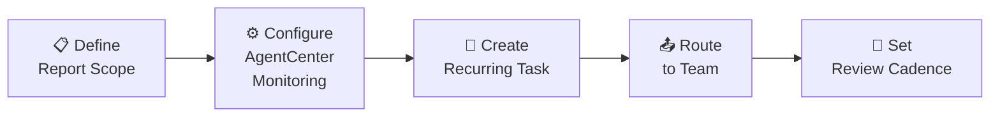

Checking your agent dashboard manually is fine when you have two agents. When you have twelve, it doesn't work. Things go wrong between checks, costs creep up, and one failing agent gets overlooked because three others looked fine.

Automated health reports fix this. Instead of you hunting for problems, a regular report brings the right data to you on a schedule.

## What an Automated Health Report Is (and Isn't)

A health report is a periodic snapshot of your agent fleet. Not a real-time alert. Alerts fire when something breaks. A health report shows you how your fleet is trending over time: which agents ran, what they cost, where errors showed up, and which tasks are stuck.

You need both. Alerts catch fires. Health reports catch slow decay — the agent that's 40% slower this week, the cost that crept up $50, the task queue that's growing without anyone noticing.

A good health report covers four things:

- **Status summary**: which agents are active, idle, or blocked
- **Cost summary**: total spend, cost per agent, any outliers
- **Error summary**: error count, error rate, which agents triggered the most
- **Task summary**: tasks completed, tasks stuck, average completion time

That's it. Don't add more. A report that takes 10 minutes to read doesn't get read.

## How to Set One Up

Here's the process, end to end.

### 1. Define What Goes in Your Report

Write down the four sections above. Then for each one, decide on a single number or short list. For example:

- Status: count of agents per state (active: 8, idle: 3, blocked: 1)
- Cost: total last 24h, top 3 most expensive agents
- Errors: total errors last 24h, top 3 agents by error count
- Tasks: completed vs stuck, average completion time

One page or one Slack message worth of content. No more.

### 2. Configure Monitoring in AgentCenter

Open [AgentCenter's agent monitoring view](/features/agent-monitoring) and make sure every agent that matters is tracked. If you've never configured this before, budget about 20 minutes for a fleet of 10 agents.

Make sure you have:

- Real-time status visible for all agents
- Cost tracking enabled — this requires agents to report token usage back to AgentCenter
- Error logging enabled — AgentCenter captures this automatically when your agents surface errors as task failures

If an agent isn't showing up in the monitoring view, it's not reporting correctly. Fix that before building reports. A health report is only as good as the data flowing into it.

### 3. Create a Recurring Task for Report Generation

This is where AgentCenter's recurring task feature (available on Pro and Scale plans) becomes the engine for your reports.

Create a new recurring task. Schedule it at a consistent time — daily at 8am local time works well for most teams. Assign it to an agent with read access to your AgentCenter analytics. The task prompt should specify exactly what to pull: time range, format, and where to send the output.

A concrete task description looks like this:

> Pull the last 24h health summary for all agents in the Production project. Report: agent status counts, total token cost, top 3 agents by cost, total errors, error rate, and any tasks pending for more than 6 hours. Format as a short Slack message.

The agent runs on schedule, reads your fleet data, and posts the summary. You don't check a dashboard. The report finds you.

### 4. Route It to Where Your Team Reads

A report that lives inside AgentCenter is only useful if someone opens AgentCenter. Route it to Slack, email, or wherever your team actually checks things.

If your agent has Slack access, route the output directly there. If not, have the agent write the summary to a dedicated AgentCenter task and use a webhook to forward it. The goal is zero friction between the report and the person who needs to act on it.

### 5. Set a Review Cadence

Decide who reads the report and when. If everyone can look at it, no one does. Assign one person per team as the report owner. Their job is to flag anything unusual before standup.

A cadence that works for most teams:

- Daily: report owner reads it before standup and flags outliers
- Weekly: team reviews cost trends together
- Monthly: review agent count, total spend, and error patterns for anything structural

## Checking Your Work with the Activity Feed

The [activity feed in AgentCenter](/features/agent-monitoring) shows recent events across your entire fleet. Before your automated report is live, the feed is a manual substitute. After it's live, use the feed to validate your report.

If the report says zero errors but the feed shows three task failures from the last 12 hours, something in your reporting logic is off. Cross-checking the two catches gaps in coverage early.

## Common Mistakes

**Too many metrics.** Teams add one more metric every week until the report takes 15 minutes to read. Pick 4-6 numbers and hold the line.

**No named owner.** If the report goes to a shared channel with no one responsible, it becomes background noise within two weeks. Name an owner explicitly. Rotate if needed, but always someone specific.

**Reviewing but not acting.** A health report is only useful if cost spikes trigger a review, rising error rates trigger debugging, and stuck tasks get picked up. If you read it weekly and never act on it, the problem isn't the report.

**Wrong time range.** Daily reports should cover the last 24 hours, not "since midnight." An agent fleet that runs overnight will show almost nothing in a report generated at 8am with a midnight cutoff. Match the time window to when your agents actually work.

## Bottom Line

Manual dashboard checks scale to two agents, maybe five. After that, you need the information to come to you. Automated health reports give your fleet consistent visibility without relying on anyone to remember to look. Set up the recurring task, route the output to where your team already works, and name someone to own the review. The whole setup takes a few hours. The cost of not having it shows up slowly, then all at once.

---

*The best time to set this up is before your agents start failing. [Try AgentCenter free for 7 days](/pricing) — cancel anytime.*
