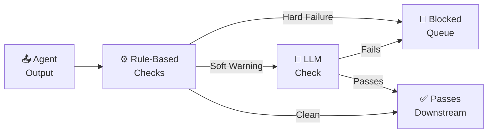

Your agent ran. Status shows complete. But nobody checked what it actually produced.

Most teams add output validation after something breaks. A report ships with placeholder text still in it. A pipeline receives malformed data that takes three hours to untangle. An approval gets flagged by the client because a required section was blank.

Automated output validation for AI agents is what catches those failures before they leave the queue. Here's how to set it up.

## What Automated Output Validation Is

A schema check confirms your agent returned the right fields. Output validation goes further.

It checks whether the content makes sense for the task. Did the summary hit the minimum word count? Are all required sections present? Does the extracted price fall within a plausible range? Is there placeholder text that should have been filled in?

Think of it as a set of programmatic assertions that run after your agent submits a deliverable, before any human sees the result or before output passes downstream to the next step.

## Step 1: Define What Good Output Looks Like

Before writing any validation rule, get specific about what acceptable output looks like for each agent.

For a research summary agent: minimum 150 words, at least one source citation, no placeholder text like "TBD" or "insert here", must have a title line.

For a data extraction agent: must return a number between 0 and 1,000,000, must include a unit label, must reference the source field.

For a content drafting agent: must be between 400 and 900 words, must not start with the word "Introduction", must not contain the phrase "As an AI".

Write these as specific rules, not vague quality descriptions. "High quality" cannot be automated. "Summary contains at least 150 words" can.

## Step 2: Separate Hard Failures from Soft Warnings

Not every validation failure should stop the output cold. Classify your checks into two categories:

**Hard failures** block the output and route it to review. Use these for: missing required fields, word count below 50, known error strings present in the body, output that fails to parse.

**Soft warnings** let the output through but flag it. Use these for: word count below target but above minimum, confidence score under threshold, unusual formatting patterns.

Hard failures go into a blocked queue. Soft warnings appear as comments in the [agent monitoring dashboard](/features/agent-monitoring) task thread so reviewers can see them without being forced to act on every one.

This separation is important. If everything is a hard failure, your review queue fills up and people stop checking it.

## Step 3: Build Your Validation Checks

Three approaches, in order of effort:

**Rule-based checks** run in milliseconds and catch structural problems reliably. Start here.

```python
def validate_output(output):
    errors = []
    if len(output.get("summary", "").split()) < 150:
        errors.append("Summary under 150 words")
    if "TBD" in output.get("summary", ""):
        errors.append("Placeholder text found")
    if not output.get("sources"):
        errors.append("No sources listed")
    return errors
```

**LLM-based checks** handle subjective criteria that rules can't cover. Send the output to a small model with a yes/no prompt: "Does this summary cite at least one external source? Answer yes or no." These cost tokens, so save them for checks that require judgment.

**Hybrid** is what most production setups use: run rule-based checks first, then run LLM checks only on outputs where rules returned soft warnings. That keeps LLM validation calls under 20% of total output volume.



## Step 4: Connect Validation to Your Task Flow

Validation should trigger automatically when an agent submits a deliverable, not as a separate step someone has to remember.

In [AgentCenter's task orchestration workflow](/features/task-orchestration):

1. Agent submits deliverable
2. Validation layer runs your checks
3. Hard failure: task is marked Needs Review, failure reason logged in the task thread
4. Soft warning: task passes, warning comment posted with @mention to the reviewer
5. Clean output: task moves to Done or the next pipeline stage

The key is that failures surface where your team already works. Not a separate validation dashboard. Not an email alert that gets buried.

## Step 5: Monitor Patterns, Not Just Individual Failures

One failed output is noise. A pattern is signal.

If more than 30% of an agent's outputs fail the same check within 24 hours, the prompt or task template is probably broken. Set an alert for that threshold in your monitoring setup, not just for individual task failures.

Route hard failures to the agent owner by default. Route soft warnings to a shared review queue. Don't send everything to one person, or it becomes invisible work that compounds.

## Real Example: Catching a Silent Failure Pattern

A research agent was producing outputs that passed the completion check. But when we reviewed a sample, around 18% had an "Analysis" section containing only "N/A". The agent had started filling in N/A on ambiguous inputs instead of flagging the task.

We added a hard failure rule: if the analysis section contains only "N/A" or is under 50 words, block and route to review. Within two weeks the N/A rate dropped to under 2%, partly because we also updated the task template to make expected behavior explicit.

Validation caught the incident. The pattern data told us where to fix the root cause.

## Common Mistakes

**Validating format, not content.** A JSON file that parses successfully can still contain empty or garbage content. Check what the output actually says, not just whether it has the right shape.

**Making everything a hard failure.** If 40% of outputs trigger a block, reviewers start ignoring the queue. Hard failures should be rare and genuinely blocking.

**Skipping validation on cheap agents.** Low-cost agents run at high volume. A 3% failure rate at 500 tasks a day is 15 broken outputs daily. Validate everything that feeds downstream systems.

**Not logging which rule triggered the failure.** "Output failed validation" is useless at 2am. "Summary under minimum word count: 88 of 150 words" tells you what happened and what to fix.

## Bottom Line

Automated output validation doesn't replace human review. It filters out obvious failures before a reviewer sees them, surfaces quality patterns before they become incidents, and gives you data on which agents need prompt fixes.

Start with rule-based checks for your highest-volume agent. Define hard and soft failure categories before you ship. Connect failures to the task thread so the right person sees them without a second dashboard to watch.

The first hour of setup catches more problems than a week of watching completion metrics.

---

*The best time to set this up is before your agents start failing. [Try AgentCenter free for 7 days](/pricing) — cancel anytime.*
