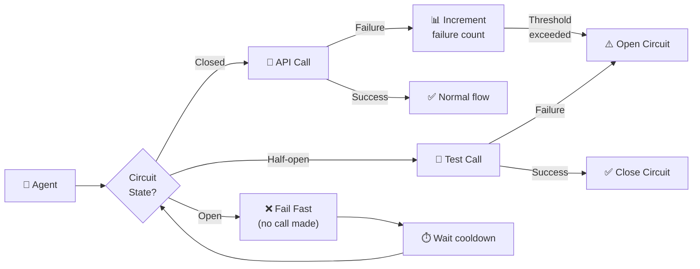

Your agent calls an external API. The API starts timing out. Your agent retries. Still timing out. It retries again. Twenty minutes later you have 47 failed calls, a $14 LLM bill for tokens spent generating retry requests, and the downstream service was never going to respond in the first place.

Circuit breakers for AI agents fix this exact problem. The pattern is borrowed from distributed systems: after a threshold of failures, you stop trying entirely. The circuit "opens," calls fail fast without hitting the service, and after a cooldown window you test again. One of the cheapest reliability improvements you can make.

## What Circuit Breakers Do

Three states:

- **Closed**: Everything works. Calls go through normally.
- **Open**: Failure threshold crossed. Calls are rejected immediately without making the actual request.
- **Half-open**: After a cooldown period, one test call goes through. If it works, the circuit closes. If it fails, it opens again.

The key benefit isn't just saved tokens — it's signal quality. Without a circuit breaker, a 10-minute API outage produces 40+ "agent failed" events in your monitoring. With one, you get 3 failures, the circuit opens, a single "circuit open on service X" event, and then recovery. Much easier to act on.

## How to Set Up Circuit Breakers for AI Agents

Here's how to implement this in a production agent setup, step by step.

**1. Define failure thresholds per service**

Don't use one threshold for everything. A payment API and a low-priority enrichment service deserve different settings. A reasonable starting point:

- Failure threshold: 5 failures
- Rolling window: 60 seconds
- Cooldown before half-open: 30 seconds

Tune these against what you actually know about the service. If the vendor's SLA says incidents resolve within 5 minutes, set your cooldown to 5 minutes.

**2. Wrap every external call**

Every service your agent touches — APIs, databases, other agents — should go through a wrapper that tracks success and failure. In Python, `pybreaker` is a solid lightweight library. In Node.js, `opossum` does the same. Both support the three-state model and let you configure thresholds per circuit instance.

What counts as a failure:
- HTTP 5xx responses
- HTTP 429 (rate limit) — treat separately, see step 5
- Timeouts — set explicit timeouts on every call, and count them as failures
- Unhandled exceptions from the SDK

**3. Handle the open state as "blocked," not "failed"**

This is the step most teams miss. When a circuit is open and your agent can't proceed, the task shouldn't be marked as failed — it should be marked as blocked. Blocked means "waiting on external recovery." Failed means "something is wrong with the agent itself."

This distinction matters for your [monitoring dashboard](/features/agent-monitoring). Blocked tasks that resolve themselves don't need human attention unless they stay blocked too long. Failed tasks do.

In AgentCenter, when an agent marks a task as blocked with a reason attached, it shows up separately in the task board with a status your team can filter on. You can also set an @mention on the task so the right person gets notified when a circuit opens.

**4. Add a fallback where one exists**

Some calls have a reasonable fallback. An agent that summarizes content can fall back from a primary model to a cheaper one when the primary is rate-limited. An agent that fetches live data might have a cached result that's good enough for 90% of cases.

Not every call has a fallback. When there isn't one, the right response is explicit: this task is paused until the downstream service recovers. Don't try to fake a fallback with stale data if the task genuinely needs fresh data.

**5. Treat rate limits differently from outages**

A 429 response means "slow down." A 503 means "I'm down." These need different handling.

For rate limits: exponential backoff with jitter, not a circuit breaker. The service is fine — you're just hitting it too hard.

For outages (5xx, timeouts): circuit breaker, because repeated calls won't help and will make things worse for the service recovering under load.

**6. Log what tripped the circuit**

When you're investigating an incident three hours later, you need to know exactly which API failed, when, and with what error. A circuit breaker that trips silently is worse than no circuit breaker — you have the same confusion plus an agent that stopped working for reasons that aren't visible.

Log: service name, failure type, failure count at trip time, timestamp, and the last error message. Store this alongside your [agent task history](/features/agent-monitoring) so incidents are reconstructable.

## Real Example

An agent pulls pricing data from a third-party API every 15 minutes. The API has occasional 10-minute outages.

Without a circuit breaker: 10-minute outage produces ~40 failed calls (API call + 2 retries × polling interval). LLM tokens burned on each retry attempt. Ops team gets a flood of alerts.

With a circuit breaker (threshold: 3 failures, cooldown: 10 minutes): 3 failures, circuit opens, task moves to "blocked" status, one notification fires. At minute 10, half-open test call succeeds, circuit closes, task resumes. Ops team sees one notification, watches it resolve automatically.

The setup time for this is under an hour. The difference in incident noise is significant.

## Common Mistakes

**One threshold for all services.** Your most critical dependencies need tight circuits. Background enrichment services can tolerate more failures before tripping. Map circuit settings to service criticality.

**No logging when the circuit trips.** If the only signal you get is "agent stopped working," you'll spend time diagnosing a problem that should have explained itself.

**Treating the open state as an error.** A task that's blocked on a circuit breaker is not broken — it's waiting. Make sure your monitoring reflects this. Counting blocked tasks as failures inflates your error rate and trains your team to ignore alerts.

**Forgetting timeouts.** A circuit breaker only works if your calls can actually fail. Without explicit timeouts, a hung API call will wait forever and never trip the circuit. Set timeouts on every external call — not just the ones you think might be slow.

## Bottom Line

Circuit breakers are a small addition that makes your agents dramatically more predictable under failure. The pattern is: count failures, open when the threshold crosses, wait for cooldown, test recovery, log everything. The hard part is integrating circuit state into your task visibility so your team doesn't mistake "waiting on recovery" for "agent is broken."

Get the fundamentals right before your agents hit production. See the [AgentCenter features overview](/features) for how task status and monitoring fit together.

---

*The best time to set this up is before your agents start failing. [Try AgentCenter free for 7 days](/pricing) — cancel anytime.*
