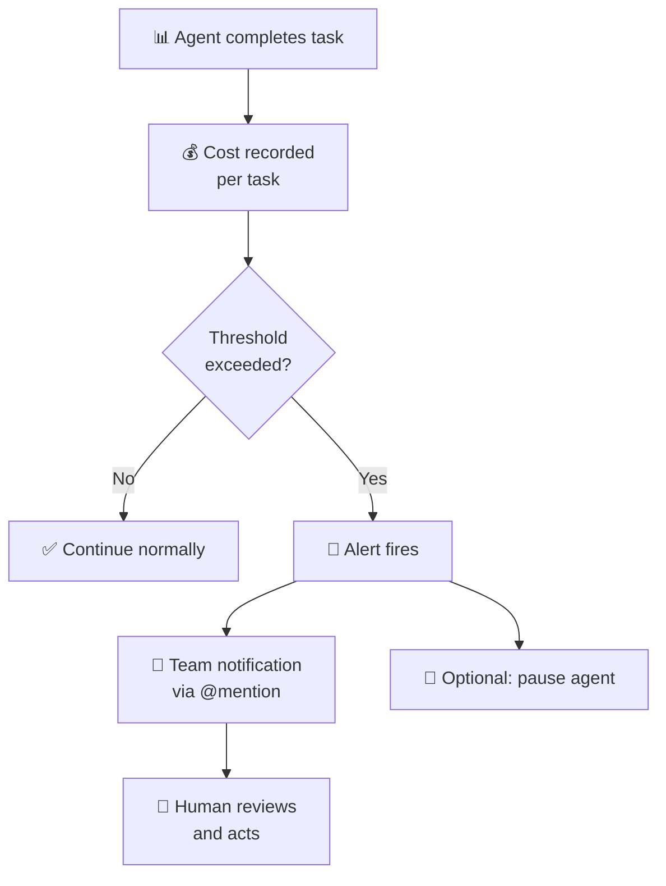

We had a research agent running a daily loop. During testing, each run cost under $2. Someone updated the prompt to pull more context, and the cost jumped to $18 per run. We found out on billing day. It had been running for 11 days.

That's what cost alerts are for.

## What Cost Alerts Do

A cost alert fires when agent spending crosses a threshold you define. Not when a task fails. Not when an agent goes offline. Specifically when money is leaving your account faster than you planned.

Done right, you get notified before the problem compounds. Done without any system in place, you get a bill.

## Before You Set Thresholds

You need a baseline first. Without knowing what "normal" looks like, any threshold is a guess.

Track per-task spend for at least 7 days using [AgentCenter's monitoring dashboard](/features/agent-monitoring). Look for three numbers:

- Average cost per task type
- Typical daily spend per agent
- Outliers: tasks that cost 3x or more than average

With a week of data, you'll see the real range. Use that to set thresholds, not a gut feeling.

## How to Set Up Cost Alerts for AI Agents

Here's a setup that works for teams running 5 or more agents in production.

**Step 1: Set per-task cost thresholds**

Start at the task level, not the project level. Per-task thresholds catch runaway prompts before they pile up.

A practical rule: alert at 2x your average cost for that task type. If a research task typically costs $1.50, alert at $3. You're not blocking the task. You're flagging it for a human to look at.

In AgentCenter, cost per task is visible in real time from the [monitoring view](/features/agent-monitoring). Set a threshold on any task type from the agent settings panel.

**Step 2: Set daily per-agent budgets**

Each agent in production should have a daily spend cap. This catches drip problems where individual tasks look normal but volume is too high.

For a new agent, set the daily limit at 150% of what you saw during baseline testing. After 30 days in production, you can tighten it.

**Step 3: Add a project-level weekly cap**

Project-level alerts catch the aggregate. One agent running 20% hotter than usual may not cross its daily limit. Three of them will cross the weekly project cap.

Set this at 20 to 25% above your expected weekly spend for the project. Review it monthly as your agent count and prompt complexity change.

**Step 4: Configure who gets notified**

An alert that goes to the wrong person, or no one, is the same as no alert.

Define a simple escalation path:
- First alert: the engineer who owns the agent
- Second alert (if no response in 2 hours): team lead
- Third alert (if spend keeps climbing): billing owner

Use @mentions in AgentCenter to tag the right person on the task. If the alert fires and the inbox is quiet, the @mention shows up in the task thread where the agent's work is already visible to context.

**Step 5: Decide on automatic actions**

Alerts are reactive. Automatic actions are proactive. For batch jobs that can be safely paused, you can configure the agent to stop when a cost threshold is crossed, not just send a notification.

This makes sense for low-urgency workflows. It doesn't work well for time-sensitive tasks where pausing causes more problems than the cost spike itself.

Treat automatic pause as a last resort, not a first response.

**Step 6: Test before going live**

Run a test task that you know will be expensive. Confirm the alert fires, reaches the right person, and includes enough context to act on: agent name, task ID, actual cost vs. threshold.

If the alert fires with just "cost threshold exceeded" and nothing else, fix the message before you go live. An alert without context creates more work.

## A Real Example

A team running 12 research agents configured alerts like this:

- Per-task threshold: $4 (their average was $1.80, so 2x covers normal variance)
- Daily per-agent cap: $25
- Weekly project cap: $800

The first week, one alert fired. A prompt change had bumped a task from $2 to $6.50. They caught it on day 2, not day 11.

Setup time: about 2 hours. Cost avoided: 9 days of $18 tasks running unchecked.

## Common Mistakes

**Thresholds set too tight.** If every routine task triggers an alert, your team starts ignoring them. That's worse than having no alerts. Give yourself at least a 2x buffer.

**No escalation path.** An alert that fires at 3am and lands in one engineer's inbox, while that engineer is asleep, does nothing. Define the chain before something goes wrong, not after.

**Thresholds that never get updated.** As agents scale or prompts change, baselines shift. What was a reasonable daily cap at 5 agents is too restrictive at 20. Review monthly.

**Alerting on total cost, not rate of change.** A $500/week project is not the problem. A $500/week project that suddenly does $80 in a single day is. Rate-of-change signals catch problems that absolute limits miss.

## Bottom Line

Cost alerts for AI agents are not complicated. The hard part is baselining before you set thresholds, and making sure alerts reach someone who can act. Get those two things right, and you stop finding out about spending problems on billing day.

The [AgentCenter monitoring dashboard](/features/agent-monitoring) shows per-task and per-agent spend in real time. Add threshold alerts and a clear escalation path, and you have a cost monitoring setup that actually works. See [available plans](/pricing) if you're not yet tracking costs per agent.

---

*The best time to set this up is before your agents start failing. [Try AgentCenter free for 7 days](/pricing) — cancel anytime.*
