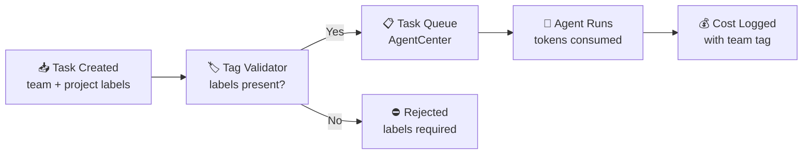

You're running 12 agents. Three teams use them. At the end of the month, finance asks you to split the LLM bill. You have no idea where to start.

This is the cost allocation problem. It's not about cutting costs — that's a different problem. It's about knowing who is spending what so you can have an honest conversation about resources, priorities, and budget.

Here's how to set it up before you need it.

## Why Cost Allocation Is Harder for AI Agents Than Traditional Services

With a web service, you can bill by API calls or active users. With AI agents, the cost is almost entirely LLM token consumption, which varies wildly by task type. A two-sentence email summary uses 200 tokens. An 80-page contract review uses 80,000. If marketing runs 5,000 tasks and finance runs 50, finance might still owe more.

The second problem is that agents are often built by one team but used by several. Your platform team builds the agent. Your sales team uses it for lead research. Your customer success team uses it for onboarding emails. The bill is unified. The usage isn't.

## Step 1: Define Your Cost Attribution Model

Before you instrument anything, decide how you want to attribute costs. Three common approaches:

**Per-task attribution.** Each task is tagged with a team or project. Cost equals tokens consumed per task. This is the most granular approach and works well when tasks are clearly owned by a single team.

**Per-agent attribution.** Each agent is owned by one team. All tasks that agent runs get attributed to that team. Simpler to set up, but breaks down when multiple teams share a single agent.

**Proportional attribution.** Divide total costs by task volume per team. Works if task complexity is roughly equal across teams — which is rarely true for AI agents.

Most teams start with per-task attribution because it's the fairest model and scales well as your fleet grows.

## Step 2: Tag Every Task with an Owner at Creation

The moment a task enters your queue, it should carry two things: a project identifier and a team identifier. If you're using [AgentCenter's task orchestration](/features/task-orchestration), this is where you add those fields before the task is dispatched to an agent.

Practically, this means:

1. **Add team and project labels to every task** — make this mandatory at the intake point, not optional
2. **Set them programmatically if tasks are created via API** — pass the metadata in the request payload, not as an afterthought you fill in later
3. **Reject unlabeled tasks at the queue boundary** — untagged tasks are a cost hole. They disappear into a shared bucket with no attribution and you'll never recover that data

If you're building the intake layer yourself, add a validation step that rejects tasks missing owner tags before they reach the agent.

## Step 3: Capture Token Usage Per Task

This is where most teams have a gap. The agent runs. The task completes. Nobody records how many tokens it used.

Token usage is available from every LLM provider in the response payload. You need to store it per task, not just per session or per day. The fields you need:

- `prompt_tokens` — what went into the model
- `completion_tokens` — what came out
- `model` — costs differ by model; you can't calculate cost without this
- `task_id` — to join back to the task record and its team tag
- `timestamp` — for weekly and monthly breakdowns

If your agent logs this directly to your task records in AgentCenter, you can run cost queries by team without any extra infrastructure.

## Step 4: Build a Weekly Cost Attribution Report

Once token data is tagged per task and per team, the math is simple. For each model, multiply tokens by the per-token rate and sum by team. Run this weekly, not just at month-end. Surprises are easier to absorb in small doses.

A weekly summary might look like this:

| Team | Tasks Run | Prompt Tokens | Completion Tokens | Est. Cost |
|---|---|---|---|---|
| Sales | 1,240 | 4.2M | 890K | $48.20 |
| Customer Success | 780 | 2.1M | 440K | $24.60 |
| Marketing | 460 | 1.8M | 380K | $20.10 |
| Platform (internal) | 120 | 310K | 80K | $3.80 |

You can pull this data from [AgentCenter's monitoring dashboard](/features/agent-monitoring) if you've tagged tasks consistently from the start.

## Step 5: Set Per-Team Soft Budget Thresholds

Once you have 2 to 4 weeks of attribution data, you'll have a baseline. Use it to set soft budget thresholds per team.

Soft thresholds work like this: when a team's weekly spend exceeds their expected range, someone gets notified — not blocked. The goal isn't to shut down agents mid-run. It's to surface conversations early. A team that suddenly triples their spend might have launched a new campaign, or might have a runaway agent loop. You want to know which before the month-end invoice.

Hard limits make sense later, once teams understand their own patterns and you've seen a few over-spend events. Don't start with hard limits — they create friction before anyone knows what normal looks like.

## Common Mistakes

**Tagging retroactively.** If you wait until month-end to assign costs to teams, you're guessing. Nobody remembers who ran what task three weeks ago. Tag at creation, every time, without exception.

**Using one label for everything.** Mixing project, team, environment, and customer into a single tag field makes reporting a mess. Keep them as separate fields: `team`, `project`, `env`. Join them in reports, not at write time.

**Ignoring staging and dev costs.** Staging runs are often the biggest hidden cost. An engineer might run the same task 30 times while debugging. Tag those runs too — you need to decide whether to allocate them to the platform team or to the requester.

**Only tracking completion tokens.** Long system prompts or large context windows can make prompt tokens the majority of your bill. Track both. The split between prompt and completion tokens tells you something real about your agent's architecture.

## Bottom Line

Cost allocation for shared agents requires discipline at one specific point: task creation. Tag every task before it runs, capture tokens per task, summarize weekly, set soft budgets once you have a baseline. That's the whole process.

The teams using your agents often don't know they're spending money until you show them the data. That's when the conversation about priorities gets real — and useful.

---

*The best time to set this up is before your agents start failing. [Try AgentCenter free for 7 days](/pricing) — cancel anytime.*
