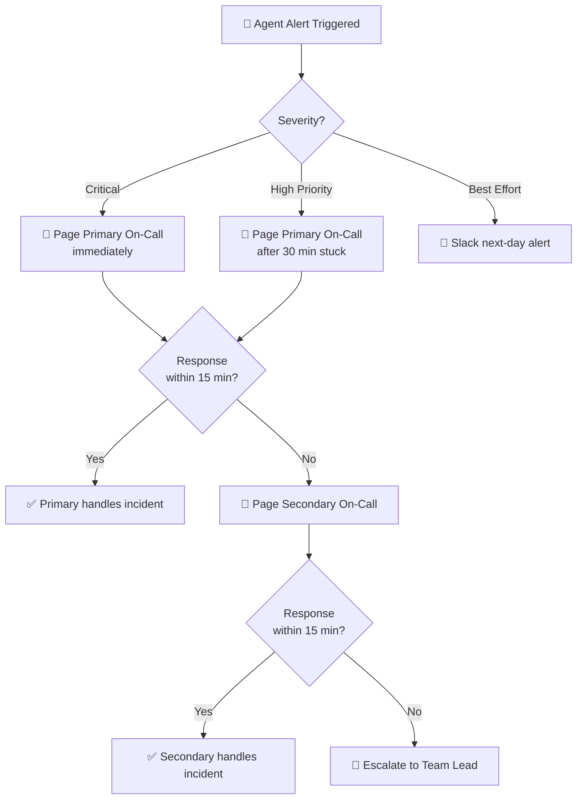

We had a data-extraction agent that scraped pricing data overnight and dropped results into a shared spreadsheet every morning at 7am. One night it hung. Nobody set up an on-call rotation for it. Nobody knew until the team arrived, found stale data, and spent an hour pulling numbers manually before someone checked the agent logs.

No alert. No page. No escalation. Just silence and a wasted morning.

That's what happens when you treat agent failures like you'd treat a dev environment going down: someone will notice eventually. They will. But too late.

## What On-Call for Agents Actually Means

On-call for applications usually means "something's down, users are impacted, fix it now." On-call for agents is messier.

An agent failure might look like:
- The agent completes the task but outputs garbage
- The agent hangs and never finishes
- The agent fails silently and no downstream system notices for hours
- The agent triggers a retry loop that burns through your API quota by 4am

You need a process that catches all of these — not just the obvious crashes.

This isn't about waking someone up for every blip. It's about making sure the right person gets the right signal fast enough to matter.

## Step-by-Step: Setting Up Agent On-Call

### Step 1: Define what actually needs a page

Not every failure warrants waking someone up at 2am. Start by classifying your agents:

- **Critical agents** — customer-facing, revenue-impacting, or feeding live data into other systems. These need immediate response.
- **High-priority agents** — internal workflows with hard deadlines (end-of-day reports, compliance checks). Page if stuck for more than 30 minutes.
- **Best-effort agents** — background tasks, exploratory research, non-urgent enrichment. Alert next business day.

In [AgentCenter's agent dashboard](/features/agent-dashboard), you can see real-time status for every agent — online, working, idle, or blocked. Start by placing each agent into one of these tiers.

### Step 2: Set alert thresholds for each tier

Thresholds that work in practice:

| Agent tier | Alert condition | Response window |
|---|---|---|
| Critical | Blocked or no output in 15 min | Immediate page |
| High-priority | Stuck or error rate above 10% | 30-minute page |
| Best-effort | Failed 3+ consecutive tasks | Next-day Slack alert |

You want thresholds tight enough to catch real problems but loose enough not to fire on normal variance. A single timeout isn't an incident. Three in a row usually is.

### Step 3: Route alerts to specific people

This is where most teams skip a step. They set up an alert. It goes to a shared Slack channel. Everyone assumes someone else is handling it.

Use [AgentCenter's agent monitoring features](/features/agent-monitoring) to route alerts to named people:
- Primary on-call for that agent or project
- Secondary on-call if primary doesn't respond in 15 minutes
- Team lead as a final escalation

Channels feel like ownership. They're not. Name a specific person as primary.

### Step 4: Write a five-minute runbook for each critical agent

When something wakes you up at 3am, you don't want to figure out from scratch what to do. Write this before you need it:

```
Agent: [name]
What it does: [one sentence]
What "stuck" looks like: [specific symptom]
First thing to check: [log location or AgentCenter task view]
Quick fix if hung: [restart command or rollback step]
Escalate to: [name + contact]
```

Four to six lines per agent. You can write one in 10 minutes. It saves 45 minutes during a real incident.

### Step 5: Test the alert path before you need it

Schedule a test. Kill a low-risk agent intentionally. Verify the alert fires, goes to the right person, and includes enough context to act on. Do this once a quarter.

If you skip this step, you'll find out your escalation path is broken during a real incident.



## A Real Example

A weekly report agent pulled data from three internal APIs and summarized it for leadership every Monday morning. Critical tier: leadership was counting on it.

We set a 30-minute stuck threshold and routed alerts to the primary engineer with a 15-minute escalation to the team lead.

Two months in, one of the source APIs changed its response format. The agent started returning malformed output at 11pm Sunday. The alert fired at 11:30pm. The engineer was paged, checked the monitoring view in AgentCenter, identified the schema mismatch, fixed the prompt, and re-ran the agent. Report landed on time at 7am Monday.

Without the on-call setup, that failure gets discovered Monday morning by the people who needed the report.

## Common Mistakes

**Too many pages.** If every minor agent hiccup fires an alert, people start ignoring them. Set thresholds at levels that signal real problems, not normal variance.

**No secondary escalation.** If the primary on-call misses the page — sick, on a flight, asleep — the incident waits. Always define a secondary.

**Runbook lives in someone's head.** The person who built the agent shouldn't be the only one who knows how to fix it. Write it down before they're unavailable.

**Alerts go to a channel, not a person.** A channel full of alerts with no clear owner is a channel everyone ignores.

**Never testing the path.** Alert routing is configuration. Configuration breaks. Test it quarterly with a deliberate low-stakes trigger.

## Bottom Line

Agents fail when you're not watching. The goal isn't to watch constantly — it's to make sure the right person gets the right signal fast enough to fix it before anyone downstream notices.

Set tiers. Set thresholds. Route to people, not channels. Write the runbook now. Test it before you need it.

That takes one afternoon. It pays back the first time an agent fails at 3am.

---

*The best time to set this up is before your agents start failing. [Try AgentCenter free for 7 days](/pricing) — cancel anytime.*
