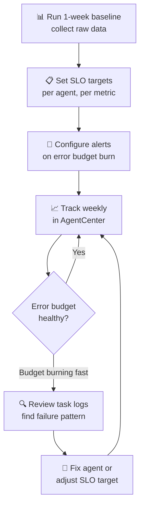

Your agents run. Tasks get marked complete. But you don't know if they're performing at the level your team needs. Is a 12% error rate acceptable? Is that better or worse than last month? Without a target, you're guessing.

Service Level Objectives — SLOs — fix that. They give your agent fleet measurable reliability targets, separate from any customer contract, so your team has a shared definition of "working well."

## What SLOs Are (and Aren't)

An SLO is an internal engineering target. Not a promise to customers (that's an SLA). An SLO says: "Our document summarization agent should complete 97% of tasks successfully." When it drops to 91%, that's worth addressing. When it holds at 98%, you can relax.

For AI agents, SLOs work differently than typical service SLOs. A completed task doesn't mean a correct one. An agent can finish a task with a technically valid output that's still wrong for the use case. So you need to think beyond binary success/failure.

Four dimensions worth tracking:

- **Task success rate**: Did the agent finish without an error?
- **Output quality rate**: Of completed tasks, what percentage passed review?
- **Task latency (P95)**: What's the 95th percentile completion time?
- **Cost per successful task**: How much does it cost when it works?

You don't need all four from day one. Start with success rate and latency. Add output quality rate once you have a review workflow in place.

## Step 1: Collect a Baseline Before Setting Targets

Don't set SLO targets in a vacuum. Run your agents for a week without any targets — just collect data. AgentCenter's [agent monitoring](/features/agent-monitoring) view shows per-agent completion rates, error counts, and average task duration. Pull that data before you write a single SLO.

You'll find things you didn't expect. An agent that looked fine in staging might fail 20% of production tasks. Another might take 4 minutes on P95 when you assumed 30 seconds. That baseline is your starting point.

## Step 2: Define Targets with Error Budgets

An SLO without an error budget is just a wish. An error budget defines how much you're allowed to miss before the team needs to act.

If your SLO for task success rate is 97%, your error budget is 3%. In a week with 1,000 tasks, you can have up to 30 failures before you're in breach of your own SLO.

Start with something achievable, not aspirational. If your baseline is 92% success, setting an SLO at 99% means you're in permanent breach from day one. Set it at 95%, build confidence in the number, then tighten it over 60 to 90 days.

Here's what a simple SLO table looks like:

| Agent | Metric | Target | Error Budget |
|-------|--------|--------|--------------|
| summarization-agent | Task success rate | 97% | 3% |
| summarization-agent | P95 latency | 90s | — |
| data-extraction-agent | Task success rate | 95% | 5% |
| review-agent | Output quality rate | 90% | 10% |

## Step 3: Wire Up Alerts in AgentCenter

In AgentCenter's monitoring view, set alerts to fire when your 7-day rolling success rate drops below your SLO threshold. You'll want to trigger on rate of change, not just absolute numbers. An agent dropping from 99% to 94% in 48 hours is a bigger concern than one that's held steady at 93% for a month.

The activity feed is useful here. When an alert fires, you can jump directly to the task log for that agent and see which tasks failed, what the errors were, and when the pattern started. That beats hunting through external log tools.

Wire alerts to wherever your team pays attention: a Slack channel, an email list, or a shared AgentCenter notification. An alert that goes somewhere no one checks is the same as no alert.

## Step 4: Review SLOs Weekly, Not Just When Things Break

Build a 15-minute weekly review into your team's schedule. Look at three things:

1. Which agents are in breach of their SLO this week?
2. Which agents are burning through their error budget faster than normal?
3. Did any changes — prompt updates, new task types, model swaps — correlate with metric shifts?

If you're running multi-agent pipelines in AgentCenter, the [workflow view](/features/multi-agent-workflows) shows which agents feed into others. A document-parsing agent failing 15% of tasks might explain why a downstream summarization agent is struggling, even if the summarization agent looks fine in isolation. Follow the dependency chain, not just individual agent metrics.

## Common Mistakes

**Setting targets too tight from day one.** If agents are permanently breaching their SLOs, the team stops believing in the numbers. Start achievable. Tighten over 90 days as you understand normal behavior better.

**Treating "completed" as "succeeded."** An agent that returns garbage but technically finishes is not hitting your SLO. If you don't have a quality review process, add output quality rate to your list and start tracking it.

**Having SLOs no one looks at.** An SLO is only useful if someone acts on it. If the weekly review drops off the calendar, or the alert goes to a dead channel, or no one owns the agent in question — the SLO is theater.

**Applying the same SLO to every agent type.** A research agent and a code-generation agent have different natural error rates. A 5% failure rate might be acceptable for a best-effort research task and catastrophic for a billing calculation. Set SLOs per agent type, not one number for the whole fleet.

## Bottom Line

SLOs are the difference between knowing your agents are working and hoping they are. A task completion counter tells you agents ran. An SLO tells you if they're performing at the level your team needs — and gives everyone a shared signal for when to act.

Start with two metrics per agent. Collect a baseline first. Review weekly. The specific numbers matter less than having numbers at all.

---

*The best time to set this up is before your agents start failing. [Try AgentCenter free for 7 days](/pricing) — cancel anytime.*
