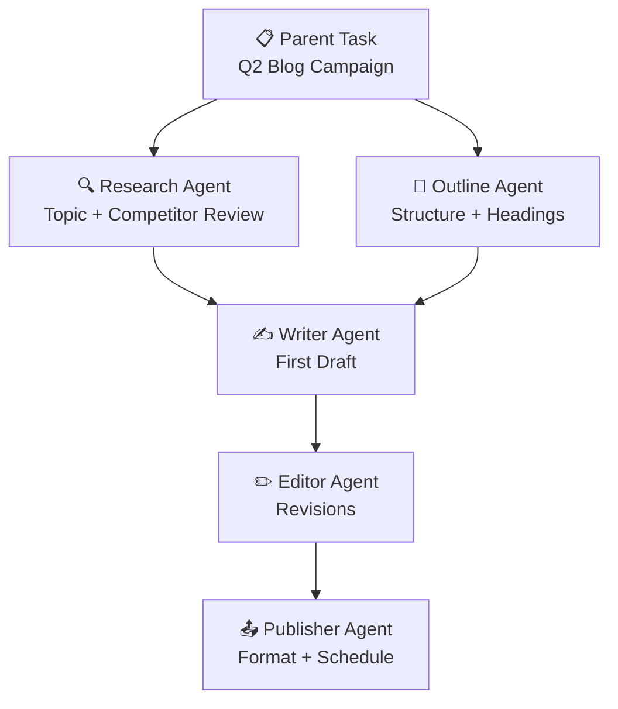

You have three agents in a pipeline. The researcher runs first, the writer second, the editor third. Except nothing actually enforces that order. The writer starts on an empty input because the researcher hasn't finished. The editor reviews a draft that doesn't exist yet. Your pipeline didn't fail — it just ran wrong, and no error surfaced.

Task dependencies fix this. Without them, multi-agent workflows are a suggestion, not a process.

## What Task Dependencies Actually Do

A task dependency is a hard gate: this task cannot start until that task is complete. It's the same concept you know from CI pipelines, build systems, and data engineering DAGs — applied to AI agent work.

In AgentCenter, you configure dependencies through the parent-child task structure. The parent task holds the goal. Each child task is a step toward that goal. Child tasks can be set to block on each other, so an agent can't pick up work until its prerequisite is in a completed state.

The difference from just "assigning tasks in the right order" is enforcement. Assigning order is a hope. Dependencies are a constraint.

## Map the Pipeline Before Configuring Anything

Draw the pipeline on paper first. You need to know:

- Which tasks produce outputs that other tasks consume
- Which tasks can run in parallel vs. which must run sequentially
- What "done" looks like for each step, so the handoff is clean

A five-agent pipeline usually isn't a straight line. Typically two or three tasks run in parallel, then converge into one, then fan out again. Drawing this before you click anything in AgentCenter saves a lot of reconfiguration later.

## How to Set Up Task Dependencies in AgentCenter

**Step 1: Create the parent task**

In AgentCenter, open the project and create a new task for the overall goal — for example, "Q2 Blog Campaign." This is the container for all dependent work. Don't assign an agent to the parent task. Its job is to hold structure and give you a single status view of the whole pipeline.

**Step 2: Add child tasks for each pipeline step**

Inside the parent task, create one child task per stage. Keep the scope tight — each child task should have one clear output that the next step can consume. For the content pipeline above: Research, Outline, Draft, Edit, Publish.

**Step 3: Assign agents and set completion criteria**

Assign the right agent to each child task. Write explicit [acceptance criteria for each task](/blogs/how-to-write-acceptance-criteria-for-ai-agent-tasks) in the task description — what the output must include before the task counts as done. This matters because the next agent uses the delivered output as its input. Vague criteria mean the gate technically opens but the handoff is broken.

**Step 4: Configure the dependency order**

In the child task settings, use the "depends on" field to link tasks in sequence. The Writer task depends on both Research and Outline. The Editor depends on Draft. The Publisher depends on Edit. Tasks with unmet dependencies show as "Blocked" in the [Kanban board](/features/task-orchestration), so it's immediately visible when something upstream stalls.

**Step 5: Test with manual completions first**

Before running agents against real work, verify the dependency chain. Mark the Research task complete manually. Check whether the Writer task shifts from "Blocked" to "Ready." Step through each dependency. If a task unblocks when it shouldn't — or doesn't unblock when it should — you have a misconfiguration to fix before agents are involved.

**Step 6: Monitor the activity feed during live runs**

Once agents are running, the AgentCenter [activity feed](/features/agent-dashboard) shows each state transition — when a task completes, which downstream task became unblocked, and which agent picked it up. Watch this during the first few real runs to confirm the sequencing holds before you step back.

## What This Looks Like in Practice

We ran a content production pipeline with four agents: researcher, outliner, writer, editor. Before task dependencies, the writer agent would occasionally pick up work before the researcher finished, because both tasks showed as "Ready" at the same time in the queue.

After configuring parent-child structure with explicit blocking:

- The writer never touched an empty research document again
- When the research task failed, it surfaced as a blocked writer task — which triggered a human review
- The pipeline took the same wall-clock time, but outputs were consistent

The agents didn't change. The structure around them did.

## Common Mistakes

**Making everything sequential when parallel is fine.** If your Research and Outline tasks don't depend on each other, run them at the same time. Only block what genuinely needs to wait. Over-serializing a pipeline adds latency without adding reliability.

**Skipping the parent task.** Without a parent, child tasks are just loose tasks. You lose the visual grouping, the rollup status, and the ability to see the whole pipeline's health at once. The parent task is not overhead — it's the dashboard for that workflow.

**Leaving acceptance criteria blank.** The dependency enforces execution order, not output quality. If the researcher marks a task complete without attaching the research doc, the writer starts with nothing. Acceptance criteria close that gap. Write them before you connect the dependency.

**Ignoring blocked tasks.** A task sitting in "Blocked" for two hours is a signal — either the upstream agent failed silently, or it's still running longer than expected. The activity feed tells you which. Don't wait for the pipeline to fall apart before checking.

## Bottom Line

Task dependencies don't make your agents smarter. They make your pipeline predictable. If you're managing more than two agents in the same workflow, dependencies aren't optional — they're the difference between a process that runs and a process that works.

---

*The best time to set this up is before your agents start failing. [Try AgentCenter free for 7 days](/pricing) — cancel anytime.*
