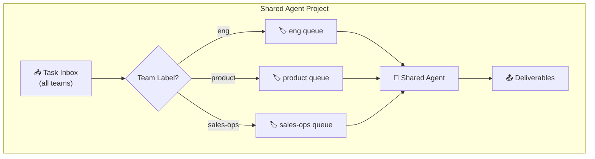

You built an agent. Engineering uses it daily. Then product wants access. Then sales ops asks. Now you have three teams, one agent, and no system for who controls what.

This is one of the fastest ways to end up with conflicting tasks, mystery failures, and blame-shifting when something goes wrong.

Here's how to share an AI agent across teams in AgentCenter without turning it into a coordination nightmare.

## Why Sharing an Agent Is Harder Than It Looks

A shared agent isn't just one that two people can submit tasks to. It's a piece of infrastructure with competing stakeholders, different priorities, and no single owner.

When team A submits a task and team B submits a conflicting one five minutes later, which runs first? When the agent starts returning bad outputs, who investigates? When you want to update the agent's prompt, who approves that?

These aren't AI problems. They're coordination problems. AgentCenter gives you the tools to solve them, but you have to set them up.

## Step 1: Create a Dedicated Project for the Shared Agent

Don't add the agent to an existing team project. Create a new project specifically for it.

Give it a name that makes ownership clear: "Docs Processor" instead of "Engineering Agents." A dedicated project lets you control who can view tasks, create tasks, and change agent settings, all separately from each team's regular work.

Invite team leads (not every team member) as project members. They act as the bridge between their team's requests and the shared agent.

## Step 2: Define Task Labels Per Team

Create a label for each team using the agent: `eng`, `product`, `sales-ops`, or whatever maps to your org.

Every task submitted to the shared agent gets tagged with the submitting team's label. This keeps the backlog from becoming a pile of unattributed tasks and lets you filter the [Kanban board](/features/task-orchestration) by team.

Set this as a rule, not a suggestion. If a task doesn't have a label, it goes into a triage column until someone tags it.

## Step 3: Agree on a Priority System

This is the hardest step and the one teams skip most often.

You need a clear answer to: when two tasks from different teams are both marked high priority, which runs first?

Options:
- First-in, first-out (simple but frustrating when something is urgent)
- Escalation path: anyone can flag a task for the shared agent owner to bump
- Time windows: engineering gets morning slots, product gets afternoon

Pick one. Document it in the project description inside AgentCenter so anyone who joins later can find it.

## Step 4: Set Up Filtered Views Per Team

Each team should see only their tasks by default. Seeing another team's backlog causes confusion and sometimes accidental edits.

In AgentCenter, use saved filters on the [Kanban board](/features/task-orchestration): filter by label, then save the view with a team-specific name. Share the link with that team. They get a focused view of their work without the noise from other teams.

The agent owner keeps the unfiltered view to see everything.

## Step 5: Use @Mentions for Cross-Team Handoffs

When a task from engineering produces output that product needs to review, use @mentions in the task thread.

This keeps the conversation in AgentCenter instead of spilling into Slack or email. The relevant person gets notified, the context stays attached to the task, and there's a record of who said what.

Don't use @mentions to assign task ownership though. Task assignment is formal. Mentions are for communication.

## Step 6: Assign One Person as Agent Owner

Someone has to own this agent. Not the team using it most, not the person who built it, not whoever's available this week. One named person.

Their job:
- Investigate and triage failures before anyone points fingers
- Approve changes to the agent's prompt or configuration
- Resolve priority disputes between teams
- Watch the [agent monitoring dashboard](/features/agent-monitoring) for cost spikes or error rate increases

Without this person, failures only get noticed when a team complains. By then, several tasks have already gone wrong.

## Common Mistakes

**No ownership when it breaks.** Three teams share an agent, nobody owns it. The agent starts failing on Tuesday afternoon. Everyone assumes someone else is looking into it. It runs unmonitored until Thursday.

**Too many admins.** Every team lead has full edit access. Someone changes the system prompt to fix a problem their team hit. Now it works for them and breaks for everyone else. Keep agent configuration changes gated to one owner.

**Skipping cost allocation.** At some point someone will ask how much that agent is costing per team. If you didn't set up labels and track tasks from day one, you can't answer. Set up cost tracking with [AgentCenter's monitoring](/features/agent-monitoring) before you need it.

**No escalation path for urgent requests.** If every task gets submitted as normal priority and a team has a genuine emergency, there's no way to signal that. Define a high-priority label or escalation step before teams start inventing their own systems.

## Bottom Line

Sharing an AI agent across teams works when you treat it like shared infrastructure: clear ownership, documented rules, and a single point of accountability.

The setup in AgentCenter takes about an hour. The hard part is getting teams to agree on a priority system and stick to the label convention. Handle those upfront and the rest runs itself.

---

*The best time to set up shared access rules is before everyone starts asking for access. [Try AgentCenter free for 7 days](/pricing) — cancel anytime.*
