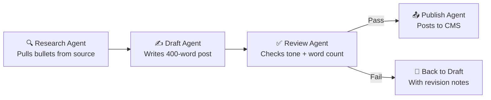

We had a content agent that did five things: pulled source material, wrote a draft, reformatted it for three channels, ran a quality check, and posted to our CMS. It worked fine until the quality check started rejecting inputs because the model had drifted on the drafting step. When that happened, we lost the entire run. All five steps, gone.

That's the problem with a monolithic agent. Splitting it into a multi-agent pipeline changed that. Each step became a separate agent with its own task, its own output, and its own failure mode.

## What Makes an Agent "Monolithic"

A monolithic agent handles multiple distinct tasks inside a single execution. It fetches data, transforms it, validates it, and writes output — all in one shot. The internal steps are implied by the prompt, not enforced by the architecture.

That feels simple. It's fragile.

When something goes wrong at step 4, you can't retry just step 4. You restart everything. When the output format changes, you touch the prompt that also controls unrelated behavior. When you want to improve step 2, you risk breaking step 3.

A multi-agent pipeline solves this by making each step an independent agent with a defined input, a defined output, and a clear boundary where it hands off to the next.

## Step 1: List What the Agent Actually Does

Open the prompt and write down every distinct action. Not the high-level description — the actual steps.

For a content pipeline agent:
- Searches a source URL for relevant articles
- Extracts the key points into bullet format
- Drafts a 400-word post from the bullets
- Rewrites the post for LinkedIn, Twitter, and email
- Checks word count and tone against a rubric
- Publishes to the CMS via API

Six steps. That's six potential split points.

## Step 2: Find the Natural Handoffs

A handoff is where one agent produces something the next one consumes. Look for outputs that are data structures, not prose.

In the example above:
- Search outputs: a list of URLs
- Extract outputs: structured bullet points
- Draft outputs: a raw post
- Reformat outputs: three formatted versions
- Check outputs: a pass/fail with notes
- Publish outputs: a confirmation and URL

Each output is a discrete artifact. That's your split point.

Where it gets tricky: if two steps always succeed or fail together and finish in under two seconds combined, splitting adds overhead without benefit. Split where failures are expensive, not just where boundaries exist.

## Step 3: Define the Interface Between Agents

Before you create any agents, write down exactly what each agent receives and what it returns.

```
Research Agent
Input:  topic + source URL
Output: list of 5-10 bullet points (JSON array)

Draft Agent
Input:  bullet list (JSON array)
Output: raw post (plain text, 400 words max)

Review Agent
Input:  raw post (plain text)
Output: pass/fail + revision notes (JSON)
```

This is the spec your agents will work to. If the output format changes, you update one agent and the rest stay stable. Without this spec, agents pass slightly wrong things to each other and you spend hours tracing the mismatch.

## Step 4: Set Up the Pipeline in AgentCenter

Create a separate agent for each stage. Give each one a specific task type in your project with the interface spec attached as acceptance criteria.

Then configure [task dependencies](/features/task-orchestration):

1. Draft Agent's task is blocked until Research Agent submits its deliverable
2. Review Agent's task is blocked until Draft Agent submits
3. Publish Agent requires Review Agent's pass verdict

Here's what the full pipeline looks like:



When Review Agent fails a draft, AgentCenter routes the task back to Draft Agent with the notes attached. No human needs to intervene unless it fails twice.

## Step 5: Test Each Stage Before Running the Full Chain

Give Research Agent 10 different topics and verify the bullet format is consistent. Give Draft Agent 10 bullet lists and check output quality before wiring anything downstream.

If you test monolithically, a failure in step 5 of a 6-step agent tells you nothing about where the problem started. Testing each stage independently tells you exactly where quality degrades.

Use AgentCenter's [agent monitoring](/features/agent-monitoring) to track success rates per stage. If Review Agent is failing 30% of runs, you've found your bottleneck without touching the rest of the pipeline.

## Common Mistakes

**Splitting too early.** If two steps always run together and neither can fail independently, combining them is fine. Start by splitting where failures are expensive — not everywhere a boundary could theoretically exist.

**No interface spec.** The most common failure in multi-agent pipelines is an agent passing something slightly different from what the next one expects. Write the spec before you write the agent.

**Testing the chain before testing the parts.** Running the full pipeline end-to-end before each stage is stable means any failure could come from anywhere. Validate each agent in isolation first.

**Forgetting the unhappy path.** Define what happens when Review Agent fails. Does Draft Agent retry automatically? Does a human get notified? If you don't specify it, the pipeline stalls silently.

## Bottom Line

Splitting a monolithic agent into a pipeline takes an afternoon. Debugging why a six-step agent failed on step four — for the third time this week — takes longer.

The pipeline gives you independent testability, cheaper retries, and task-level visibility in AgentCenter's Kanban board. When something breaks, you know which agent broke, what it received, and what it was supposed to return.

---

*The best time to set this up is before your agents start failing. [Try AgentCenter free for 7 days](/pricing) — cancel anytime.*
