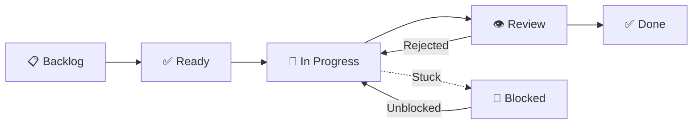

Kanban boards work for AI agents. They give you a visual overview of work in progress, what's waiting, and what's done. But if you set up your agent Kanban the same way you'd set up a software development board, you'll run into friction quickly.

Software development tasks move through predictable stages: backlog, in progress, review, done. Agent tasks move differently. An agent can be "in progress" for 45 minutes or 45 seconds. A task can be done but blocked from moving forward because its deliverable is waiting for review. An agent can be available but have nothing to work on.

Here's how to structure a Kanban board that reflects agent work accurately.

## The Column Structure That Actually Works

Don't copy a dev board. Agent work has different states.

**Column 1: Backlog**
Tasks that have been defined but not yet assigned. These have a brief, an acceptance criteria, and a priority. They're not yet assigned to an agent.

**Column 2: Ready**
Tasks that are fully defined and ready for an agent to pick up. The difference between Backlog and Ready: Ready means everything needed to start is present. No blockers, no missing context.

**Column 3: In Progress**
Tasks currently being worked on by an agent. Each card shows which agent and how long it's been running. Cards that have been here for 2x the expected duration get flagged.

**Column 4: Review**
Agent has submitted a deliverable. Waiting for human review. This column should never accumulate — if cards pile up here, review is a bottleneck.

**Column 5: Done**
Deliverable approved, task complete.

**Column 6: Blocked**
A separate column for blocked tasks, not "in progress." This is important. A task that's "in progress" for 6 hours is probably stuck. A card that's explicitly moved to "Blocked" with a note about why is visible and actionable.

## Card Fields for Agent Tasks

A task card for an agent needs different fields than a task card for a developer.

**Required fields:**

- Task title and description
- Acceptance criteria (what does "done" look like?)
- Assigned agent (which agent type handles this)
- Priority (1-3 is enough: urgent, normal, low)
- Estimated duration (how long should this take?)
- Due date or SLA (if time-sensitive)

**Useful optional fields:**

- Cost estimate per task (especially for budget-sensitive projects)
- Context attachments (reference documents, prior deliverables the agent needs)
- Review owner (who reviews the deliverable when it's submitted)
- Dependencies (does this task wait for another to complete first?)

**What you don't need:**

- Story points (agents don't estimate in story points)
- Sprint assignments (agent work is continuous, not sprint-based)
- Pull request links (unless your agents write code)

## Managing Multiple Agent Types in One Board

If you have 5 different agent types (research, writing, review, analysis, notification), you have a few options:

**Option A: Tag-based filtering.** All agents use the same board. Each card is tagged with the agent type. You filter by agent to see that agent's queue.

**Option B: Agent-specific swimlanes.** Each row of the board represents one agent. All columns still apply. You see each agent's work in its own lane.

**Option C: Separate boards per project.** If agents work on separate projects, each project gets its own board. You navigate between boards for a cross-project view.

AgentCenter's [multi-agent workflow view](/features/multi-agent-workflows) handles this through project-level boards with agent assignment per task. Each project is a board. Each task is a card assigned to a specific agent.

## The Blocked Column Is the Most Important One

Most Kanban boards don't have a Blocked column. For agent work, it's the most critical.

Blocked tasks need:

- Explicit reason why blocked (not just "blocked")
- Owner who's responsible for unblocking
- Time-in-blocked tracking (if it's been blocked for 24 hours, escalate)

An agent that's stuck without an explicit blocked state looks like an agent that's still working. That's how a 6-hour stuck state goes unnoticed. The blocked column makes the problem visible.

## Daily Review Ritual

Kanban boards for agents need a brief daily review, not just as-needed checking. Five minutes:

1. Any cards stuck in In Progress for 2x their estimated duration? Move to Blocked or investigate.
2. Any cards piling up in Review? Who needs to review and hasn't?
3. Any cards in Blocked that have been there more than 24 hours? Escalate.
4. Is the Ready column full enough to keep agents busy, or is it about to run empty?

Five minutes, same time each day, keeps the board accurate and catches problems while they're small.

## What Good Looks Like

A well-managed agent Kanban shows you at a glance: what's running, what's waiting, what's stuck. Cards move through the board in hours, not days. The Review column clears daily. The Blocked column is usually empty. When it's not empty, there's a clear owner and a clear resolution plan.

_The best time to set this up is before your agents start failing. [Try AgentCenter free for 7 days](/pricing) — cancel anytime._
