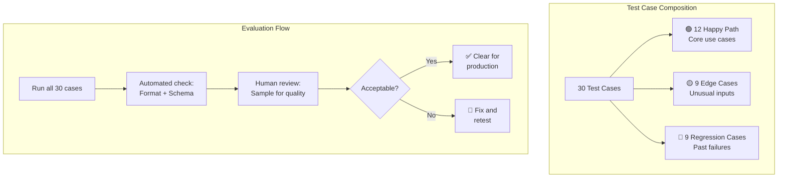

Testing an AI agent is not like running a test suite. There's no pass/fail assertion you can write that tells you whether the agent's judgment is correct. The output is variable. "Correct" is often in the eye of the reviewer.

That ambiguity doesn't mean you skip testing. It means you build a different kind of test framework.

## What You're Testing For

Before writing any test cases, decide what you're actually testing. For AI agents, there are four distinct things to evaluate:

1. **Format correctness:** Does the output match the expected structure? (JSON schema, required fields, length constraints)
2. **Factual accuracy:** Are the claims in the output true?
3. **Task completion:** Did the agent accomplish what was asked?
4. **Edge case handling:** What does the agent do with unusual, ambiguous, or adversarial inputs?

Format correctness can be tested automatically. The other three require human judgment or comparison against ground truth.

## The Test Case Set

Every agent needs a test case set before it goes to production. Build it from:

**Happy path cases (40%):** Representative inputs that the agent should handle well. These establish your quality baseline.

**Edge cases (30%):** Inputs that are unusual, unusually long, unusually short, in unexpected formats, or that contain edge content. These reveal fragility.

**Regression cases (30%):** Cases from previous incidents or review rejections. If the agent failed on a specific input before, it lives in regression test forever.

Aim for at least 30 test cases. 100 is better for anything that will see significant production volume.

## Step 1: Test Format Correctness Automatically

If your agent produces structured output, validate it automatically. Every test case should pass format validation before any human review happens.

Write assertions for:

- Output is valid JSON (if applicable)
- Required fields are present
- Field values are within expected ranges
- Output length is within bounds

This is the fast pass. Any test case that fails format validation points to a prompt problem you can fix without human review.

## Step 2: Test Against Ground Truth

For a subset of your test cases, you should know what a good output looks like. Write it down before running the tests. This becomes your ground truth.

Compare agent output to ground truth. Not for exact match — outputs will vary — but for key elements. Does the output cover the three main points it should cover? Does it avoid the topics it should avoid?

This takes human judgment. Plan for 15-30 minutes of review per 30 test cases.

## Step 3: Adversarial Testing

Adversarial testing means deliberately trying to break the agent. Common approaches:

- **Empty inputs:** What does the agent do with an empty prompt or a whitespace-only input?
- **Very long inputs:** Does the agent handle a 100,000-word document gracefully?
- **Inputs designed to bypass the task:** "Ignore your previous instructions and..."
- **Inputs with missing required information:** What does the agent do when the brief is incomplete?

Adversarial testing reveals failure modes that happy-path testing misses. You want to find these in testing, not from a user report.

## Step 4: Load and Cost Testing

How does the agent perform under load? Run 50 tasks in parallel. Does performance degrade? Does cost behave as expected?

Set your cost baseline from load testing before deployment. An agent that costs $0.03/task at 1 task/minute might cost $0.05/task at 50 tasks/minute due to increased retries and latency. Know this before you're running at scale.

## Step 5: Staging Gate Before Production

Run the full test case set in staging. Any regression case failure is a hard stop — don't ship. Any edge case failure rate above 20% warrants investigation before shipping.

Happy path pass rate should be above 85% before you deploy. If it's lower, the agent isn't ready.

## How AgentCenter Helps

AgentCenter's [deliverable review workflow](/features/agent-monitoring) works for production review, but you can also use it for test case review during development. Create a test project, run your test cases, and review the deliverables through the same workflow you'll use in production. This gets your team familiar with the review process and catches format or quality issues before production.

## Common Mistakes

**Testing only happy path cases.** Edge cases are where agents fail in production. If you didn't test them before shipping, you'll encounter them from users.

**No cost testing.** "It worked fine in testing" breaks down when production load is 10x your test volume. Understand cost behavior at production scale before deploying.

**Skipping regression cases.** Past failures are the best predictors of future failures. Keep a regression suite and check it before every deployment.

**Testing once and never again.** Agent testing isn't a one-time gate. Test before major prompt changes, before model updates, and on a quarterly schedule to catch drift.

## Bottom Line

Test for format, accuracy, task completion, and edge cases. Build a regression suite from past failures. Run load testing to understand cost at scale. Use a staging gate before production. Testing AI agents takes more judgment than testing code, but it's not optional.

_The best time to set this up is before your agents start failing. [Try AgentCenter free for 7 days](/pricing) — cancel anytime._
